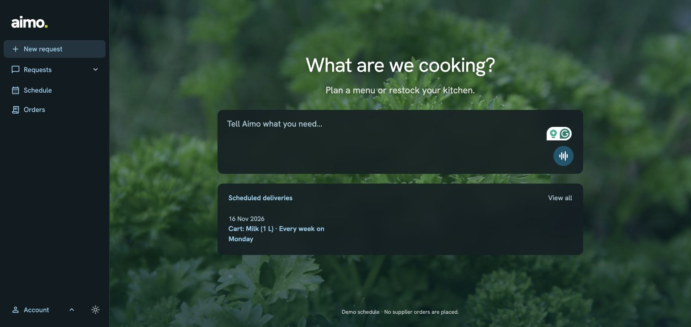
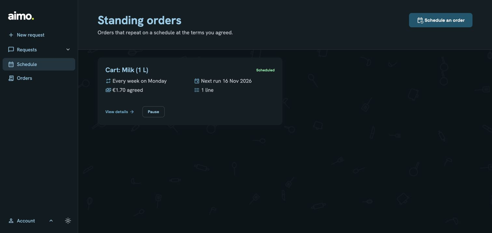

# Aimo — plan the meal. Build the basket.

An AI purchasing assistant for professional kitchens, built for the **Valio Aimo challenge at Junction**. Describe a meal or a restock, and Aimo helps turn it into a basket you can review: ingredients, wholesale packs, prices and availability.

[Open the demo](https://aimo.201-79-68-84.sslip.io/) · [Architecture & agent harness](docs/architecture.md) · [Product brief](docs/brief.md)



> **Hackathon demo:** supplier price and stock lookups are live; orders are simulated. Aimo never places a real supplier order or reserves stock. The demo requires sign-in.

## From a kitchen request to a checked basket

> “Help me plan carbonara for 200 portions, within €1,000.”

1. **Plan together.** Aimo helps you choose a meal and asks about material missing details, keeping dietary needs and budgets in mind. Use text, voice, or attach a recipe, spreadsheet or image.
2. **Find what fits.** Recipe quantities are scaled on the server, then matched to catalog products and wholesale packs. Prices and stock are checked for the shortlist.
3. **Review before confirming.** Review delivery details, proposed quantities, costs and any blockers. A purchase requires your on-screen confirmation of the exact basket revision.

Saved recipes retain their source; assistant-created recipes are labelled estimates. Uncertain ingredients or commercial evidence can block a basket. Chat text alone never confirms a purchase.

## Keep the kitchen running

Save preferences across conversations, set purchasing limits, revisit past orders, and approve recurring orders at agreed terms. Standing orders run within those terms; changes that need your attention return for review.



_Screenshots from the deployed demo. All recorded orders are mocks._

## Under the hood

| Part          | Built with                                                              |
| ------------- | ----------------------------------------------------------------------- |
| Customer app  | React, TypeScript, Vite, Tailwind CSS; served by Nginx                  |
| API           | Python, FastAPI; authenticated sessions and purchase controls           |
| Agent worker  | Durable PostgreSQL jobs, typed tools, Google Gemini chat and guardrails |
| Data & search | PostgreSQL + pgvector; versioned product and recipe catalogs            |
| Deployment    | Docker images, Kubernetes on DigitalOcean, Terraform, GitHub Actions    |

The API, frontend and agent worker deploy independently. Catalog ingestion is a separate job. See the [two illustrated architecture diagrams](docs/architecture.md) for the cluster, external services and agent harness.

## Local setup

Requires **Docker**, **Python 3.12.12** with **uv 0.12.5**, and **Node 24.6.0** for frontend development. Run commands from the repository root.

```sh
uv sync --frozen
uv run aimo configure
```

`configure` creates a private, ignored `.env`. If one already exists, preserve it and add missing settings from [.env.example](.env.example). Set `GEMINI_API_KEY` and `VALIO_AIMO_API_KEY` privately before continuing; production pricing has no fixture fallback.

```sh
docker compose up -d --wait db
uv run aimo migrate
uv run aimo seed
uv run aimo sync-catalog
docker compose --profile app up --build
```

Open **[localhost:8000](http://localhost:8000/)**. Sign in as **buyer**, using the generated `DEMO_BUYER_PASSWORD` in your `.env`.

The catalog command downloads and verifies the approved challenge snapshot. Initial import uses paid Google embeddings; unchanged imports are skipped. The private catalog is not included in Git. Saved recipes need a [separate import](docs/recipes.md).

For local snapshots, hot reload, generated API types and troubleshooting, see the [development guide](docs/development.md). For an existing deployment, follow the [migration and release runbooks](docs/release-migrations.md).

## Check and contribute

```sh
tests/ci.sh                      # offline lint, Python tests and API sweep; Docker + uv
npm ci --prefix frontend
npm run build --prefix frontend  # lint, type check and production build
```

Tests use labelled fixtures and do not verify live model or supplier behavior. See [testing](tests/README.md) for browser tests and the optional read-only live supplier check.

Start a task branch from the latest `origin/develop`; preserve teammates' changes. Open every task PR with `gh pr create --base develop` and wait for green CI before merging. Coordinate shared API, schema and deployment changes. `main` is reserved for explicitly requested releases. Full working rules are in [AGENTS.md](AGENTS.md).

## Further reading

- [Product behavior and purchasing controls](docs/brief.md)
- [Architecture and agent harness](docs/architecture.md) · [Guardrails](docs/guardrails.md)
- [Supplier reliability and carbon comparisons](docs/supplier-metrics.md)
- [Recipes](docs/recipes.md) · [Attachments](docs/attachments.md) · [Voice](docs/voice.md) · [Memory](docs/memory.md)
- [Frontend development](frontend/README.md) · [Deployment and operations](infra/README.md) · [Runtime diagnostics](docs/observability.md)
- [Preparation, reused work and third-party attribution](docs/pre-existing-work.md)
