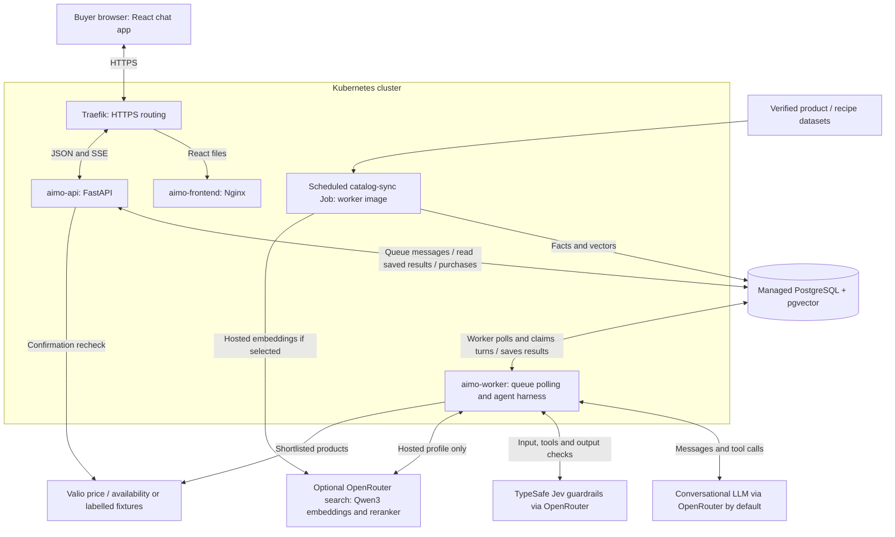
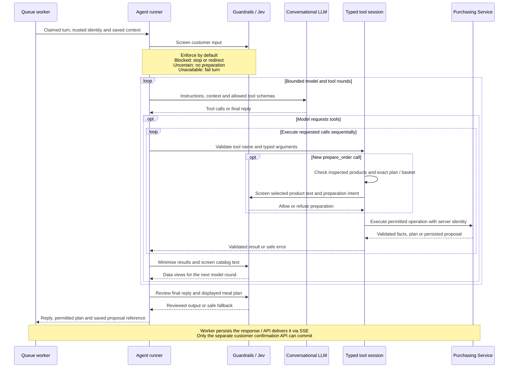
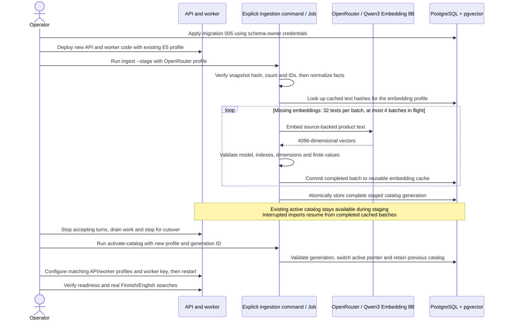
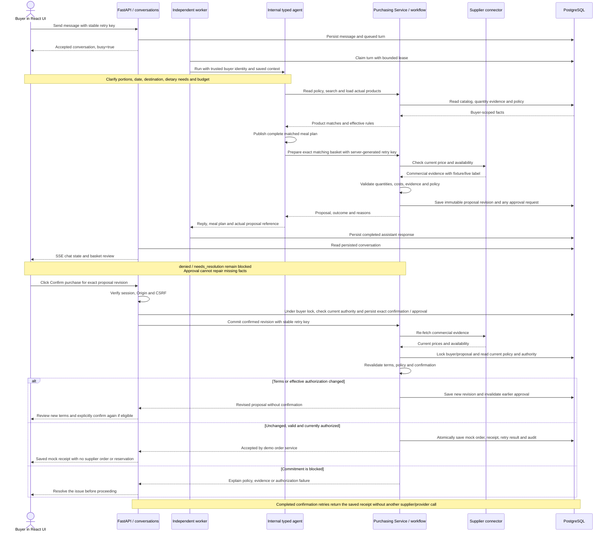

# Aimo chat purchasing architecture

This describes the implemented chat product. The [chat purchasing migration](chat-purchasing.md)
supersedes the external-agent/MCP entry points in the [original brief](brief.md).
GitHub renders the Mermaid diagrams directly; edit their text here when the architecture changes.
This describes the repository implementation and deployment configuration, not a live cluster inventory.

The OpenRouter search profile requires an explicit staged import and coordinated cutover.
Deploying the code alone retains the existing local E5 profile.

## System overview

Frontend, API and worker each have their own image, Deployment, pod and Service.
React runs in the buyer's browser; Nginx serves its files. The worker contains the agent loop,
typed tools, guardrails and hybrid search. Search reads facts and vectors from the same database
as the queue and purchases; local E5 (384 dimensions) runs in the worker by default. The optional
hosted profile uses Qwen3 Embedding 8B (4096 dimensions) and Qwen3 Reranker 8B.
API requests persist chat jobs; the worker consumes them independently, and SSE
returns saved conversation snapshots. The worker owns the embedding backend,
conversational LLM key and separate `SEARCH_API_KEY`. Hosted search needs no GPU or
separate model server. The API owns browser session signing and exact customer confirmation;
it checks catalog/profile compatibility without model loading or search credentials.
The frontend receives no application credentials. PostgreSQL remains outside the
cluster as the existing managed database.

The agent can plan, search and prepare; its tool registry has no approval or
commit operation. Policy/identity provisioning remain privileged setup operations.
Even with live price/availability, orders are persistent **mocks**, without supplier
checkout or stock reservation. See [cutover and recovery](separate-apps.md).

Exact product ID/GTIN matches stay local. Descriptive hosted searches combine keyword and
exact cosine ranking in pgvector, then rerank a filtered shortlist. Dietary exclusions apply
before reranking; model scores never prove suitability. Embedding failures return errors;
reranker outages preserve filtered hybrid results with `rerank_status=unavailable`.

## Chat trigger, queue and recovery

A buyer sending a message creates the work. FastAPI validates the session, Origin and CSRF,
then atomically saves the message and a `queued` row in `conversation_turns`. It returns
`busy=true`; it does not invoke the worker over HTTP. The independently running worker
polls PostgreSQL, waiting one second when there is no work. There is no separate message broker.

Claims use database locks with `SKIP LOCKED`, a 240-second lease and an attempt ID.
Expired work can be reclaimed; an old attempt cannot overwrite a newer result. After three
interrupted attempts, the turn fails and needs an explicit customer retry. If preparation
already committed before a crash, recovery returns that saved basket using the turn's stable
preparation key instead of preparing again. The API reads saved updates and sends them to the
browser over SSE; this is persisted conversation state, not a stream of model tokens.

## Agent harness inside the worker

The worker supplies the recorded customer's current identity, a server-scoped internal agent,
the turn ID and saved conversation to `run_turn`. The model receives instructions and tool
schemas; it cannot choose its buyer identity or grant itself purchase authority.

The default cooperative budget is 90 seconds and 20 model rounds; four cumulative tool
errors stop the loop. Up to 12 calls in one model response execute serially. Oversized history
fails explicitly instead of silently dropping earlier requirements. Tools have their own I/O
timeouts; the budget cannot interrupt a synchronous tool already running.

| Tool group | Allowed operations |
| --- | --- |
| Product discovery and facts | `search_products`, `get_product`, `check_price_and_availability` |
| Policy and planning | `get_purchase_policy`, `publish_meal_plan` |
| Proposal preparation and history | `prepare_order`, `get_proposal`, `get_order` |
| Recipes, when enabled | `search_recipes`, `get_recipe`, `scale_recipe`, `get_recipe_plan`, `match_ingredient` |
| Optional recipe illustrations | `generate_recipe_image` (Google generation, signed Cloudinary upload) |

There is no approval, confirmation, commitment or policy-editing tool. Typed validation,
buyer scope, quantity checks and purchasing state transitions remain authoritative in every
`GUARDRAIL_MODE`. Semantic checks use TypeSafe Jev through OpenRouter with the worker's
`LLM_API_KEY`; `enforce` is the default, with explicit `shadow` and `off` alternatives.
A semantic allow never bypasses deterministic checks. Output rejection preserves the saved
proposal and trusted status while replacing unsupported narrative and withholding the plan.
See [guardrails](guardrails.md) for boundary-specific failure handling and coverage limits.

Recipe illustrations use the worker's private Google and Cloudinary credentials.
The generation ledger prevents another generation on retry; a hosted URL and
dimensions persist with the reply. These public illustrations are optional visual
aids, separate from recipe/catalog and purchase evidence. See [recipe images](recipe-images.md).

## Database and recipe state

All of these are logical groups in **one managed PostgreSQL database**, not separate databases
or services. `pgvector` is an extension in that database.

| Stored state | Main tables |
| --- | --- |
| Buyer identity, sessions and versioned policy | `buyers`, `identities`, `internal_agents`, `sessions`, `login_attempts`, `policies`, `policy_managers`, `policy_changes` |
| Chat history and durable work queue | `conversations`, `conversation_messages`, `conversation_turns` |
| Product facts, keyword search and vectors | `products`, `catalog_generations`, `active_catalog`, `embedding_cache` |
| Purchase revisions, decisions and receipts | `proposals`, `proposal_revisions`, `approvals`, `customer_confirmations`, `orders` |
| Retry safety and audit | `prepare_requests`, `idempotency`, `audit_events` |
| Recipe corpus and vectors | `recipes`, `recipe_versions`, `recipe_ingredients`, `recipe_catalogs`, `recipe_catalog_entries`, `active_recipe_catalog`, `recipe_embedding_cache` |
| Reviewed ingredient evidence and saved plans | `recipe_product_evidence`, `recipe_plans`, `recipe_plan_revisions` |

Recipe planning is opt-in (`RECIPE_PLANNING_ENABLED=false` by default). An operator imports
verified recipes and reviewed ingredient/product evidence; the worker uses the existing
embedding provider and database. Saved recipe plans retain exact recipe versions, scaled
quantities and immutable matching revisions. Missing ingredient forms, conversions or matching
evidence block recipe preparation. Direct product/free-form planning remains available;
its UI label explains that completeness and conversions are not checked against a saved recipe.
See [recipe planning](recipes.md) for import, evidence and cross-turn enforcement limits.

## Cluster and release boundaries

The provided DigitalOcean stack provisions DOKS and managed PostgreSQL in a private VPC;
the database firewall restricts access to the cluster and connections verify the database TLS
certificate. The Kubernetes stack is portable to an existing cluster. Traefik routes public
requests to frontend/API Services; the worker's HTTP port exposes health checks only and has
no public ingress. ClusterView, when installed, has its own `/clusterview` route outside the
customer flow. Configuration and credentials live in Kubernetes ConfigMaps and Secrets.

Successful `main` CI builds three component images in GHCR. An enabled release runs a dedicated
schema-migration/grant Job before rolling out those images and checking readiness. Migration
credentials are separate from the restricted runtime role. Provisioning, initial seeding and
product/recipe imports remain explicit operator actions. A failed rollout restores changed
images, not database history. See [infrastructure](../infra/README.md) and
[release migrations](release-migrations.md) for the deployment gate and recovery procedure.

## Hosted catalog ingestion and cutover

PostgreSQL stores normalized product facts as JSONB, searchable text/`tsvector`, and one embedding
per product and catalog generation. Migration 005 allows old 384-dimensional and new
4096-dimensional generations to coexist, with a database dimension check. Search reads only the
active generation. Exact vector ranking does not use an HNSW index; the old unused index is removed.

This staged hosted-search cutover is an operator action, never a deployment/startup hook. Routine
ingestion of the approved snapshot runs as a daily CronJob in its own temporary pod. It skips unchanged data
and never runs inside the API or worker ([catalog sync](catalog-sync.md)).
The Job creates its own local/hosted embedding adapter; it does not call a running worker pod. Only changed
text needs new embeddings within the same profile; switching models requires a new compatible
catalog. The reranker runs at search time, not during ingestion. Readiness checks the database,
profile and worker key presence without making paid API calls. Rollback selects the retained previous
generation and matching serving profile. See the [hosted search runbook](hosted-search.md) for
commands, failure handling, measured quality/latency and rollout details.

## Purchase and confirmation sequence

Recipe agreement or approval text in chat never authorizes a purchase. Both `ready_to_commit`
and `approval_required` proposals still need the authenticated confirmation action for the internal
agent. A changed revision needs a new confirmation. Idempotency and one-order-per-proposal
constraints prevent duplicate acceptance; persisted conversations and receipts survive restarts.

## Code map

| Responsibility | Main source |
| --- | --- |
| Browser screens and generated API types | [frontend/src](../frontend/src) |
| HTTP routes, sessions, Origin/CSRF and SSE | [api.py](../src/aimo/api.py), [auth.py](../src/aimo/auth.py) |
| Queue claiming and worker health | [worker.py](../src/aimo/worker.py) |
| Conversation recovery and customer confirmation | [conversations.py](../src/aimo/conversations.py) |
| Provider loop and allowed typed tools | [agent.py](../src/aimo/agent.py), [agent_provider.py](../src/aimo/agent_provider.py), [agent_tools.py](../src/aimo/agent_tools.py), [chat_schemas.py](../src/aimo/chat_schemas.py) |
| Semantic boundary checks and safe data views | [guardrails.py](../src/aimo/guardrails.py) |
| Recipe import, discovery and saved plans | [recipe_import.py](../src/aimo/recipe_import.py), [recipe_search.py](../src/aimo/recipe_search.py), [recipes.py](../src/aimo/recipes.py) |
| Shared purchasing entry points | [service.py](../src/aimo/service.py) |
| Explicit buyer/personal memory ([memory.md](memory.md)) | [memory.py](../src/aimo/memory.py), [memory_schemas.py](../src/aimo/memory_schemas.py) |
| Catalog normalization, ingestion and hybrid search | [catalog.py](../src/aimo/catalog.py), [ingest.py](../src/aimo/ingest.py), [search.py](../src/aimo/search.py) |
| OpenRouter embeddings, reranking and response validation | [search_provider.py](../src/aimo/search_provider.py) |
| Commercial evidence and quantity snapshots | [upstream.py](../src/aimo/upstream.py), [purchases.py](../src/aimo/purchases.py) |
| Policy decisions and durable purchase workflow | [approval_policy.py](../src/aimo/approval_policy.py), [approval_workflow.py](../src/aimo/approval_workflow.py) |
| Purchasing contracts and database schema | [schemas.py](../src/aimo/schemas.py), [migrations](../migrations) |
| Workloads, ingress and cloud/database provisioning | [deploy/kubernetes.yaml](../deploy/kubernetes.yaml), [infra/kubernetes](../infra/kubernetes), [infra/digitalocean](../infra/digitalocean) |
| Image release and migration gate | [deploy.yml](../.github/workflows/deploy.yml), [migrate-release.py](../infra/scripts/migrate-release.py) |

Buyer policy managers can edit purchasing rules through the authenticated [Settings page](policy-settings.md). This is a browser-only capability, separate from the agent tool allowlist.
