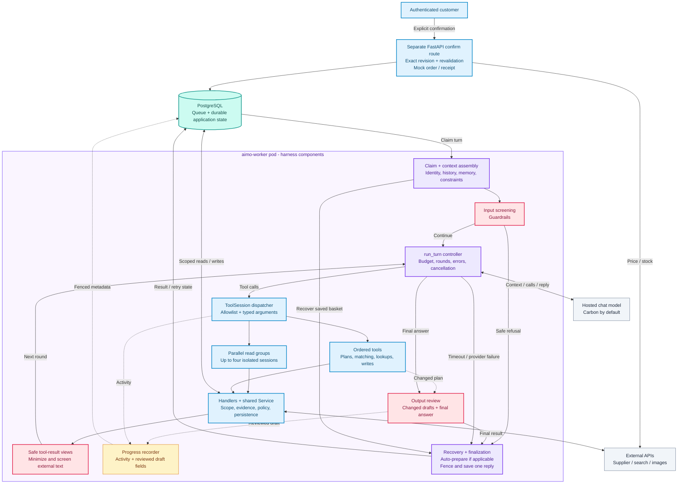

# Aimo architecture and agent harness

These two diagrams describe the repository's implemented architecture and Kubernetes
configuration. They are not a live cluster inventory. The [product brief](brief.md)
defines purchasing controls; [chat behavior](chat-purchasing.md) defines persisted
conversation and confirmation contracts. Solid arrows show requests or data flow;
dotted arrows show provisioning, configuration or progress updates. Blue marks app
services and tools, purple marks agent execution, amber marks jobs/progress, teal
marks storage, rose marks guardrails, and grey marks infrastructure/external systems.

## 1. Services, cluster and external systems

The frontend, backend API and agent worker are three independent Deployments with
separate images, pods and Kubernetes Services. Ingestion runs as a temporary Job,
not an always-running service. PostgreSQL is outside Kubernetes, on the private
network, and holds both application state and the search index.

```mermaid
flowchart TB
    Browser["Customer browser<br/>React chat / cart / voice"]
    Release["GitHub Actions / GHCR<br/>Release images"]

    subgraph VPC["Private VPC - DigitalOcean deployment"]
        LB["Cloud LoadBalancer<br/>Public HTTPS"]
        subgraph Cluster["DOKS Kubernetes cluster"]
            subgraph Edge["junction-ingress namespace"]
                Traefik["Traefik + Service<br/>TLS and routing"]
                TLS["Certificate PVC<br/>ACME state"]
            end
            subgraph App["junction namespace - configurable"]
                Frontend["aimo-frontend<br/>Service + Nginx pod"]
                API["aimo-api<br/>Service + FastAPI pod"]
                Worker["aimo-worker<br/>Agent pod + health Service"]
                Cron["aimo-catalog-sync<br/>Daily CronJob"]
                Import["Ingestion Job / pod<br/>Worker image: sync-catalog"]
                Ops["Maintenance Jobs / pods<br/>Bootstrap / migrate / recipes"]
                Config["ConfigMap / Secrets<br/>Scoped credentials + DB CA"]
            end
        end
        DB[("Managed PostgreSQL<br/>Application state + pgvector")]
    end

    Valio["Valio Aimo<br/>Catalog / live price / stock"]
    Google["Google APIs<br/>Chat / guardrails / search / images"]
    Live["Google Gemini Live<br/>Voice audio"]
    CDN["Cloudinary<br/>Illustrations"]
    Files["Verified recipe files<br/>Reviewed matching evidence"]

    Browser -->|"HTTPS"| LB
    LB --> Traefik
    Traefik -->|"Pages and assets"| Frontend
    Traefik <-->|"JSON / SSE"| API
    Traefik --- TLS
    API <-->|"Queue / state / confirmation"| DB
    Worker <-->|"Claim / tools / results"| DB
    Cron -->|"Creates Job"| Import
    Import -->|"Publish catalog"| DB
    Ops -->|"Schema / seed / recipes"| DB
    Config -.-> API
    Config -.-> Worker
    Config -.-> Import
    Config -.-> Ops
    Release -.->|"Migration gate"| Ops
    API -->|"Confirm recheck"| Valio
    Worker -->|"Shortlist lookup"| Valio
    Import -->|"Download catalog"| Valio
    Worker <-->|"Chat / checks / search"| Google
    Import <-->|"Document embeddings"| Google
    Ops <-->|"Recipe embeddings"| Google
    Files --> Ops
    Worker -->|"Signed illustration upload"| CDN
    Browser -->|"Fetch illustration"| CDN
    API -->|"Voice token"| Live
    Browser -->|"Audio WebSocket"| Live

    classDef app fill:#e0f2fe,stroke:#0284c7,color:#0c4a6e,stroke-width:2px
    classDef agent fill:#ede9fe,stroke:#7c3aed,color:#4c1d95,stroke-width:2px
    classDef job fill:#fef3c7,stroke:#d97706,color:#78350f,stroke-width:2px
    classDef store fill:#ccfbf1,stroke:#0d9488,color:#134e4a,stroke-width:2px
    classDef infra fill:#f1f5f9,stroke:#64748b,color:#1e293b
    classDef external fill:#f8fafc,stroke:#94a3b8,color:#334155
    class Browser,Frontend,API app
    class Worker agent
    class Cron,Import,Ops job
    class DB store
    class LB,Traefik,TLS,Config,Release infra
    class Valio,Google,Live,CDN,Files external
    style VPC fill:#f8fafc,stroke:#94a3b8,color:#334155
    style Cluster fill:#eff6ff,stroke:#3b82f6,color:#1e3a8a,stroke-width:2px
    style Edge fill:#f1f5f9,stroke:#94a3b8,color:#334155
    style App fill:#ffffff,stroke:#93c5fd,color:#1e3a8a
```

**Read the system diagram as three paths:**

1. **Customer request:** Traefik routes pages to Nginx and `/api`, `/health`,
   `/docs` and `/openapi.json` to FastAPI. React runs in the browser. The API
   authenticates a message and saves it with a queued turn in PostgreSQL. The
   worker polls that table, claims the turn and runs the harness below. There is
   no API-to-worker HTTP request or separate message broker. The API sends saved
   results and heartbeats through SSE; it does not stream speculative model tokens.
2. **Catalog preparation:** the CronJob creates a separate pod from the worker
   image. It downloads and verifies the approved product snapshot, normalizes
   facts, reuses cached embeddings and activates a complete generation atomically.
   It skips unchanged snapshots. Failed imports leave the active catalog usable.
   Recipe ingestion is an explicit operator command using verified source/review
   files, not part of the daily product CronJob or application startup.
3. **Purchase:** the worker prepares proposals, but the customer confirms through
   the API. FastAPI checks session, Origin, CSRF, current authority and the exact
   revision, records confirmation, then rechecks supplier evidence and policy.
   Changed terms need another explicit confirmation. Acceptance is a persisted
   **mock order**: there is no supplier checkout, payment or stock reservation.

**Deployment and integration boundaries:**

- The worker also advances due [standing orders](scheduler.md) when no chat turn
  is claimed. Their separately saved customer authorization and restricted
  scheduler commit gate apply; they do not use a model-generated confirmation.
- Traefik has persistent ACME certificate storage. An existing ingress/TLS setup
  can replace the provided controller. App state lives in managed PostgreSQL;
  application and importer temporary files use disposable pod storage. Database
  connections verify TLS and the database firewall restricts access to the cluster.
- ConfigMaps hold public runtime settings; Secrets supply credentials only to
  the consumers that need them. Nginx receives no application secrets. The API
  owns session signing and receives the Google key for voice-token issuance.
  The worker receives model/supplier credentials and optional Cloudinary credentials.
  Ingestion has a dedicated catalog-only database role; schema-owner credentials
  belong only to maintenance Jobs. All roles connect to the same database.
- Google is the default hosted model provider. Search combines keyword and exact
  vector ranking in pgvector, with shortlist reranking; no separate vector database,
  model-serving pod or GPU service is required. Explicit legacy E5/OpenRouter
  profiles remain available. Model/profile changes require a coordinated
  [index cutover](google-models.md), not reuse of incompatible vectors.
- [Voice](voice.md) connects the browser directly to Gemini Live with a constrained
  short-lived token. Its `ask_aimo` bridge sends the transcript through the ordinary
  authenticated chat queue and waits for the saved answer. It cannot confirm orders.
  [Illustrations](recipe-images.md) are generated in the worker and hosted publicly
  on Cloudinary; neither images nor spoken responses establish purchasing evidence.
- Bootstrap is an explicit setup Job. Enabled releases create a dedicated
  migration/grant Job before rolling out images; they do not re-seed or re-import
  datasets. Image rollback preserves database history and does not undo schema
  changes. See [infrastructure](../infra/README.md), [app operations](separate-apps.md)
  and [release migrations](release-migrations.md) for the operator procedures.

## 2. Agent harness inside the worker pod

The harness is the code around the language model: context assembly, the bounded
model/tool loop, typed execution, guardrails, progress and recovery. The model is
one hosted dependency inside this workflow. It does not own execution identity,
database transactions or purchase authorization.

**How a turn runs:**

1. **Claim and reconstruct.** `worker.run_once` claims a queued turn through
   `conversations.claim_turn`. The worker checks that the recorded customer is
   still active, maps the internal agent server-side and reconstructs persisted
   context. Customer files and saved preferences are untrusted context, never
   authority. A stable preparation key derived from the turn recovers a basket
   already prepared before a crash without asking the model to recreate it.
2. **Control the loop.** `agent.run_turn` applies input screening, then sends
   instructions, bounded history and generated tool schemas to the provider.
   Each response is either a final answer or a set of tool requests. Successful
   results and safe errors return to the next model round. The default cooperative
   deadline is **180 seconds**, with **20 model rounds**, at most **12 tool calls
   per response**, and a stop after **four cumulative tool errors**. Configuration
   may tighten these limits. Oversized history fails explicitly.
3. **Execute typed tools.** `ToolSession` validates names and arguments and binds
   the buyer, turn and retry identity. `agent_reads.executions` runs only allowed
   independent product/policy/recipe reads concurrently, in groups of at most four.
   Each child has isolated caches; successful updates merge in model order.
   Plan changes, matching, supplier lookups, memory writes, images and preparation
   are ordered barriers. These are Python calls, not MCP calls or new services.
4. **Enforce boundaries.** The default `GUARDRAIL_MODE=enforce` uses Decision 1 at
   input, external-text/tool-result, preparation-intent, memory-intent and output
   boundaries. The prepare tool additionally checks inspected products and exact
   plan/basket agreement. Deterministic Service checks enforce buyer scope,
   quantity evidence, commercial validity and policy in every guardrail mode.
   A semantic allow never supplies purchase authority. See [guardrails](guardrails.md)
   for boundary-specific refusal, uncertainty and outage behavior.
5. **Publish reviewed progress.** Changed plans pass output review before draft
   fields are exposed under enforcement. Activity records fixed labels and safe
   result summaries, without tool arguments, secrets or private model reasoning.
   The API reads these persisted fields through detail/SSE snapshots. Draft prices
   are checked unit evidence, not a payable total or executable basket.
6. **Finish or recover.** Final prose is reviewed again. Provider failure can
   retain the last reviewed partial plan or an already persisted proposal/image;
   otherwise the turn fails with an explicit retry path. After the runner returns,
   enabled auto-preparation can stage the changed cart using ordinary purchasing
   checks. It does not run the model prepare-tool intent check; its delivery
   defaults remain visible for customer review ([cart preparation](cart-purchase.md)).
   The worker fences the final reply against the active attempt before saving it.

The worker lease is **240 seconds**. A cancelled or reclaimed attempt cannot
publish over its replacement; a late parallel read cannot mutate the live session.
After three interrupted claims, the customer must retry explicitly with the same
message key. Cancellation is cooperative: an already running tool can finish its
I/O, while its own durable-write checks and idempotency still apply. Database
connections are not held while waiting for model responses.

The agent tool registry contains discovery, product/recipe inspection, substitution
candidates, server-scaled saved/draft plans, ingredient matching, supplier lookup,
proposal preparation/status, receipt reads, scoped memory and optional illustrations.
It has **no approve, confirm, commit or policy-edit tool**. The separate customer
confirmation route in the diagram owns chat commitment. Scheduled orders use their
own restricted gate and prior saved customer authorization.

## Stored state and source map

The queue, tool state and confirmation route all use the **same PostgreSQL database**.
`pgvector` is an extension in that database, not a second service.

| State | Examples |
| --- | --- |
| Identity, authentication and versioned policy | Buyers, identities, sessions, policies and policy change attribution |
| Conversation and execution | Messages, attachments, queued turns, attempt leases, activity and display-only drafts |
| Catalog and retrieval | Product generations, active pointer, normalized facts, full-text fields, vectors and reusable embedding cache |
| Recipes and planning | Versioned recipe corpus, reviewed product evidence, scaled plans and immutable matching revisions |
| Preferences and images | Buyer/personal memory with revisions; durable illustration-generation ledger |
| Purchasing and audit | Proposal revisions, approvals, exact confirmations, mock orders/receipts, idempotency and audit events |
| Standing orders and demo state | Customer schedule authorizations, due runs, disruptions and optional demo clock |

| Responsibility | Source |
| --- | --- |
| Deployments, Services, ingress, ConfigMaps and Secrets | [Kubernetes stack](../infra/kubernetes/main.tf), [ingress](../infra/kubernetes/ingress.tf) |
| Temporary ingestion and maintenance pods | [catalog CronJob](../infra/kubernetes/catalog_sync.tf), [bootstrap](../infra/kubernetes/setup.tf), [release migration Job](../infra/scripts/migrate-release.py) |
| Private network and managed PostgreSQL | [DigitalOcean stack](../infra/digitalocean/main.tf) |
| Browser app and generated API types | [frontend/src](../frontend/src) |
| Authenticated HTTP, SSE and confirmation | [api.py](../src/aimo/api.py), [auth.py](../src/aimo/auth.py), [conversations.py](../src/aimo/conversations.py) |
| Worker and standing-order execution | [worker.py](../src/aimo/worker.py), [scheduler.py](../src/aimo/scheduler.py) |
| Harness controller, typed dispatch and concurrent reads | [agent.py](../src/aimo/agent.py), [agent_tools.py](../src/aimo/agent_tools.py), [agent_reads.py](../src/aimo/agent_reads.py) |
| Provider transport and semantic boundaries | [agent_provider.py](../src/aimo/agent_provider.py), [google_chat.py](../src/aimo/google_chat.py), [guardrails.py](../src/aimo/guardrails.py) |
| Progress, draft projection and automatic cart preparation | [chat_activity.py](../src/aimo/chat_activity.py), [chat_draft.py](../src/aimo/chat_draft.py), [cart_purchase.py](../src/aimo/cart_purchase.py) |
| Shared purchasing, evidence and policy/workflow | [service.py](../src/aimo/service.py), [purchases.py](../src/aimo/purchases.py), [upstream.py](../src/aimo/upstream.py), [approval_policy.py](../src/aimo/approval_policy.py), [approval_workflow.py](../src/aimo/approval_workflow.py) |
| Product and recipe ingestion / retrieval | [ingest.py](../src/aimo/ingest.py), [search.py](../src/aimo/search.py), [recipe_import.py](../src/aimo/recipe_import.py), [recipe_search.py](../src/aimo/recipe_search.py) |
| Durable contracts and schema | [schemas.py](../src/aimo/schemas.py), [chat_schemas.py](../src/aimo/chat_schemas.py), [migrations](../migrations) |
