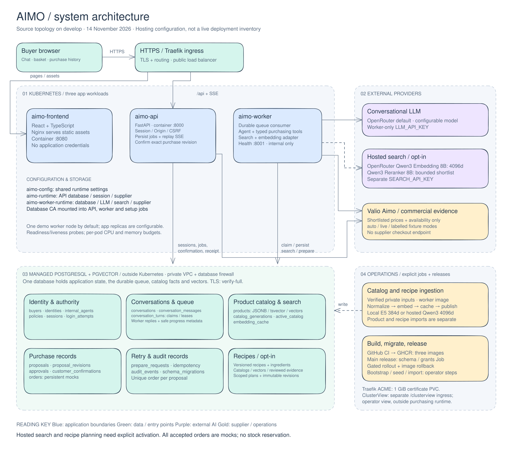
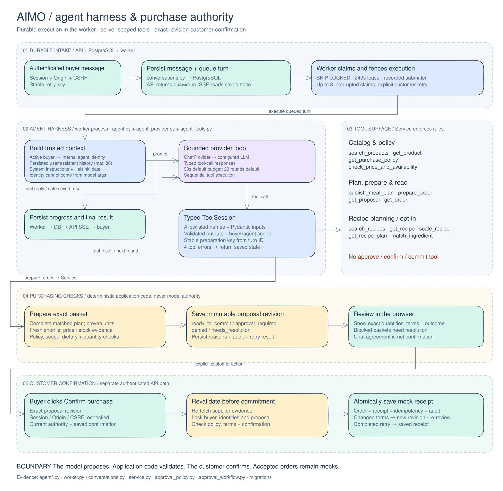
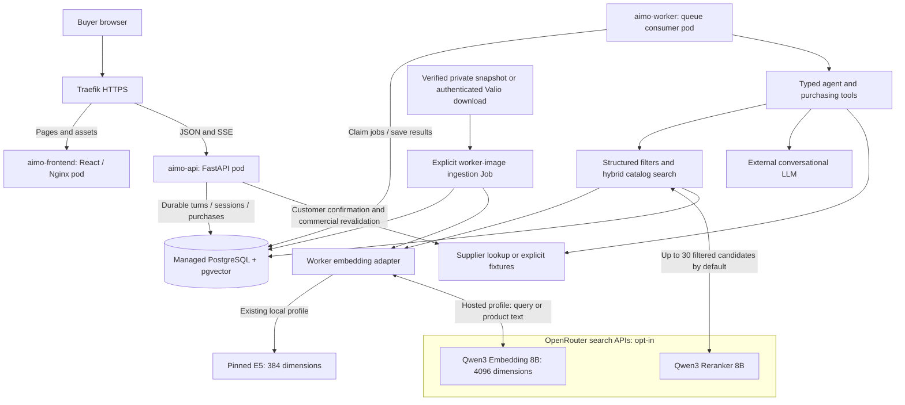
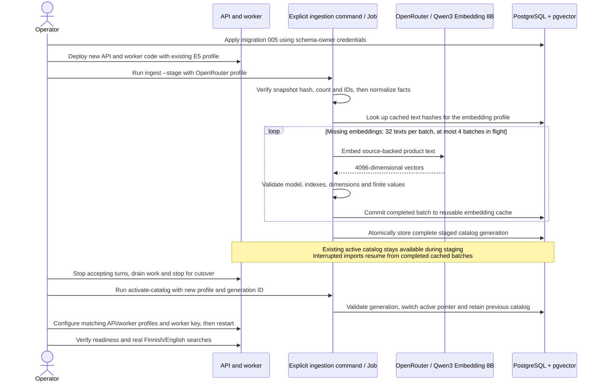
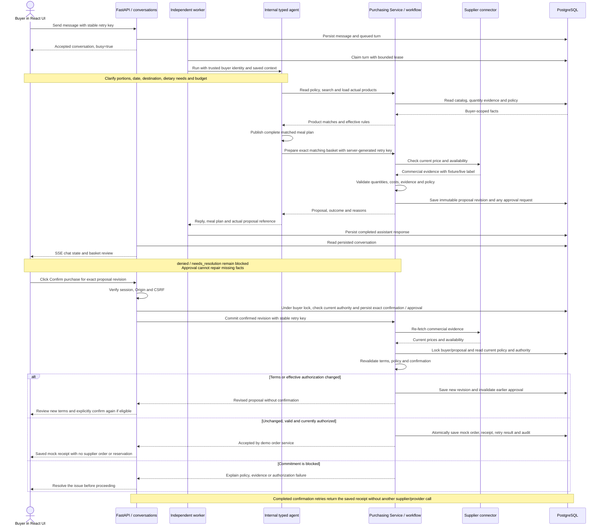

# Aimo chat purchasing architecture

This describes the implemented chat product. The [chat purchasing migration](chat-purchasing.md)
supersedes the external-agent/MCP entry points in the [original brief](brief.md).
GitHub renders the Mermaid diagrams directly; edit their text here when the architecture changes.

The OpenRouter search profile requires an explicit staged import and coordinated cutover.
Deploying the code alone retains the existing local E5 profile.

## D2 system and harness views

These views separate the browser application, static-file server, public router, application
API and background worker, and show the persisted purchasing flow. They describe repository
configuration rather than live cluster state. Detailed behavior and data ownership are explained
below. [Edit the diagrams with free D2](diagrams/README.md).

### Full system architecture

[Editable D2 source](diagrams/architecture.d2) · [Full-size SVG](diagrams/architecture.svg) · [PNG](diagrams/architecture.png)

The buyer message creates the work: the API persists a queued turn; the continuously
running worker polls PostgreSQL, claims a turn, and executes the agent. It saves its
reply/proposal in PostgreSQL. The API reads saved state and delivers updates to the
browser via SSE. The API does not invoke the worker directly. The diagram’s green
stores are logical areas of one external managed database; blue workloads share the
Kubernetes cluster.

### Agent harness and purchase authority

[Editable D2 source](diagrams/harness.d2) · [Full-size SVG](diagrams/harness.svg) · [PNG](diagrams/harness.png)

The worker owns the model/tool loop. Customer confirmation is a separate authenticated API
action for an exact revision. Revalidation can block acceptance or require a new confirmation;
only successful unchanged terms lead to a saved mock receipt.

## System overview

Frontend, API and worker each have their own image, Deployment, pod and Service.
API requests persist chat jobs; the worker consumes them independently, and SSE
returns saved conversation snapshots. The worker owns the embedding backend,
conversational LLM key and separate `SEARCH_API_KEY`. Hosted search needs no GPU or
separate model server. The API owns browser session signing and exact customer confirmation;
it checks catalog/profile compatibility without model loading or search credentials.
The frontend receives no application credentials. PostgreSQL remains outside the
cluster as the existing managed database.

The agent can plan, search and prepare; its tool registry has no approval or
commit operation. Policy/identity provisioning remain privileged setup operations.
Even with live price/availability, orders are persistent **mocks**, without supplier
checkout or stock reservation. See [cutover and recovery](separate-apps.md).

Exact product ID/GTIN matches stay local. Descriptive hosted searches combine keyword and
exact cosine ranking in pgvector, then rerank a filtered shortlist. Dietary exclusions apply
before reranking; model scores never prove suitability. Embedding failures return errors;
reranker outages preserve filtered hybrid results with `rerank_status=unavailable`.

## Hosted catalog ingestion and cutover

PostgreSQL stores normalized product facts as JSONB, searchable text/`tsvector`, and one embedding
per product and catalog generation. Migration 005 allows old 384-dimensional and new
4096-dimensional generations to coexist, with a database dimension check. Search reads only the
active generation. Exact vector ranking does not use an HNSW index; the old unused index is removed.

The import is an operator action, never a deployment/startup hook or continuous sync. Only changed
text needs new embeddings within the same profile; switching models requires a new compatible
catalog. The reranker runs at search time, not during ingestion. Readiness checks the database,
profile and worker key presence without making paid API calls. Rollback selects the retained previous
generation and matching serving profile. See the [hosted search runbook](hosted-search.md) for
commands, failure handling, measured quality/latency and rollout details.

## Purchase and confirmation sequence

Recipe agreement or approval text in chat never authorizes a purchase. Both `ready_to_commit`
and `approval_required` proposals still need the authenticated confirmation action for the internal
agent. A changed revision needs a new confirmation. Idempotency and one-order-per-proposal
constraints prevent duplicate acceptance; persisted conversations and receipts survive restarts.

## Code map

| Responsibility | Main source |
| --- | --- |
| Browser screens and generated API types | [frontend/src](../frontend/src) |
| HTTP routes, sessions, Origin/CSRF and SSE | [api.py](../src/aimo/api.py), [auth.py](../src/aimo/auth.py) |
| Queue claiming and worker health | [worker.py](../src/aimo/worker.py) |
| Conversation recovery and customer confirmation | [conversations.py](../src/aimo/conversations.py) |
| Provider loop and allowed typed tools | [agent.py](../src/aimo/agent.py), [chat_schemas.py](../src/aimo/chat_schemas.py) |
| Shared purchasing entry points | [service.py](../src/aimo/service.py) |
| Catalog normalization, ingestion and hybrid search | [catalog.py](../src/aimo/catalog.py), [ingest.py](../src/aimo/ingest.py), [search.py](../src/aimo/search.py) |
| OpenRouter embeddings, reranking and response validation | [search_provider.py](../src/aimo/search_provider.py) |
| Commercial evidence and quantity snapshots | [upstream.py](../src/aimo/upstream.py), [purchases.py](../src/aimo/purchases.py) |
| Policy decisions and durable purchase workflow | [approval_policy.py](../src/aimo/approval_policy.py), [approval_workflow.py](../src/aimo/approval_workflow.py) |
| Purchasing contracts and database schema | [schemas.py](../src/aimo/schemas.py), [migrations](../migrations) |
