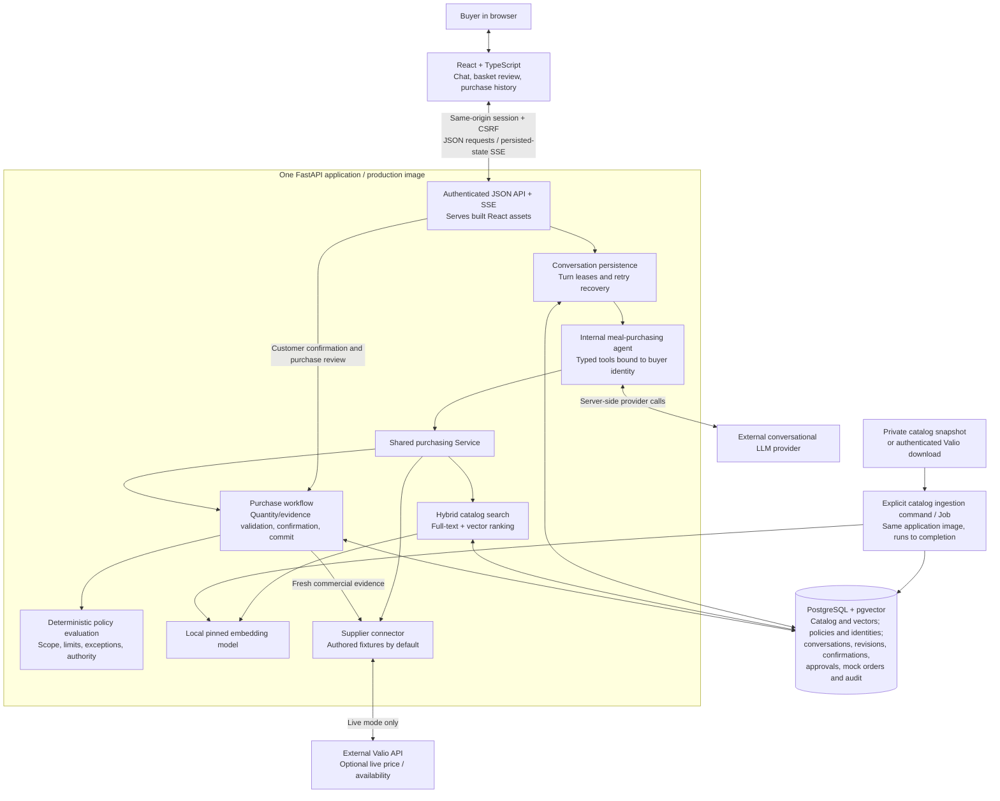
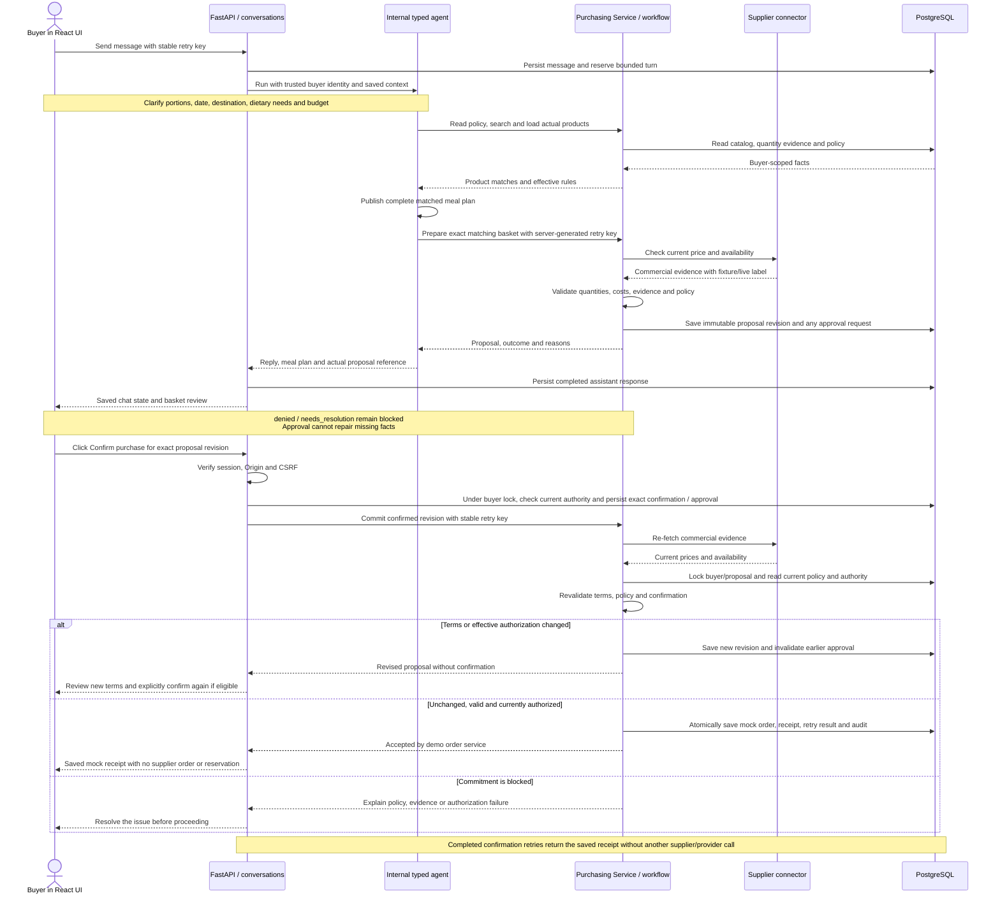

# Aimo chat purchasing architecture

This describes the implemented chat product. The [chat purchasing migration](chat-purchasing.md)
supersedes the external-agent/MCP entry points in the [original brief](brief.md).
GitHub renders both Mermaid diagrams directly; edit their text here when the architecture changes.

## System overview

- **Runtime:** one backend serves the frontend and runs the agent, search and purchasing modules.
  The embedding model runs locally in the process. The conversational LLM is a separate provider;
  its credentials stay on the server.
- **Data:** PostgreSQL stores both the derived catalog index and durable business records.
  Catalog ingestion is an explicit operator command, never a request/startup hook. Fixture
  embeddings and a small fixture catalog are available for testing independently of supplier mode.
- **Authority:** the backend binds tool calls to a trusted internal identity. The agent can plan,
  search and prepare; its tool registry has no approval or commit operation. Policy and identity
  provisioning are privileged setup operations, with no runtime policy editor.
- **Ordering:** even with live prices/availability, acceptance is a persistent **mock order**.
  There is no supplier checkout or stock reservation. `/mcp` and `/api/agent/*` are removed.

Optional Kubernetes hosting uses one application Deployment plus a PostgreSQL endpoint and an
occasional ingestion/setup Job. Infrastructure configuration does not establish that it has been
deployed; see the [deployment guide](../deploy/README.md) and [Terraform runbook](../infra/README.md).

## Purchase and confirmation sequence

Recipe agreement or approval text in chat never authorizes a purchase. Both `ready_to_commit`
and `approval_required` proposals still need the authenticated confirmation action for the internal
agent. A changed revision needs a new confirmation. Idempotency and one-order-per-proposal
constraints prevent duplicate acceptance; persisted conversations and receipts survive restarts.

## Code map

| Responsibility | Main source |
| --- | --- |
| Browser screens and generated API types | [frontend/src](../frontend/src) |
| HTTP routes, sessions, Origin/CSRF and SSE | [api.py](../src/aimo/api.py), [auth.py](../src/aimo/auth.py) |
| Conversation recovery and customer confirmation | [conversations.py](../src/aimo/conversations.py) |
| Provider loop and allowed typed tools | [agent.py](../src/aimo/agent.py), [chat_schemas.py](../src/aimo/chat_schemas.py) |
| Shared purchasing entry points | [service.py](../src/aimo/service.py) |
| Catalog normalization, ingestion and hybrid search | [catalog.py](../src/aimo/catalog.py), [ingest.py](../src/aimo/ingest.py), [search.py](../src/aimo/search.py) |
| Commercial evidence and quantity snapshots | [upstream.py](../src/aimo/upstream.py), [purchases.py](../src/aimo/purchases.py) |
| Policy decisions and durable purchase workflow | [approval_policy.py](../src/aimo/approval_policy.py), [approval_workflow.py](../src/aimo/approval_workflow.py) |
| Purchasing contracts and database schema | [schemas.py](../src/aimo/schemas.py), [migrations](../migrations) |
