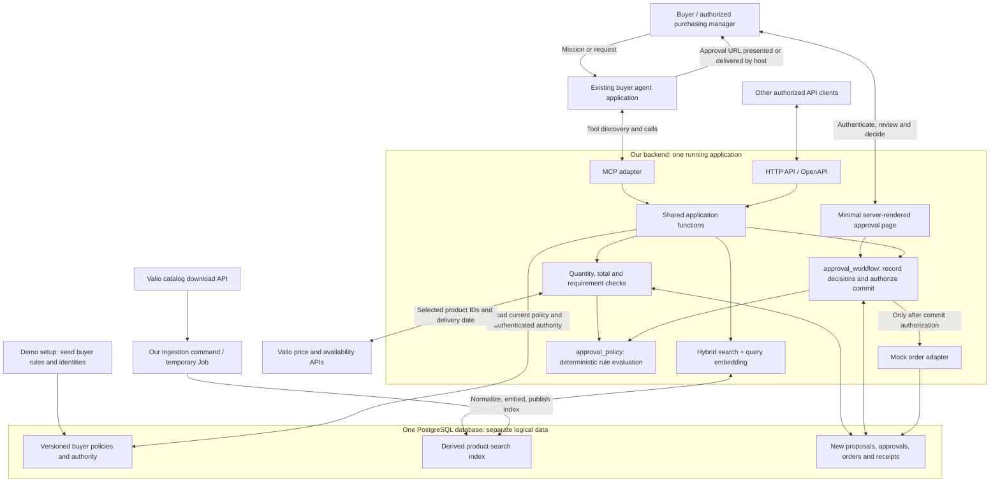
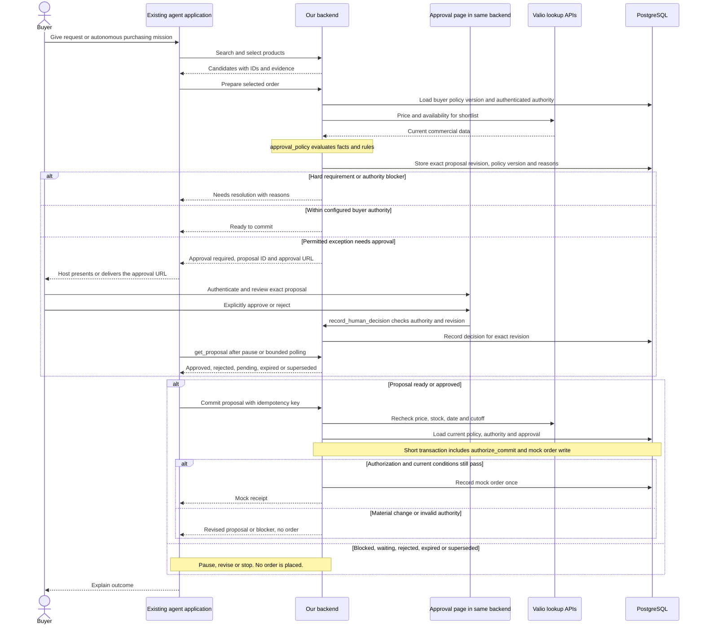
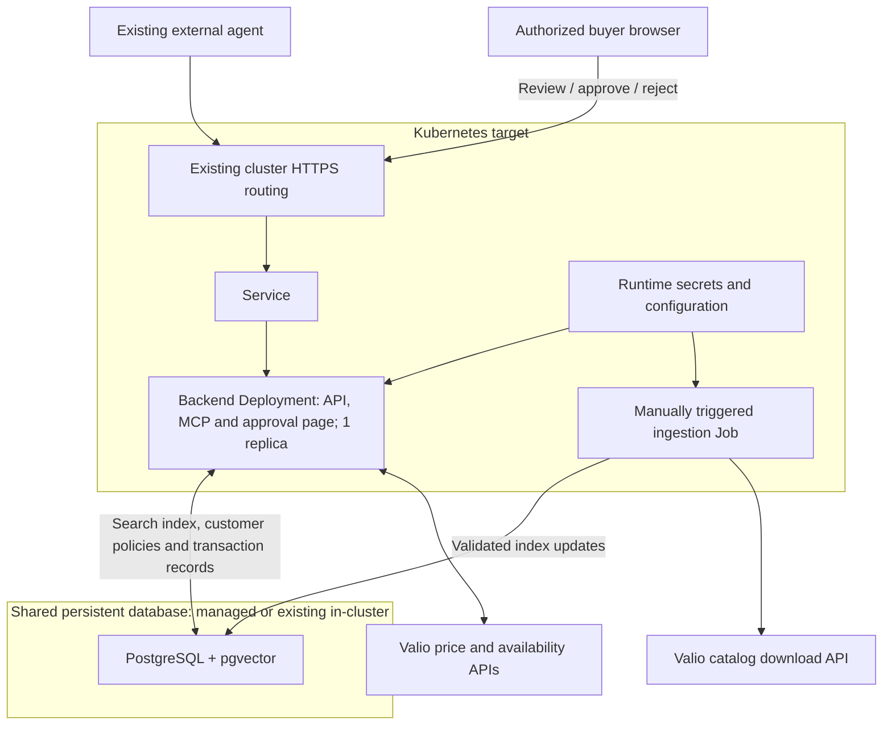

# Valio Aimo — implementation plan

Updated **14 November 2026 (Europe/Helsinki)** with the agreed scope and the discussion after the first draft. This is a design document: application code, containers, Kubernetes resources, and authenticated Valio API integration have not been implemented or tested.

## 1. What we are building

Build **one seller-side backend with HTTP and MCP interfaces** that lets an external purchasing agent search Valio Aimo's products, obtain prices and availability, prepare a valid purchase, obtain any required buyer approval, and submit a mock order.

The buyer already has an agent, which may be conversational or run a mission without an active chat. We provide the tools it calls and enforce the purchasing rules. The default human-approval route is **one small server-rendered page served by this same backend**. We do not build a buyer-agent application, separate frontend service, or React application. Direct approval inside a compatible agent client is an optional later integration.

The approval gate consists of **preconfigured customer rules, backend policy/workflow modules, and the approval page**. The backend decides whether a purchase fits the agent's authority; an authorized buyer decides permitted exceptions. Every new commitment passes backend enforcement. The MVP seeds one demo customer's rules and identities during setup; rule-management screens and MCP administration tools are deferred.

The [official challenge](https://hackjunction.app/participate/45/challenges/327) requires structured lookup, inquiry-to-order interaction at fixed prices, and permissions/human approval. Judging weights are end-to-end demonstration **30%**, matching buyer needs **20%**, controls **20%**, exceptions **15%**, and openness/production path **15%**. Include a small shortage-recovery demonstration after the basic flow works. MCP is our interface choice, not a sponsor requirement.

The first milestone is **one complete milk purchase**, not a general purchasing platform: request → search → current price/stock → valid quantity and total → authorization → mock receipt.

## 2. Elements, ownership, and service count

| Element | Count | Responsibility and ownership |
| --- | --- | --- |
| Our continuously running backend | **1** | Product search, Valio connectors, proposal calculations, `approval_policy`, `approval_workflow`, and mock ordering are modules in the same application. |
| Machine access interfaces | **2** | HTTP/OpenAPI and MCP expose the same application functions; they are not separate services. The human approval view uses the same backend and HTTPS endpoint. |
| Ingestion task | **1 when invoked** | Another command in the same application image; imports/updates the catalog, then exits. |
| PostgreSQL database | **1 shared database endpoint** | Holds derived search data, versioned customer rules/authority, and new transaction records in separate tables. Existing/managed PostgreSQL is preferred if available. |
| Product search index | **1 logical index** | Product IDs, searchable text, embeddings, and relevant structured attributes, stored in PostgreSQL using pgvector and full-text search. |
| Embedding model | **1 pinned model, loaded per serving/import process** | Runs as a library in our application; no separate model-serving service is planned. |
| Human approval view | **1** | Minimal server-rendered review/approve/reject page with buyer authentication; no separate frontend deployment. |
| Custom buyer agent | **0** | Any compatible external client can use the tools, receive an approval URL, and check proposal status. |
| Valio endpoints used initially | **3** | Catalog download, price lookup, and availability lookup. Valio operates these. |

**Deployment count:** one custom application service plus one database service/dependency, and an occasional ingestion Job. A PostgreSQL instance can be outside the cluster. Search, approval, ordering, and MCP do not each get a separate deployment.



## 3. Technology and storage decisions

| Area | Planned choice | Reason |
| --- | --- | --- |
| Language and dependencies | Python, `uv`, committed lockfile | One environment for the API, ingestion, normalization, and embedding work. Pin runtime/dependency versions during the skeleton. |
| HTTP service | FastAPI, Pydantic, Uvicorn | Typed requests/responses, validation, generated OpenAPI, HTML approval routes, and one HTTP process per container. |
| Agent interface | Official Python MCP SDK, HTTP transport supported by the chosen client | Reuse application functions; pin a compatible SDK/protocol version. Client-specific human-confirmation support is not required for the default approval page. |
| Embeddings | Sentence Transformers; initial candidate `intfloat/multilingual-e5-small` | Concrete multilingual starting point. Verify Finnish/English retrieval quality and CPU latency before locking the model revision. |
| Semantic and keyword retrieval | PostgreSQL + pgvector + native full-text search | One shared store can support vector retrieval, keyword retrieval, and metadata filters. Combine result rankings with reciprocal rank fusion. |
| Transaction records | PostgreSQL | Shared proposals, approvals, and idempotency records survive process/pod restarts and are available to additional backend replicas. |
| Packaging and target | One Docker image; Kubernetes Deployment and manually triggered Job | The same image runs the service or ingestion. Use an available cluster; provisioning a new cluster is outside the application MVP. |
| Human approval UI | FastAPI server-rendered HTML templates, using Jinja2 | One small review/approve/reject view served by the existing backend. No React app, separate frontend build, or admin dashboard. |
| Approval rules and workflow | Typed Python `approval_policy` and `approval_workflow` modules; versioned policy rows in PostgreSQL | Deterministic decisions shared by HTTP/MCP and the page; no separate approval service or general rules engine. |

The initial draft suggested SQLite and a local embedding matrix for a single-instance demo. **For the selected Kubernetes direction, the proposed default is PostgreSQL with pgvector**, consolidating shared transaction state and the search index without adding a separate vector-search service. SQLite plus file/in-memory indexes remains a possible single-instance simplification, not a second backend we must implement alongside PostgreSQL.

The two kinds of stored data have different purposes:

- **Derived catalog data:** a search representation of Valio's product file, linked by product ID. It is reproducible from the source and does not replace Valio as the product-data authority.
- **New application data:** customer policies/authority, proposals, permission decisions, human approvals, mock orders, and receipts that our service stores. The supplied Valio lookup APIs do not store these for us.

Current prices and availability come from Valio's APIs. Save evidence snapshots with proposals, but do not embed live prices or stock into product vectors. The database and pgvector do not generate embeddings; the embedding model does.

## 4. Ingestion: where the searchable data comes from

Valio exposes the catalog through **`GET /api/products/download`**, which redirects to the full product JSON. The importer can fetch this directly; a manual download is not required. The supplied API has no product-search endpoint or documented incremental product-change feed.

Run ingestion once initially. The sponsor says static files remain unchanged during the challenge unless an update is announced; continuous synchronization and a scheduled CronJob are unnecessary for the MVP.

The importer will:

1. Fetch the catalog with the documented authentication and follow the download redirect. Process the JSON in backend code rather than putting the full catalog into an agent context.
2. Check the snapshot structure and product IDs. Preserve source/version/hash information and identify incomplete or invalid imports before publishing changes.
3. Extract concise search text from real multilingual names, useful descriptions, brand, and supported documented attributes. Do not invent names for opaque category or unit codes.
4. Preserve structured sales units, packaging factors, ordering steps, claims, allergen relationships, and other supported requirements separately from text similarity.
5. Generate embeddings and store them with the product ID, search text, metadata, model identifier/revision, and text fingerprint. Follow the selected model's document/query formatting and normalization conventions.
6. Publish a validated index generation. Failed or partial imports leave the previously usable index active; an import must not silently mix incompatible embedding models.

For an updated complete catalog, rerun the same importer:

| Change | Action |
| --- | --- |
| New product ID | Insert its metadata and generate an embedding. |
| Searchable text changed | Update metadata/text and replace its embedding. |
| Only non-embedded structured attributes changed | Update those attributes without recomputing the embedding. |
| No relevant change | Reuse the existing record and embedding. |
| Product removed or marked deleted in a validated full snapshot | Exclude it from new searches; retain proposal/order evidence already referencing it. |
| Embedding model, revision, or text-building rules changed | Build a compatible new index generation; do not compare old-model vectors with new-model queries. |

Do not infer deletions from an interrupted download or partial list. Do not ingest on every user request or independently at every backend replica startup. One import command/Job owns an update, and its reruns must be safe.

## 5. Search and the agent-facing schema

The agent does **not** download every product name, internal field name, or possible catalog value before querying. It discovers our small tool definitions through MCP. Our code maps those public fields to Valio's structure.

Example proposed search request:

```json
{
  "query": "milk for hotel breakfast",
  "requirements": {"lactose_free": true},
  "limit": 5
}
```

The schema documents `query`, `requirements.lactose_free`, and `limit`, including their types and meanings. The external agent maps the buyer's words to those fields. Our adapter maps the lactose-free condition to explicit `nutritionalClaim` evidence such as `FREE_FROM_LACTOSE`, checking relevant conflicts. The agent does not need to know the path `synkkaData.classifications`.

Support a small set of precise, tested requirements first. Descriptive preferences can remain in the free-text query. Reject unsupported structured filters explicitly, and surface unverified requirements rather than silently claiming they were checked. A request such as “100 boxes” needs a known buyer preference or clarification before quantity calculation.

At search time:

1. Embed the query with the same model/version used by the active index.
2. Retrieve semantic candidates and keyword candidates. Apply supported structured filters to both paths where possible; maintain exact ID/GTIN lookup.
3. Fuse ranks and revalidate mandatory requirements. Similarity is not evidence of dietary suitability, physical quantity, or delivery eligibility.
4. Return a concise shortlist with real product IDs, names, sales units, supported packaging facts, matching evidence, and unknown/conflicting fields.
5. Let the agent inspect/select candidates, then query current prices and availability only for that shortlist.

Use language-aware text preparation for Finnish and English. Evaluate keyword-only, semantic-only, and hybrid search on approximately 30 labeled requests, including synonyms, exact SKUs, dietary distinctions, adjacent-but-wrong categories, and no-match cases. Record top-result relevance, constraint violations, and latency. The initial embedding model is a candidate, not a claim of proven best performance on this data.

## 6. Tools and upstream APIs

The seven ordinary agent tools call the same application functions as the HTTP API:

| Operation | Inputs / result |
| --- | --- |
| `search_products` | Free-text query, supported requirements, limit → concise candidates with IDs, units, evidence, and unresolved fields. |
| `get_product` | Product ID → detailed attributes, packaging, and source evidence. |
| `check_price_and_availability` | Shortlisted IDs and delivery date → timestamped dynamic evidence. Customer identity is taken from authenticated account configuration. |
| `prepare_order` | Selected products, requested amounts/units, requirements, destination and delivery date → immutable proposal revision, calculations, authorization state, reason codes, policy version, and an approval URL when required. |
| `get_proposal` | Proposal ID → current revision, authorization/approval state and reasons, policy version, expiry, approval URL when applicable, and resulting order ID if committed. Enables an agent to pause and resume. |
| `commit_order` | Proposal revision and idempotency key → accepted mock order, revised proposal, or structured blocker. |
| `get_order` | Order ID → authorized access to status, receipt, and explanation. |

A **restricted human-approval action** is separate from these autonomous tool permissions. The authenticated buyer submits it through our approval page. The purchasing model must not gain approval authority through a generic `approved: true` field or possession of the page URL.

The minimal human routes are `GET /approvals/{approval_id}` for authenticated review and `POST /approvals/{approval_id}/decision` for approve/reject. These routes are served in the same application as the API/MCP adapters. Viewing a page has no approval or purchase side effect. The decision records authorization; the agent still calls `commit_order` after checking status.

Customer rules are seeded during setup for the MVP. Future `get_customer_policy` and `update_customer_policy` tools could use this same MCP/API backend with separate account-scoped read/admin permissions. They are **not part of the seven MVP tools**. The backend must enforce permission on every call; hiding a tool from discovery is insufficient. Ordinary purchasing credentials cannot edit their own authority. See [customer rule ownership](#81-who-sets-the-rules-and-how).

| Valio endpoint | Usage |
| --- | --- |
| `GET /api/products/download` | Full catalog download for ingestion; follow redirect. |
| `POST /api/price` | Prices for selected product IDs, customer, and requested delivery date. |
| `POST /api/availability` | Availability and delivery information for selected product IDs, customer, and requested delivery date. |

The price/availability request maximum is 1,000 IDs, not a target batch size. Keep the `X-API-Key` server-side. Use bounded retries/backoff for read calls, explicit failures, and validate returned IDs, units, dates, currency, nulls, and error flags. A response cache is optional; if added, key it by customer/date/product and display its timestamp. Cached or refreshed data does not reserve stock or lock prices.

## 7. Quantities, evidence, and correct proposals

Normalize supported facts while preserving raw values and provenance. Distinguish **known, derived, unknown, and conflicting** information. The inspected synthetic catalog has **17,546 products**, including **6,622** with different sales/base units, **632** explicitly marked variable weight, and **506** with deposits. **3,072** lack populated packaging measurements.

| Actual example | Evidence | Required handling |
| --- | --- | --- |
| `464306`: Arki Eila lactose-free milk drink | Sales/base unit `ST`; base volume `1 L`; `KI` factor `20` | 1,000 L maps to 1,000 ST. A handling unit does not replace the declared sales unit. |
| `465039`: Eila lactose-free milk drink | Sales unit `KI`; base unit `ST`; factor `5`; structured base volume absent | Five ST per KI is explicit; the 1 L size comes from the name. Preserve that difference in evidence quality. |
| `460123`: Vitamin Well 12 × 500 ml | Sales unit `KI`; 12 BOT per KI; 12 deposit units per KI | Ten KI means 120 bottles and 120 deposit units, with corresponding price calculations. |
| `460675`: flank steak, approximately 2 kg | Sales unit `KG`; order step `10`; variable weight | The name does not define the order step. A 12 kg request rounds to 20 kg under the documented step; actual-weight settlement remains unresolved. |
| `460035`: lettuce mix | Sales unit `KG`; order step `3`; no packaging measurements | A 4 kg request is not exactly orderable; proposing 6 kg requires the buyer's overbuy permission. |

Important data checks:

- **6,373 of 8,970** populated `volume` objects use `GRM` or `KGM`. Check the physical dimension, not just the field name. Do not use gross packaging weight as food content or convert mass to volume without evidence.
- Product `468044` declares allergen code `AM` as both `CONTAINS` and `FREE_FROM`. A positive free-from flag alone is insufficient. Missing allergen information is also not an absence claim. Lactose-free does not mean milk-free.
- Seven referenced deposit-material IDs are absent from the catalog. Verify whether the price endpoint resolves them; an unknown deposit price is not zero.
- Nutrition declarations have their own quantity/unit basis. Support only rules whose units and codes have been established.
- `allowedLotSize=0.01` is common synthetic source data. Preserve it and make any additional whole-pack policy explicit rather than silently rewriting the source.
- A listed substitution is a candidate, not a guarantee of buyer-specific suitability. Opaque category and temperature codes require documented mappings; do not guess them.

`prepare_order` deterministically calculates sales quantity, ordering-step rounding, excess/shortfall, product price, tax, deposits, and applicable charges using decimal arithmetic. Preserve currency and net/gross totals; the demo spend limit is defined against the gross payable total. Comparison prices are for comparison, not a substitute for sales-unit prices. Missing costs or unsupported conversions prevent an executable proposal.

Availability is in sales units. Check product-level and schedule-line sales blocks, quantity, earliest available date, and order cutoff in Helsinki time. Terminal quantity `999999` means unknown supplier quantity; it cannot support a confirmed-fulfillment claim. The price API is the authoritative tax source.

Initial autonomous ordering supports fixed-quantity products with sufficient evidence. Variable-weight products, unresolved Terminal fulfillment, and conflicting critical attributes can be returned as unresolved cases. A human spending approval does not establish missing inventory or product facts.

## 8. Customer rules, backend approval gate, and approval page

The gate has three parts in the same application: backend rule evaluation, the frontend review/decision page, and backend enforcement before commitment. The page presents a proposal and captures a human decision; it does not decide policy or provide the only protection against an unauthorized order.

### 8.1 Who sets the rules and how

The **buyer's authorized human** approves spending or preference exceptions, for example a hotel's purchasing manager. Valio Aimo is the seller. Our backend enforces the buyer's configured authority and records the decision; it does not substitute its own approval for the buyer's.

The **buying company's authorized administrator owns its standing rules**. For the challenge, we act as the setup operator and preconfigure one demo customer's agreed settings in PostgreSQL with a small seed command/fixture. Seed once during setup; reruns must preserve existing settings, and backend startup must not overwrite policy rows. Demo identities are also preconfigured, with credentials supplied privately. No rules-management frontend or runtime policy-editing tool is required.

| Rule or input | Owner and MVP handling |
| --- | --- |
| Buyer account and purchasing-agent scope | Bind authenticated credentials to the buyer and allowed actions in backend configuration. An agent-supplied account ID or role is not proof of authority. |
| Autonomous spending limit | Buyer-configured limit per proposal, in a specified currency, against the full gross payable total including tax, deposits, and applicable charges. €1,500 is an illustrative demo value, not a sponsor requirement. |
| Destinations | Preconfigure allowed buyer delivery destinations; an unlisted destination needs corrected configuration/request, not an ordinary spending approval. |
| Substitution and excess-quantity rules | Explicitly choose `allowed`, `requires_approval`, or `forbidden` for each. A substitution must still satisfy mandatory product requirements. Preserve requested and proposed quantities. |
| Human approvers | Preconfigure approver identities, buyer-account scope, permitted exception types, and an explicit maximum gross approval amount/currency. An approver can grant only exceptions within that authority. |
| Instructions for this purchase | The buyer's agent sends budget, quantity, dietary needs, date, and other supported constraints from its mission/conversation. They may narrow standing permissions, never increase them. |
| Policy version and validity | Store a version with the rules and record it with every decision. Proposals and approvals have explicit expiry; revoked authority is checked before any new commitment. |

For example, a company limit of €1,500 and a hard request budget of €800 do not authorize a €900 order. The buyer must revise that request. Approving a permitted €1,700 proposal does not permanently raise the company's autonomous limit. Seller conditions, such as availability and cutoff, still apply regardless of buyer approval.

Later, an administrator could manage rules through a settings page or the same MCP/API using `get_customer_policy` and `update_customer_policy`. Restrict edits to verified customer-admin authority, bind the account server-side, require the expected policy version to avoid lost updates, and record the actor/change. A policy edit triggers reevaluation of pending proposals; older approvals cannot silently authorize a new policy version. Purchasing credentials do not receive this admin permission. MCP's [authorization mechanism](https://modelcontextprotocol.io/specification/2025-11-25/basic/authorization) supports scoped access; our application remains responsible for account, operation, and policy checks. This extension is deferred, along with a policy language, organization hierarchy, cumulative/daily budgets, and a general identity platform.

### 8.2 Backend functions and decision precedence

Implement two internal modules with explicit interfaces, not separately deployed services:

| Module / planned function | Responsibility |
| --- | --- |
| `approval_policy.evaluate_purchase(proposal, buyer_policy, identity, evidence, now)` | Pure deterministic evaluation of supplied validated facts and authority. Return outcome, reason codes, relevant limits, required exception types, policy version, and expiry. No LLM decision, network access, or database mutation inside this function. |
| `approval_workflow.record_human_decision(proposal_revision, approver, decision)` | Load current policy/authority and persisted proposal; verify account, approver limits, revision, expiry and pending state; atomically store approval/rejection and its evidence. The authenticated approver comes from the server session, not a caller-selected role. |
| `approval_workflow.authorize_commit(proposal_revision, identity, current_evidence)` | Reuse policy evaluation, check the current exact-revision approval when required, and authorize only a valid current commitment. Run within the final commit transaction together with order creation; this is not a reusable permission token. |

The orchestration layer loads the policy, identity, and evidence; calculates the exact basket; and invokes the evaluator. Evaluate blockers before approval exceptions:

| Outcome | Meaning and examples |
| --- | --- |
| `needs_resolution` | An identity/scope failure, forbidden action, hard request violation, missing cost/conversion, conflicting dietary evidence, or unavailable delivery prevents commitment. Human approval cannot repair missing facts or bypass a hard prohibition. Authentication failures return the appropriate access error without leaking proposal data. |
| `approval_required` | All hard checks pass, but a permitted exception exceeds the agent's authority: e.g. gross total above its autonomous limit, a substitution, or overbuy configured to require confirmation. At least one configured approver must have authority for all required exceptions and the total; otherwise return an unresolved authority blocker. |
| `ready_to_commit` | All hard checks pass and the purchase is within the agent's configured authority. A proposal that requires approval becomes eligible for commit only after the workflow verifies a valid recorded human decision. |

Keep policy outcome, human decision (`pending`, `approved`, `rejected`, etc.), and order status distinct. Persist the reasons rather than only an `approved` boolean. Example reason codes: `AUTONOMOUS_LIMIT_EXCEEDED`, `SUBSTITUTION_REQUIRES_APPROVAL`, `OVERBUY_REQUIRES_APPROVAL`, `DESTINATION_NOT_ALLOWED`, `MISSING_PRICE`, and `DIETARY_EVIDENCE_CONFLICT`.

Inputs include authenticated buyer/agent scope; standing rules; requested constraints; exact products, quantities/units, substitutions and gross total/currency; live price/stock/date/cutoff evidence; current time and policy version; and, at decision/commit time, approver authority and any existing approval's revision, expiry or revocation. Missing policy or authority never falls back to unrestricted purchasing.

Call evaluation during `prepare_order` and repeat it through `authorize_commit` for every new `commit_order`, including direct HTTP/MCP calls that skip the page or status lookup. At commitment, reload current authority and recheck commercial evidence. A policy change or material proposal change requires a new authorization decision; an earlier approval cannot be reused. A completed idempotent retry only returns the existing receipt as described in section 9.

### 8.3 Minimal approval page and agent resume

The default approval flow works for both conversational and mission-driven agents:

1. Our service persists the exact proposal revision and returns its ID, total, exception reasons, expiry, `approval_required`, and an absolute `approval_url` under our configured public origin.
2. A conversational client can show the link in chat. A mission-driven agent pauses while its host application makes the link available to the buyer. The demo can present the returned link directly; building email, Slack, or other notification integrations is outside the MVP.
3. The buyer opens the page and authenticates as an authorized approver. The page shows the buyer account, destination/date, exact product lines and units, requested versus proposed quantities, payable total with tax/deposits, substitutions, exception reasons, and expiry.
4. The buyer explicitly approves or rejects. The page calls `record_human_decision`; our backend verifies account/exception authority, approval amount limit, current policy version, and proposal revision, then records the human identity, decision, time, and proposal fingerprint. The purchasing agent never receives approver credentials.
5. The agent uses `get_proposal` to check the persisted decision, then calls `commit_order` only when ready/approved. Its host can suspend and resume the task or use bounded polling; no tool request must stay open while waiting for a human.

Keep the page small: a readable proposal, approve/reject buttons, and the resulting status. Use server-rendered, escaped HTML with minimal styling. Use a seeded demo approver account/session in the same backend or the cluster's existing buyer identity mechanism; do not build account registration or role administration. Enforce account/approver access for both viewing and deciding, secure session handling and CSRF protection for browser submissions. A proposal ID or URL alone is not authorization.

Repeated decisions must be safe, and an expired, superseded, rejected, or already-finalized request must not silently change state. Display those states clearly. The page records a decision but does not itself place an order, lock a price, or reserve stock. Show this distinction next to the approval action.

**Optional direct in-agent approval:** a client with a verified authenticated human-confirmation mechanism may later submit the same restricted decision without opening the page. That is not required for the default demo. Conversational text or a model-generated approval boolean alone is insufficient, and the same account/revision checks apply to every approval route.

Approval binds to buyer/account, destination, delivery date, product IDs, quantities/units, substitutions, currency, total, expiry, and policy version. The fingerprint describes the commercial proposal, not changing lookup timestamps. A material change creates a new revision and authorization decision. Reject expired, revoked, rejected, cross-account, or wrong-revision approvals.



## 9. Mock orders and stored transaction data

The inspected upstream contract has **no order-placement or reservation endpoint**. Implement a small persistent mock order adapter, clearly labeled **“Accepted by demo order service.”** Confirm that representation with the sponsor early; replace the adapter if an official order endpoint is supplied. Do not automate checkout in the real webshop.

Before a new commitment, recheck authority, requirements, price, availability, and cutoff. Refreshing data does not reserve upstream stock. A production backend must perform actual acceptance and inventory handling.

Persist versioned buyer policies/authority, proposals/revisions, policy outcomes/reasons, approvals, mock orders, receipts, and idempotency records. Authenticate and enforce buyer access before returning a prior result. Check for an already-completed idempotent request before attempting a new order; identical authorized retries return its original receipt. Reject reuse of a key with a different payload. Enforce one successful commitment per proposal and make creation atomic, including simultaneous attempts. A changed proposal that requires authorization cannot reuse an earlier approval.

**Concurrency and scaling:** pending human approval is a database record, with no waiting application process, open HTTP request, or database transaction. All replicas execute the same modules against shared PostgreSQL. Fetch upstream evidence before the final short transaction. Within it, use row locks or conditional state/version updates to protect the current proposal, approval, and authority/policy version through authorization and mock-order creation. Use compatible locking for any policy/revocation update, and a consistent lock order. Concurrent approve/reject/commit calls must produce one valid state transition; retries return the recorded result or a clear state conflict. PostgreSQL documents [row locking and transaction lifetime](https://www.postgresql.org/docs/current/explicit-locking.html).

Use database unique constraints for buyer-scoped idempotency keys and successful order per proposal, with the receipt and request payload hash recorded atomically. Constraints provide enforcement across replicas; an in-memory check is insufficient. See [PostgreSQL constraints](https://www.postgresql.org/docs/current/ddl-constraints.html). These guarantees cover our database-backed mock adapter. A future real order API needs its own idempotency/reconciliation contract; a database transaction cannot make an external network side effect atomic or reserve Valio stock.

Keep a short evidence history: request requirements, relevant source/version and lookup timestamps, unit calculations, policy outcome, approval actor, and receipt. This is structured data returned to the agent, not a new audit-dashboard project. No private model reasoning is needed.

## 10. Kubernetes deployment

Kubernetes is the intended hosting target; it can run this small application well. Internal modules remain in one backend. Start with **one backend replica**; multiple replicas are a later configuration step after confirming shared-state and MCP transport behavior.

| Resource | Initial role |
| --- | --- |
| Backend Deployment | One Docker image, one serving process per pod; HTTP API, MCP, and the approval page share it. |
| Ingestion Job | Same image, different command; runs once on initial import or a requested catalog update. No always-on worker or CronJob required. |
| Service and HTTPS routing | One stable public origin through the cluster's existing Ingress/Gateway and TLS setup, serving API/MCP traffic and browser approval routes. |
| PostgreSQL with pgvector | Existing/managed database if available. If hosted in-cluster, use the team's established persistent database deployment and volume. Do not build a database operator. |
| Secret/config injection | API key, database connection, browser-session and agent-auth settings supplied at runtime; public origin, model, and upstream base URL are configuration. |
| Health checks | Liveness for the running service; readiness verifies required database/index/model readiness without depending on the remote Valio API being up. |



The image has two planned entry modes, **`serve`** and **`ingest`**; exact commands will be added with runnable code. Package or cache a pinned embedding model predictably so initial startup does not unexpectedly depend on downloading new weights. Begin with CPU execution and measure memory/latency; a GPU service is not part of the minimum deployment.

Keep durable state in PostgreSQL, not pod files or process memory. Use one active validated search generation at a time. Do not re-embed on pod restarts. Run schema setup/migrations once before the serving rollout, not independently from every replica.

Policy evaluation and approval workflow scale with the backend replicas; pending approvals remain shared database state. No dedicated approval deployment, queue, or worker is required. Extract a separate service only if multiple applications need an independently owned policy/workflow capability or measured load warrants independent scaling. Additional replicas still depend on database capacity, upstream API limits, and correct concurrency handling; a service split alone does not solve these limits.

For additional replicas, verify that the chosen MCP SDK/client uses stateless HTTP handling or provide supported session routing/state handling. Shared business data alone does not solve process-local MCP sessions. Do not add Redis or a session service speculatively.

Actual cluster access, namespace, registry, database endpoint/pgvector availability, ingress class, hostname, TLS integration, and resource limits remain to be supplied or verified. This plan does not create a cluster or deploy resources. Local development should use the same application plus PostgreSQL, optionally through Docker Compose; there is no need to operate a local cluster to write the application.

## 11. MVP boundaries, demo, and execution

**Build now:** ingestion, hybrid search, the seven agent tools including proposal-status retrieval, unit/price validation, one seeded demo customer policy/authority configuration, `approval_policy` and `approval_workflow` in the existing backend, the minimal authenticated approval page, persistent mock ordering, and a retrievable explanation/receipt.

**Defer:** a custom buyer agent, standalone React frontend/admin UI, policy-management MCP/API tools, direct in-agent approval integrations, email/chat notification infrastructure, broad policy engine, daily/organization budget management, production identity federation, dedicated approval/search/model services, message queues, continuous ingestion, autoscaling, multi-agent orchestration, recipe planning, sustainability scoring, payments, and marketplace features. Add distinctive features only after the complete core purchase works.

Demo sequence:

1. **Autonomous purchase:** a fully supported milk request within authority completes and returns a mock receipt.
2. **Buyer confirmation through the approval page:** a purchase exceeds the illustrative spend limit. Show the seeded policy and backend reason code. The agent receives a link and pauses; the buyer approves/rejects in the page, and the agent checks proposal status before resuming. Demonstrate that an active conversation is not required while waiting and that this decision does not raise the standing limit.
3. **Small shortage scenario:** a labeled fixture makes 600 L of `464306` available. The agent proposes another 400 L using listed UHT alternative `464398`; a configured buyer rule requires approval of the substitution.
4. **Changed conditions and retry:** a material change after approval prevents the old revision from committing; repeating an already successful request returns the same receipt.

Use actual catalog records. Clearly distinguish live lookup mode, controlled failure fixtures, and mock acceptance. If the network fails, use labeled recorded/fixture responses rather than claiming a successful live call.

| Priority / nominal build budget | Deliverable |
| --- | --- |
| First, hours 0–6 | Verify small live API requests, representative conversions, MCP tool connectivity, and buyer authentication for the approval page. Verify database/cluster prerequisites. |
| Hours 6–16 | Seed the demo policy/identities; complete one purchase with explicit product IDs, valid totals, policy evaluation/commit enforcement, the minimal approval page and proposal-status retrieval, and a persistent mock receipt. |
| Hours 16–26 | Add API-fed catalog ingestion, semantic/keyword indexes, documented tools, and natural-language discovery. |
| Hours 26–36 | Add shortage recovery, changed-revision handling, duplicate protection, and the first cluster rollout. |
| Hours 36–48 | Compare retrieval quality, test critical failure cases, document assumptions, and rehearse the full demo. |

These are an effort budget and priority order, not a claim about time remaining. Confirm the real event deadline and reserve submission time before assigning calendar dates.

Acceptance checks should cover relevant retrieval, unchanged-product embedding reuse, failed-import preservation, valid unit/step calculations, supported dietary constraints, tax/deposit totals, customer isolation, authentic exact-revision approval, rejection/expiry/revocation, price/stock changes, concurrent duplicate submissions, and order retrieval after restart. Verify that opening an approval URL does not authorize a purchase, an unauthorized user/agent cannot view or approve another buyer's proposal, repeated decision submissions are safe, and a paused agent can retrieve a decision after a process restart. Add no tests merely to mirror implementation details. Application tests, live API integration, browser approval, and cluster deployment remain unverified at planning time.

For the approval modules, test behavior at/below/above the gross spending boundary, allowed/approval-required/forbidden substitutions and overbuy, hard purchase budgets stricter than standing limits, and blockers taking precedence over exceptions. Verify an approver cannot exceed their amount/account/exception scope, ordinary purchasing credentials cannot alter rules, missing configuration fails closed, policy changes or revocation invalidate pending authority, and direct `commit_order` cannot bypass the gate. Exercise competing approve/reject/commit requests through separate database connections, including a restart between decision and commit. Verify seed reruns preserve existing policy and one purchase approval leaves standing rules unchanged. These are planned implementation checks, not tests already run.

Suggested team work areas are catalog/search, offer/Valio integration, permissions/orders/approval page, and packaging/cluster/demo integration. These are code ownership areas, not separate microservices. Agree shared schemas first, assign named owners, and integrate small changes. Integration coordinator, demo owner, submission owner/backup, freeze time, and submission format remain **TBD**.

## 12. Open checks and sources

Resolve early:

- Does the sponsor provide another order interface, and is mock commitment accepted?
- Which external agent client will drive the demo, how will its host expose the approval URL, and which seeded or existing buyer authentication will protect the page?
- Can missing deposit IDs be priced, and what other charges belong in the total?
- Are unit/code mappings or corrections available for ambiguous/conflicting catalog facts?
- How should variable weight and uncertain Terminal fulfillment be represented if included later?
- Which cluster/database resources are available, and what are the actual submission requirements?

Sources:

- [Official challenge and judging](https://hackjunction.app/participate/45/challenges/327)
- [Resource portal](https://junction26.valioaimo.fi/), [API reference](https://junction26.valioaimo.fi/redoc), and [OpenAPI contract](https://junction26.valioaimo.fi/openapi.json)
- [Product schema](https://junction26.valioaimo.fi/files/008f9a50ba9a6538d2e5bdf29d592af8/valio_aimo_junction26_product_data_schema.json)
- Catalog measurements come from `valio_aimo_junction26_product_data.json`, SHA-256 `50651aae31ca842112afdc16fcce92f9858d7f5d05e9928a3748aef16b22ea02`. Data is synthetic and restricted to this challenge. Raw datasets and credentials are not committed with this plan.
- [FastAPI container deployment](https://fastapi.tiangolo.com/deployment/docker/), [official MCP SDKs](https://modelcontextprotocol.io/docs/sdk), and [Python MCP SDK](https://github.com/modelcontextprotocol/python-sdk)
- [Embedding model candidate](https://huggingface.co/intfloat/multilingual-e5-small), [pgvector and hybrid search](https://github.com/pgvector/pgvector#hybrid-search), and [Kubernetes Jobs](https://kubernetes.io/docs/concepts/workloads/controllers/job/)
- [Preparation and reuse log](pre-existing-work.md)
