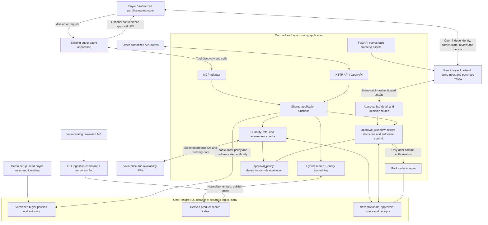
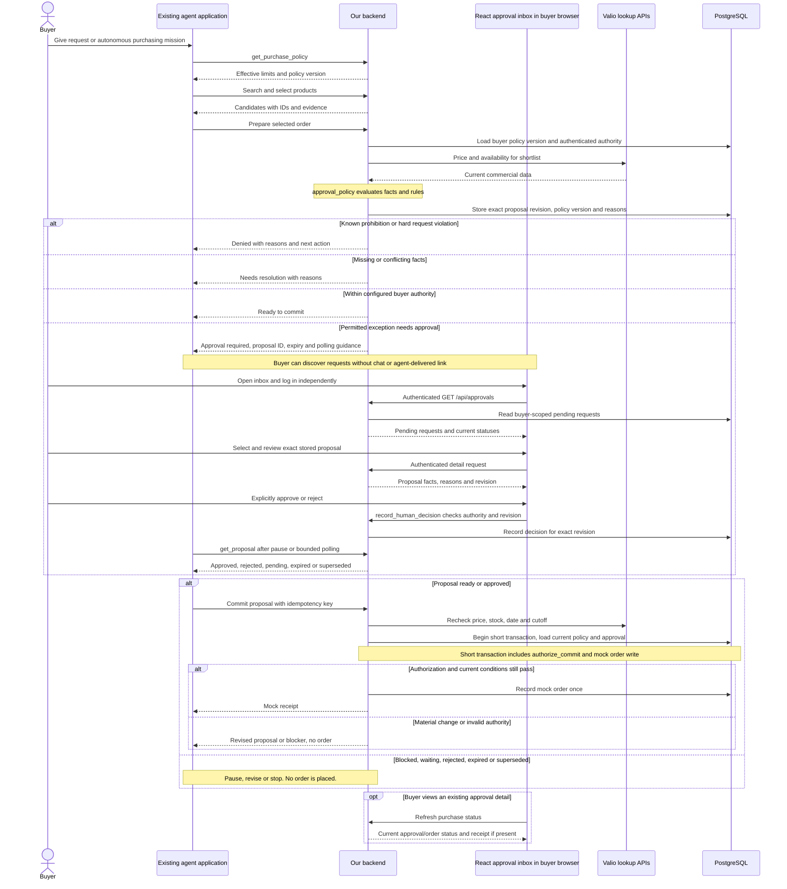
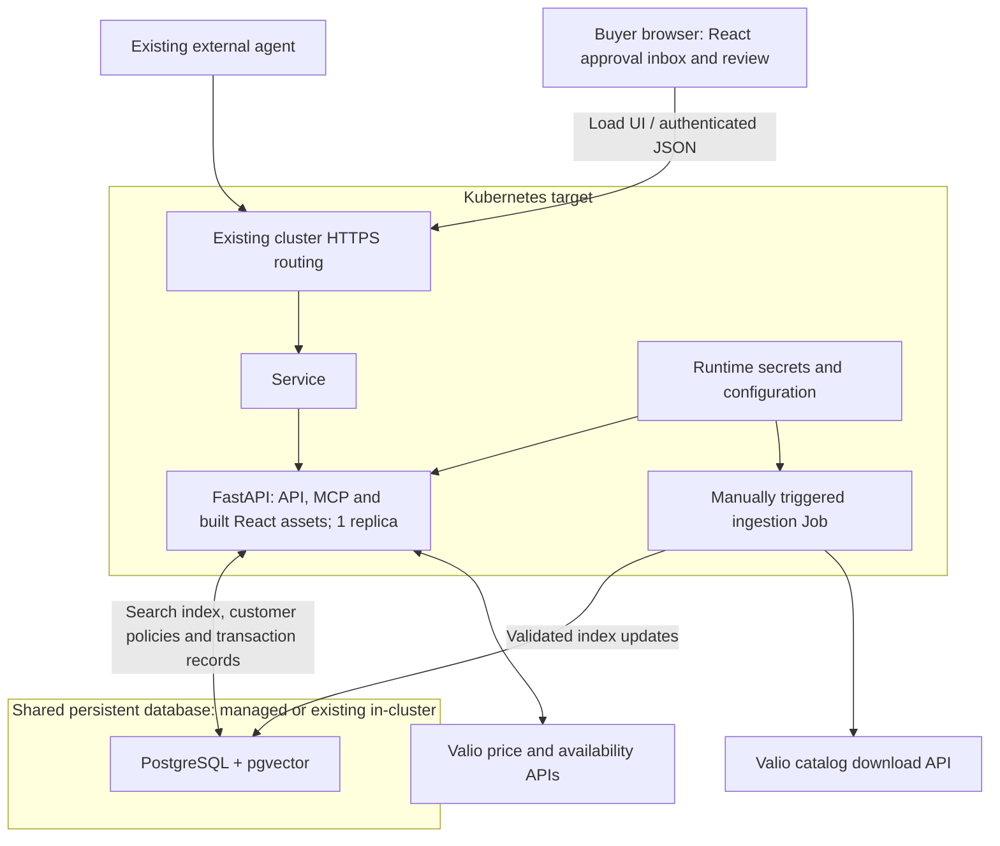

> Current product update, 2026-11-14: [Chat purchasing migration](chat-purchasing.md) supersedes the external-agent/MCP transport and standalone approval-inbox entry point in this original baseline. Its quantity, policy, approval, isolation, audit and mock-order controls remain required. The transport descriptions below document the original design.

# Valio Aimo — implementation plan

Updated **14 November 2026 (Europe/Helsinki)** with the agreed scope and the discussion after the first draft. This records the agreed design at handoff. The MVP implementation and actual validation are now described in [README](../README.md) and [validation](validation.md); authenticated live Valio integration and cluster deployment remain unverified.

Infrastructure follow-up: the owner requested optional Terraform provisioning after this plan. See [the infrastructure runbook](../infra/README.md) for the DigitalOcean adapter and portable Kubernetes stack. These configurations have not been applied in this implementation task; the existing-cluster assumptions below describe the original application scope.

## Implementation contract amendments from PR #4 review

The authorized correctness fixes clarify these interfaces without adding a service:

- Trusted `approved_product_ids` belong to the versioned buyer policy. Outside-scope products trigger substitution policy even without an agent's `substitutes_for` declaration. Missing scope is `needs_resolution` when substitution restrictions apply. The initial demo scope is `464306`; privileged `set-product-scope` provisioning inserts a new version. This controls a standing approved product set, not arbitrary external mission intent. A future mission-specific authorization contract must establish its own trusted baseline.
- `prepare_order` requires a distinct `idempotency_key`, stable across retries and scoped to buyer plus agent. A conflicting payload is rejected; creation of the proposal, approval and deduplication record is atomic. `request_id` remains a display label. Existing proposal snapshots retain their earlier request shape; commit keeps its existing idempotency contract.
- Rational quantity conversion and pack ceilings use exact fractions; monetary amounts remain decimal. Withdrawn source records remain known and denied, while discovery excludes them.
- For the 17,546-product MVP, semantic candidates use exact ranking within the filtered active catalog. Ingestion retains two generations of product/vector rows by default; generation metadata, embedding reuse and immutable purchase evidence remain. Search holds one consistent read snapshot across a concurrent refresh.
- One bounded PostgreSQL pool per process, batched inbox reads, trusted-ingress client addressing, bounded login-counter cleanup, and transient-only supplier retries are implementation details of the same backend. No queue, separate approval service or continuous ingestion is introduced.

Upgrade steps and current validation are in [README](../README.md) and [deployment instructions](../deploy/README.md).

## 1. What we are building

Build **one seller-side backend with HTTP and MCP interfaces** that lets an external purchasing agent search Valio Aimo's products, obtain prices and availability, prepare a valid purchase, obtain any required buyer approval, and submit a mock order.

The buyer already has an agent, which may be conversational or run a mission without an active chat. We provide the tools it calls and enforce the purchasing rules. The human interface is **a small React + TypeScript + Vite approval dashboard**: login, a pending-approvals inbox, and purchase review/decision. FastAPI serves the built frontend assets and its authenticated JSON API from the same application image and origin. Direct approval inside a compatible agent client is an optional later integration.

The approval gate consists of **preconfigured customer rules, backend policy/workflow modules, and the approval dashboard**. The backend decides whether a purchase fits the agent's authority; an authorized buyer decides permitted exceptions. Every new commitment passes backend enforcement. The MVP seeds one demo customer's rules and identities during setup; a read-only policy tool exposes the calling agent's effective limits. Rule-management screens and policy-editing tools are deferred.

The dashboard is the MVP's **customer inbox**. A mission-driven agent can pause while the buyer independently logs in to find pending requests; no active chat or agent-delivered link is required. Email, SMS, push, and other alerts when the dashboard is closed are optional later notification channels. The inbox does not require a separate notifier service.

The [official challenge](https://hackjunction.app/participate/45/challenges/327) requires structured lookup, inquiry-to-order interaction at fixed prices, and permissions/human approval. Judging weights are end-to-end demonstration **30%**, matching buyer needs **20%**, controls **20%**, exceptions **15%**, and openness/production path **15%**. Include a small shortage-recovery demonstration after the basic flow works. MCP is our interface choice, not a sponsor requirement.

The first milestone is **one complete milk purchase**, not a general purchasing platform: request → search → current price/stock → valid quantity and total → authorization → mock receipt.

## 2. Elements, ownership, and service count

| Element | Count | Responsibility and ownership |
| --- | --- | --- |
| Our continuously running backend | **1** | Product search, Valio connectors, proposal calculations, `approval_policy`, `approval_workflow`, and mock ordering are modules in the same application. |
| Machine access interfaces | **2** | HTTP/OpenAPI and MCP expose the same application functions; they are not separate services. The browser uses authenticated JSON routes on the same backend and HTTPS origin. |
| Ingestion task | **1 when invoked** | Another command in the same application image; imports/updates the catalog, then exits. |
| PostgreSQL database | **1 shared database endpoint** | Holds derived search data, versioned customer rules/authority, and new transaction records in separate tables. Existing/managed PostgreSQL is preferred if available. |
| Product search index | **1 logical index** | Product IDs, searchable text, embeddings, and relevant structured attributes, stored in PostgreSQL using pgvector and full-text search. |
| Embedding model | **1 pinned model, loaded per serving/import process** | Runs as a library in our application; no separate model-serving service is planned. |
| Buyer frontend | **1 build, 3 screens** | React + TypeScript + Vite: login, pending-approvals inbox, and purchase review/decision. Static assets are served by FastAPI; no separate frontend runtime deployment. |
| Standalone notification service | **0** | Pending proposals already in PostgreSQL populate the inbox. Outbound notifications are deferred. |
| Custom buyer agent | **0** | Any compatible external client can use the tools, receive an approval URL, and check proposal status. |
| Valio endpoints used initially | **3** | Catalog download, price lookup, and availability lookup. Valio operates these. |

**Deployment count:** one custom application service plus one database service/dependency, and an occasional ingestion Job. A PostgreSQL instance can be outside the cluster. Search, approval, ordering, and MCP do not each get a separate deployment.



## 3. Technology and storage decisions

| Area | Planned choice | Reason |
| --- | --- | --- |
| Language and dependencies | Python with `uv`; TypeScript for the browser; committed dependency lockfiles | Python covers API, ingestion, normalization, embeddings and policy. Vite builds the frontend. Pin runtimes/dependencies during the skeleton. |
| HTTP service | FastAPI, Pydantic, Uvicorn | Typed requests/responses, validation, generated OpenAPI, authenticated browser JSON routes, static frontend assets, and one HTTP process per container. |
| Agent interface | Official Python MCP SDK, HTTP transport supported by the chosen client | Reuse application functions; pin a compatible SDK/protocol version. Client-specific human-confirmation support is not required for the default approval page. |
| Embeddings | Sentence Transformers; initial candidate `intfloat/multilingual-e5-small` | Concrete multilingual starting point. Verify Finnish/English retrieval quality and CPU latency before locking the model revision. |
| Semantic and keyword retrieval | PostgreSQL + pgvector + native full-text search | One shared store can support vector retrieval, keyword retrieval, and metadata filters. Combine result rankings with reciprocal rank fusion. |
| Transaction records | PostgreSQL | Shared proposals, approvals, and idempotency records survive process/pod restarts and are available to additional backend replicas. |
| Packaging and target | One Docker image; Kubernetes Deployment and manually triggered Job | The same image runs the service or ingestion. Use an available cluster; provisioning a new cluster is outside the application MVP. |
| Buyer frontend | React + TypeScript + Vite; client routing for login, inbox and detail | Reusable UI for lists, status refresh and purchase review. Built assets ship in the FastAPI image; the frontend adds a build toolchain, not another running application service. |
| Approval rules and workflow | Typed Python `approval_policy` and `approval_workflow` modules; versioned policy rows in PostgreSQL | Deterministic decisions shared by HTTP/MCP and the page; no separate approval service or general rules engine. |

The initial draft suggested SQLite and a local embedding matrix for a single-instance demo. **For the selected Kubernetes direction, the proposed default is PostgreSQL with pgvector**, consolidating shared transaction state and the search index without adding a separate vector-search service. SQLite plus file/in-memory indexes remains a possible single-instance simplification, not a second backend we must implement alongside PostgreSQL.

The two kinds of stored data have different purposes:

- **Derived catalog data:** a search representation of Valio's product file, linked by product ID. It is reproducible from the source and does not replace Valio as the product-data authority.
- **New application data:** customer policies/authority, proposals, permission decisions, human approvals, mock orders, and receipts that our service stores. The supplied Valio lookup APIs do not store these for us.

Current prices and availability come from Valio's APIs. Save evidence snapshots with proposals, but do not embed live prices or stock into product vectors. The database and pgvector do not generate embeddings; the embedding model does.

## 4. Ingestion: where the searchable data comes from

Valio exposes the catalog through **`GET /api/products/download`**, which redirects to the full product JSON. The importer can fetch this directly; a manual download is not required. The supplied API has no product-search endpoint or documented incremental product-change feed.

Run ingestion once initially. The sponsor says static files remain unchanged during the challenge unless an update is announced; continuous synchronization and a scheduled CronJob are unnecessary for the MVP.

The importer will:

1. Fetch the catalog with the documented authentication and follow the download redirect. Process the JSON in backend code rather than putting the full catalog into an agent context.
2. Check the snapshot structure and product IDs. Preserve source/version/hash information and identify incomplete or invalid imports before publishing changes.
3. Extract concise search text from real multilingual names, useful descriptions, brand, and supported documented attributes. Do not invent names for opaque category or unit codes.
4. Preserve structured sales units, packaging factors, ordering steps, claims, allergen relationships, and other supported requirements separately from text similarity.
5. Generate embeddings and store them with the product ID, search text, metadata, model identifier/revision, and text fingerprint. Follow the selected model's document/query formatting and normalization conventions.
6. Publish a validated index generation. Failed or partial imports leave the previously usable index active; an import must not silently mix incompatible embedding models.

For an updated complete catalog, rerun the same importer:

| Change | Action |
| --- | --- |
| New product ID | Insert its metadata and generate an embedding. |
| Searchable text changed | Update metadata/text and replace its embedding. |
| Only non-embedded structured attributes changed | Update those attributes without recomputing the embedding. |
| No relevant change | Reuse the existing record and embedding. |
| Product removed or marked deleted in a validated full snapshot | Exclude it from new searches; retain proposal/order evidence already referencing it. |
| Embedding model, revision, or text-building rules changed | Build a compatible new index generation; do not compare old-model vectors with new-model queries. |

Do not infer deletions from an interrupted download or partial list. Do not ingest on every user request or independently at every backend replica startup. One import command/Job owns an update, and its reruns must be safe.

## 5. Search and the agent-facing schema

The agent does **not** download every product name, internal field name, or possible catalog value before querying. It discovers our small tool definitions through MCP. Our code maps those public fields to Valio's structure.

Example proposed search request:

```json
{
  "query": "milk for hotel breakfast",
  "requirements": {"lactose_free": true},
  "limit": 5
}
```

The schema documents `query`, `requirements.lactose_free`, and `limit`, including their types and meanings. The external agent maps the buyer's words to those fields. Our adapter maps the lactose-free condition to explicit `nutritionalClaim` evidence such as `FREE_FROM_LACTOSE`, checking relevant conflicts. The agent does not need to know the path `synkkaData.classifications`.

Support a small set of precise, tested requirements first. Descriptive preferences can remain in the free-text query. Reject unsupported structured filters explicitly, and surface unverified requirements rather than silently claiming they were checked. A request such as “100 boxes” needs a known buyer preference or clarification before quantity calculation.

At search time:

1. Embed the query with the same model/version used by the active index.
2. Retrieve semantic candidates and keyword candidates. Apply supported structured filters to both paths where possible; maintain exact ID/GTIN lookup.
3. Fuse ranks and revalidate mandatory requirements. Similarity is not evidence of dietary suitability, physical quantity, or delivery eligibility.
4. Return a concise shortlist with real product IDs, names, sales units, supported packaging facts, matching evidence, and unknown/conflicting fields.
5. Let the agent inspect/select candidates, then query current prices and availability only for that shortlist.

Use language-aware text preparation for Finnish and English. Evaluate keyword-only, semantic-only, and hybrid search on approximately 30 labeled requests, including synonyms, exact SKUs, dietary distinctions, adjacent-but-wrong categories, and no-match cases. Record top-result relevance, constraint violations, and latency. The initial embedding model is a candidate, not a claim of proven best performance on this data.

## 6. Tools and upstream APIs

The eight ordinary agent tools call the same application functions as the HTTP API:

| Operation | Inputs / result |
| --- | --- |
| `search_products` | Free-text query, supported requirements, limit → concise candidates with IDs, units, evidence, and unresolved fields. |
| `get_product` | Product ID → detailed attributes, packaging, and source evidence. |
| `get_purchase_policy` | No caller-selected buyer/role → the authenticated agent's effective spend limit/currency, permitted destinations, substitution/overbuy rules, relevant scope, and policy version. Read-only; omit credentials and approver contact details. |
| `check_price_and_availability` | Shortlisted IDs and delivery date → timestamped dynamic evidence. Customer identity is taken from authenticated account configuration. |
| `prepare_order` | Selected products, requested amounts/units, requirements, destination and delivery date → immutable proposal revision, calculations, authorization state, reason codes, policy version, and an approval URL when required. |
| `get_proposal` | Proposal ID → current revision, authorization/approval state and reasons, policy version, expiry, approval URL when applicable, and resulting order ID if committed. Enables an agent to pause and resume. |
| `commit_order` | Proposal revision and idempotency key → accepted mock order, revised proposal, or structured blocker. |
| `get_order` | Order ID → authorized access to status, receipt, and explanation. |

A **restricted human-approval action** is separate from these autonomous tool permissions. The authenticated buyer submits it through our approval page. The purchasing model must not gain approval authority through a generic `approved: true` field or possession of the page URL.

The frontend routes are `/login`, `/approvals`, and `/approvals/{approval_id}`. Its backend JSON routes are `GET /api/approvals` (bounded, paginated, buyer-scoped pending list), `GET /api/approvals/{approval_id}` (authorized detail), and `POST /api/approvals/{approval_id}/decision` (approve/reject for an exact revision). Add same-origin login/session/logout endpoints with the chosen demo authentication implementation. These are browser permissions, not autonomous purchasing tools. Viewing a page or listing requests has no approval or purchase side effect; the agent still calls `commit_order` after checking status.

Customer rules are seeded during setup. The MVP's `get_purchase_policy` only reads the caller's effective permissions. Future admin policy-editing tools could use this same backend with separate account-scoped administrator permission; they are **not part of the eight MVP tools**. The backend must enforce permission on every call; hiding a tool from discovery is insufficient. Ordinary purchasing credentials cannot edit their own authority. See [customer rule ownership](#81-who-sets-the-rules-and-how).

Use a consistent proposal/commit/status response with `proposal_id`, `revision`, `policy_version`, `policy_outcome`, `approval_status`, `order_status`, `reasons`, `expires_at`, and `next_action`. An approval wait can return `next_action: {"type": "wait", "tool": "get_proposal", "poll_after_seconds": 30}`; the interval is illustrative and bounded by expiry. Other actions include `commit`, `revise_request`, `request_fresh_proposal`, and `stop`, chosen from the actual outcome. An `approval_url` is optional convenience for the client, never proof of permission or a claim that a human was notified. The agent host suspends/resumes or polls; no server tool call waits for a human.

Agree shared typed models for product facts, quantities, proposal revisions, decision reasons, and responses before parallel implementation. Export JSON Schema/OpenAPI from the backend models and reuse generated types in TypeScript so the browser and MCP adapters share the contract. Commit small request/response examples and clearly labeled fixture stubs that teammates can integrate against early. Keep one model source and coordinate breaking changes; no separate contract engine or duplicated manually maintained schema system is required.

| Valio endpoint | Usage |
| --- | --- |
| `GET /api/products/download` | Full catalog download for ingestion; follow redirect. |
| `POST /api/price` | Prices for selected product IDs, customer, and requested delivery date. |
| `POST /api/availability` | Availability and delivery information for selected product IDs, customer, and requested delivery date. |

The price/availability request maximum is 1,000 IDs, not a target batch size. Keep the `X-API-Key` server-side. Use bounded retries/backoff for read calls, explicit failures, and validate returned IDs, units, dates, currency, nulls, and error flags. A response cache is optional; if added, key it by customer/date/product and display its timestamp. Cached or refreshed data does not reserve stock or lock prices.

## 7. Quantities, evidence, and correct proposals

Normalize supported facts while preserving raw values and provenance. Distinguish **known, derived, unknown, and conflicting** information. The inspected synthetic catalog has **17,546 products**, including **6,622** with different sales/base units, **632** explicitly marked variable weight, and **506** with deposits. **3,072** lack populated packaging measurements.

Use shared normalization types at catalog ingestion, upstream-response parsing, and request validation. A calculated amount includes its value/unit, evidence status, calculation basis, and source fields/version; retain raw unit codes alongside supported readable meanings. Unknown codes and ambiguous packaging stay unresolved. The importer prints compact counts by evidence status for important fields. Golden cases should cover the products below, differing packaging levels, contradictory measurements, and both allergen overlaps; expected conversions must come from verified evidence. These are internal functions and tests in the existing backend.

| Actual example | Evidence | Required handling |
| --- | --- | --- |
| `464306`: Arki Eila lactose-free milk drink | Sales/base unit `ST`; base volume `1 L`; `KI` factor `20` | 1,000 L maps to 1,000 ST. A handling unit does not replace the declared sales unit. |
| `465039`: Eila lactose-free milk drink | Sales unit `KI`; base unit `ST`; factor `5`; structured base volume absent | Five ST per KI is explicit; the 1 L size comes from the name. Preserve that difference in evidence quality. |
| `460123`: Vitamin Well 12 × 500 ml | Sales unit `KI`; 12 BOT per KI; 12 deposit units per KI | Ten KI means 120 bottles and 120 deposit units, with corresponding price calculations. |
| `460675`: flank steak, approximately 2 kg | Sales unit `KG`; order step `10`; variable weight | The name does not define the order step. A 12 kg request rounds to 20 kg under the documented step; actual-weight settlement remains unresolved. |
| `460035`: lettuce mix | Sales unit `KG`; order step `3`; no packaging measurements | A 4 kg request is not exactly orderable; proposing 6 kg requires the buyer's overbuy permission. |

Important data checks:

- **6,373 of 8,970** populated `volume` objects use `GRM` or `KGM`. Check the physical dimension, not just the field name. Do not use gross packaging weight as food content or convert mass to volume without evidence.
- Product `468044` declares allergen code `AM` as both `CONTAINS` and `FREE_FROM`. Product `469429` declares `AM` and `AN` as both `MAY_CONTAIN` and `FREE_FROM`. A full local scan found these two products with codes overlapping the allergen/nonAllergen groups, with those distinct relationships. A positive free-from flag alone is insufficient. Missing allergen information is also not an absence claim. Lactose-free does not mean milk-free.
- Seven referenced deposit-material IDs are absent from the catalog. Verify whether the price endpoint resolves them; an unknown deposit price is not zero.
- Nutrition declarations have their own quantity/unit basis. Support only rules whose units and codes have been established.
- `allowedLotSize=0.01` is common synthetic source data. Preserve it and make any additional whole-pack policy explicit rather than silently rewriting the source.
- A listed substitution is a candidate, not a guarantee of buyer-specific suitability. Opaque category and temperature codes require documented mappings; do not guess them.

`prepare_order` deterministically calculates sales quantity, ordering-step rounding, excess/shortfall, product price, tax, deposits, and applicable charges using decimal arithmetic. Preserve currency and net/gross totals; the demo spend limit is defined against the gross payable total. Comparison prices are for comparison, not a substitute for sales-unit prices. Missing costs or unsupported conversions prevent an executable proposal.

Availability is in sales units. Check product-level and schedule-line sales blocks, quantity, earliest available date, and order cutoff in Helsinki time. Terminal quantity `999999` means unknown supplier quantity; it cannot support a confirmed-fulfillment claim. The price API is the authoritative tax source.

The teammate's [PR #1 findings](https://github.com/Junction-Best-Team/Main-Application/blob/5a14b3fde3448ec2674d8711bbba676d6c6a1667/docs/findings.md#L151) report additional live-probe cases: product `463380` had 698 sales units for a 1,000 L request, some Stock lines returned `9,999,999,999`, some products had prices but no delivery schedule, and availability units differed from catalog units for `461893` and `476230`. They also report unchanged responses across requested dates, expired cutoffs on all sampled Terminal products, and price validity not enforced by the mock API. These are reported observations from their samples, not live calls independently repeated for this plan; preserve a small reproducible probe and sanitized fixtures before relying on the interpretations.

Turn verified cases into connector regression tests. Validate price `validFrom`/`validTo` and the applicable date explicitly, and bound proposal expiry by the validated price window. Confirm whether validity applies to order or delivery date if unclear. Check schedule-line units and convert only through supported, unambiguous mappings. Treat suspicious large Stock values as unverified quantities until their meaning is confirmed, not guaranteed unlimited stock. A price/comparison-price ratio can flag conversion anomalies when currency, tax basis and price semantics align; rounding means it is not an authoritative conversion source. Passed cutoffs, unknown supplier stock and unresolved quantities require factual resolution or a valid revised proposal, not a human spending override.

Initial autonomous ordering supports fixed-quantity products with sufficient evidence. Variable-weight products, unresolved Terminal fulfillment, and conflicting critical attributes can be returned as unresolved cases. A human spending approval does not establish missing inventory or product facts.

## 8. Customer rules, backend approval gate, and approval page

The gate has three parts in the same application: backend rule evaluation, the frontend review/decision page, and backend enforcement before commitment. The page presents a proposal and captures a human decision; it does not decide policy or provide the only protection against an unauthorized order.

### 8.1 Who sets the rules and how

The **buyer's authorized human** approves spending or preference exceptions, for example a hotel's purchasing manager. Valio Aimo is the seller. Our backend enforces the buyer's configured authority and records the decision; it does not substitute its own approval for the buyer's.

The **buying company's authorized administrator owns its standing rules**. For the challenge, we act as the setup operator and preconfigure one demo customer's agreed settings in PostgreSQL with a small seed command/fixture. Seed once during setup; reruns must preserve existing settings, and backend startup must not overwrite policy rows. Policy administration is kept in privileged setup tooling; ordinary serving code has no policy-edit operation. Demo identities are also preconfigured, with credentials supplied privately. No rules-management frontend or runtime policy-editing tool is required. Frozen configuration shipped with a release remains a valid alternative, but is not an additional implementation; protected versioned database configuration remains the selected plan.

| Rule or input | Owner and MVP handling |
| --- | --- |
| Buyer account and purchasing-agent scope | Bind authenticated credentials to the buyer and allowed actions in backend configuration. An agent-supplied account ID or role is not proof of authority. |
| Autonomous spending limit | Buyer-configured limit per proposal, in a specified currency, against the full gross payable total including tax, deposits, and applicable charges. €1,500 is an illustrative demo value, not a sponsor requirement. |
| Destinations | Preconfigure allowed buyer delivery destinations; an unlisted destination needs corrected configuration/request, not an ordinary spending approval. |
| Substitution and excess-quantity rules | Explicitly choose `allowed`, `requires_approval`, or `forbidden` for each. A substitution must still satisfy mandatory product requirements. Preserve requested and proposed quantities. |
| Human approvers | Preconfigure approver identities, buyer-account scope, permitted exception types, and an explicit maximum gross approval amount/currency. An approver can grant only exceptions within that authority. |
| Instructions for this purchase | The buyer's agent sends budget, quantity, dietary needs, date, and other supported constraints from its mission/conversation. They may narrow standing permissions, never increase them. |
| Policy version and validity | Store a version with the rules and record it with every decision. Proposals and approvals have explicit expiry; revoked authority is checked before any new commitment. |

For example, a company limit of €1,500 and a hard request budget of €800 do not authorize a €900 order. The buyer must revise that request. Approving a permitted €1,700 proposal does not permanently raise the company's autonomous limit. Seller conditions, such as availability and cutoff, still apply regardless of buyer approval.

The MVP includes read-only access to effective settings through `get_purchase_policy`. Later, an administrator could edit rules through a settings page or a restricted `update_customer_policy` operation on the same MCP/API. Restrict edits to verified customer-admin authority, bind the account server-side, require the expected policy version to avoid lost updates, and record the actor/change. A policy edit triggers reevaluation of pending proposals; older approvals cannot silently authorize a new policy version. Purchasing credentials do not receive this admin permission. MCP's [authorization mechanism](https://modelcontextprotocol.io/specification/2025-11-25/basic/authorization) supports scoped access; our application remains responsible for account, operation, and policy checks. Policy editing is deferred, along with a policy language, organization hierarchy, cumulative/daily budgets, and a general identity platform.

### 8.2 Backend functions and decision precedence

Implement two internal modules with explicit interfaces, not separately deployed services:

| Module / planned function | Responsibility |
| --- | --- |
| `approval_policy.evaluate_purchase(proposal, buyer_policy, identity, evidence, now)` | Pure deterministic evaluation of supplied validated facts and authority. Return outcome, reason codes, relevant limits, required exception types, policy version, and expiry. No LLM decision, network access, or database mutation inside this function. |
| `approval_workflow.record_human_decision(proposal_revision, approver, decision)` | Load current policy/authority and persisted proposal; verify account, approver limits, revision, expiry and pending state; atomically store approval/rejection and its evidence. The authenticated approver comes from the server session, not a caller-selected role. |
| `approval_workflow.authorize_commit(proposal_revision, identity, current_evidence)` | Reuse policy evaluation, check the current exact-revision approval when required, and authorize only a valid current commitment. Run within the final commit transaction together with order creation; this is not a reusable permission token. |

The orchestration layer loads the policy, identity, and evidence; calculates the exact basket; and invokes the evaluator. Use four outcomes, with known prohibitions taking precedence over unresolved facts, then permitted approval exceptions:

| Outcome | Meaning and examples |
| --- | --- |
| `denied` | A known policy/scope prohibition or hard request violation prevents this purchase: e.g. a forbidden substitution or disallowed destination. Approval cannot override it. A permitted revised request may be evaluated anew. Authentication failures return the appropriate access error without leaking proposal data. |
| `needs_resolution` | Missing policy/authority configuration, missing cost/conversion, conflicting dietary evidence, uncertain stock, or unresolved delivery eligibility prevents a reliable decision. Resolve facts, clarify the request, or prepare a valid revised proposal. Human spending approval cannot supply missing evidence. A product verified to violate a mandatory dietary requirement is denied rather than unresolved. |
| `approval_required` | All hard checks pass, but a permitted exception exceeds the agent's authority: e.g. gross total above its autonomous limit, a substitution, or overbuy configured to require confirmation. At least one configured approver must have authority for all required exceptions and the total; otherwise return an unresolved authority blocker. |
| `ready_to_commit` | All hard checks pass and the purchase is within the agent's configured authority. A proposal that requires approval becomes eligible for commit only after the workflow verifies a valid recorded human decision. |

Keep policy outcome, human decision (`pending`, `approved`, `rejected`, etc.), and order status distinct. Persist the reasons rather than only an `approved` boolean. Example reason codes: `AUTONOMOUS_LIMIT_EXCEEDED`, `SUBSTITUTION_REQUIRES_APPROVAL`, `OVERBUY_REQUIRES_APPROVAL`, `DESTINATION_NOT_ALLOWED`, `MISSING_PRICE`, and `DIETARY_EVIDENCE_CONFLICT`.

Inputs include authenticated buyer/agent scope; standing rules; requested constraints; exact products, quantities/units, substitutions and gross total/currency; live price/stock/date/cutoff evidence; current time and policy version; and, at decision/commit time, approver authority and any existing approval's revision, expiry or revocation. Missing policy or authority never falls back to unrestricted purchasing.

Call evaluation during `prepare_order` and repeat it through `authorize_commit` for every new `commit_order`, including direct HTTP/MCP calls that skip the page or status lookup. At commitment, reload current authority and recheck commercial evidence. A policy change or material proposal change requires a new authorization decision; an earlier approval cannot be reused. A completed idempotent retry only returns the existing receipt as described in section 9.

### 8.3 React approval inbox and agent resume

The small frontend has three screens:

| Screen | MVP behavior |
| --- | --- |
| Login | Authenticate a preconfigured buyer/approver and establish a backend-validated browser session. No account registration or role administration. |
| Pending approvals at `/approvals` | Independently discover requests for the authenticated buyer account. Show agent/request identifier, total, reason, expiry and current status; bounded pagination and refresh, plus empty/loading/error states. Backend checks approval authority before enabling a decision. |
| Purchase review at `/approvals/{approval_id}` | Show the persisted exact proposal: buyer, destination/date, products, quantities/units, requested versus proposed amounts, tax/deposits, total, substitutions, reasons, expiry and brief decision history. Provide approve/reject actions and the resulting status/order reference. |

The flow works for both conversational and mission-driven agents:

1. Our service atomically stores the exact proposal revision, policy outcome and pending approval record, when required. It returns its ID, total, reasons, expiry, `approval_required`, a `next_action` to wait/check status, and an optional convenience `approval_url` under our public origin.
2. The pending record is immediately discoverable through the buyer-scoped approvals API. A mission-driven agent pauses; the buyer can go directly to `/approvals`, without receiving a link from the agent or being present in chat. A conversational client may also show the direct review link.
3. The buyer logs in, opens a pending request and reviews server-stored facts. The React page renders these facts as data; any agent/supplier note is labeled as unverified and cannot substitute for the proposal or authorization state.
4. The buyer explicitly approves or rejects. The JSON decision route calls `record_human_decision`; the backend checks account/exception authority, amount limit, current policy version, revision and expiry, then records the actor, decision, time and fingerprint. The purchasing agent never receives approver credentials.
5. The agent uses `get_proposal` to retrieve the persisted decision and calls `commit_order` only when eligible. The frontend can also refresh status to show the eventual order result. A recorded approval alone does not place an order if the agent never resumes.

**Inbox versus notifier:** the dashboard covers the MVP inbox requirement through a query over existing records. It is not an outbound notification channel. The buyer must open it; while open it can use bounded polling/manual refresh, pausing polling when hidden and stopping when a request is terminal or expired. Do not claim that email/push was delivered or that a human saw a request. Outbound channels, reminders and webhooks are deferred; there is no new notification service, queue or worker. If no human approver exists, only purchases within preauthorized rules can proceed.

Use a preconfigured demo session in FastAPI or an available identity mechanism. Enforce buyer/approver access on list, detail and decision routes, with secure HttpOnly session cookies and CSRF protection for state changes. Keep session/API secrets out of frontend bundles and browser storage. A React route guard or hidden button is presentation only; every action is authorized by the backend. A proposal ID or URL alone grants no access. Render untrusted text safely and disable duplicate submissions while awaiting the authoritative response; backend concurrency protections remain required across tabs or agents.

Repeated decisions must be safe, and an expired, superseded, rejected, or already-finalized request must not silently change state. Display those states clearly. The page records a decision but does not itself place an order, lock a price, or reserve stock. Show this distinction next to the approval action.

**Optional direct in-agent approval:** a client with a verified authenticated human-confirmation mechanism may later submit the same restricted decision without opening the page. That is not required for the default demo. Conversational text or a model-generated approval boolean alone is insufficient, and the same account/revision checks apply to every approval route.

Approval binds to buyer/account, destination, delivery date, product IDs, quantities/units, substitutions, currency, total, expiry, and policy version. The fingerprint describes the commercial proposal, not changing lookup timestamps. A material change creates a new revision and authorization decision. Reject expired, revoked, rejected, cross-account, or wrong-revision approvals.



## 9. Mock orders and stored transaction data

The inspected upstream contract has **no order-placement or reservation endpoint**. Implement a small persistent mock order adapter, clearly labeled **“Accepted by demo order service.”** Confirm that representation with the sponsor early; replace the adapter if an official order endpoint is supplied. Do not automate checkout in the real webshop.

Before a new commitment, recheck authority, requirements, price, availability, and cutoff. Refreshing data does not reserve upstream stock. A production backend must perform actual acceptance and inventory handling.

Persist versioned buyer policies/authority, proposals/revisions, policy outcomes/reasons, approvals, mock orders, receipts, and idempotency records. Authenticate and enforce buyer access before returning a prior result. Check for an already-completed idempotent request before attempting a new order; identical authorized retries return its original receipt. Reject reuse of a key with a different payload. Enforce one successful commitment per proposal and make creation atomic, including simultaneous attempts. A changed proposal that requires authorization cannot reuse an earlier approval.

**Concurrency and scaling:** pending human approval is a database record, with no waiting application process, open HTTP request, or database transaction. All replicas execute the same modules against shared PostgreSQL. Fetch upstream evidence before the final short transaction. Within it, use row locks or conditional state/version updates to protect the current proposal, approval, and authority/policy version through authorization and mock-order creation. Use compatible locking for any policy/revocation update, and a consistent lock order. Concurrent approve/reject/commit calls must produce one valid state transition; retries return the recorded result or a clear state conflict. PostgreSQL documents [row locking and transaction lifetime](https://www.postgresql.org/docs/current/explicit-locking.html).

Use database unique constraints for buyer-scoped idempotency keys and successful order per proposal, with the receipt and request payload hash recorded atomically. Constraints provide enforcement across replicas; an in-memory check is insufficient. See [PostgreSQL constraints](https://www.postgresql.org/docs/current/ddl-constraints.html). These guarantees cover our database-backed mock adapter. A future real order API needs its own idempotency/reconciliation contract; a database transaction cannot make an external network side effect atomic or reserve Valio stock.

Keep an ordinary persistent audit history: request requirements, relevant source/version and lookup timestamps, unit calculations, policy outcome/reasons/version, approval actor/time, and receipt. Append decision events without rewriting earlier events. Return a concise explanation to the agent and show the relevant history on the purchase detail screen. Hash chaining, cryptographic anchoring, and a separate audit-dashboard/service project are outside the MVP. No private model reasoning is needed.

## 10. Kubernetes deployment

Kubernetes remains the hosting target **when an existing cluster is available**. It is not required to prove the purchase/approval flow and provisioning a new cluster is outside the MVP. Use Docker Compose for local development or the initial working demo. Internal modules remain in one backend. Start with **one backend replica** in the cluster; multiple replicas are a later configuration step after confirming shared-state and MCP transport behavior.

| Resource | Initial role |
| --- | --- |
| Backend Deployment | One Docker image, one serving process per pod; HTTP API, MCP, browser JSON routes and built React assets share it. |
| Ingestion Job | Same image, different command; runs once on initial import or a requested catalog update. No always-on worker or CronJob required. |
| Service and HTTPS routing | One stable public origin through the cluster's existing Ingress/Gateway and TLS setup, serving API/MCP traffic and browser approval routes. |
| PostgreSQL with pgvector | Existing/managed database if available. If hosted in-cluster, use the team's established persistent database deployment and volume. Do not build a database operator. |
| Secret/config injection | API key, database connection, browser-session and agent-auth settings supplied at runtime; public origin, model, and upstream base URL are configuration. |
| Health checks | Liveness for the running service; readiness verifies required database/index/model readiness without depending on the remote Valio API being up. |



The image has two planned entry modes, **`serve`** and **`ingest`**; exact commands will be added with runnable code. Package or cache a pinned embedding model predictably so initial startup does not unexpectedly depend on downloading new weights. Begin with CPU execution and measure memory/latency; a GPU service is not part of the minimum deployment.

Build the React/TypeScript app with Vite in a Node build stage and copy only its output into the Python runtime image. Pin the Node/tooling versions and commit the frontend lockfile alongside `uv.lock`. Node and the Vite dev server are not required in the production runtime. FastAPI serves assets and the frontend entry point for intended UI routes; unmatched `/api` or MCP routes must retain proper API errors instead of falling back to HTML. Browser requests use the same origin; in development, the Vite server can proxy API calls to FastAPI. See [React with Vite](https://react.dev/learn/build-a-react-app-from-scratch) and [FastAPI static files](https://fastapi.tiangolo.com/tutorial/static-files/).

Keep durable state in PostgreSQL, not pod files or process memory. Use one active validated search generation at a time. Do not re-embed on pod restarts. Run schema setup/migrations once before the serving rollout, not independently from every replica.

Policy evaluation and approval workflow scale with the backend replicas; pending approvals remain shared database state. No dedicated approval deployment, queue, or worker is required. Extract a separate service only if multiple applications need an independently owned policy/workflow capability or measured load warrants independent scaling. Additional replicas still depend on database capacity, upstream API limits, and correct concurrency handling; a service split alone does not solve these limits.

For additional replicas, verify that the chosen MCP SDK/client uses stateless HTTP handling or provide supported session routing/state handling. Shared business data alone does not solve process-local MCP sessions. Do not add Redis or a session service speculatively.

Actual cluster access, namespace, registry, database endpoint/pgvector availability, ingress class, hostname, TLS integration, and resource limits remain to be supplied or verified. This plan does not create a cluster or deploy resources. Local development should use the same application plus PostgreSQL, optionally through Docker Compose; there is no need to operate a local cluster to write the application.

## 11. MVP boundaries, demo, and execution

**Build now:** ingestion, hybrid search, the eight agent tools including read-only policy and proposal-status retrieval, shared typed contracts/examples, unit/price validation with evidence and golden cases, one seeded demo customer policy/authority configuration, four-outcome policy evaluation and approval workflow in the existing backend, the React login/inbox/review frontend, persistent mock ordering, and ordinary audit history with a retrievable explanation/receipt.

**Defer:** a custom buyer agent, separate frontend runtime service, customer policy-editing/admin UI and tools, direct in-agent approval integrations, outbound email/SMS/push/chat notifications, reminders and webhooks, broad contract/policy engine, hash-chained audit, daily/organization budget management, production identity federation, dedicated approval/search/model services, message queues, continuous ingestion, autoscaling, multi-agent orchestration, recipe planning, sustainability scoring, payments, and marketplace features. Add distinctive features only after the complete core purchase works.

Demo sequence:

1. **Autonomous purchase:** the agent reads its policy, and a fully supported milk request within authority completes and returns a mock receipt.
2. **Mission-driven purchase through the buyer inbox:** a purchase exceeds the illustrative spend limit. Show the seeded policy and backend reason code. The agent pauses without an active chat; the buyer independently logs into `/approvals`, discovers the pending request, and reviews/approves/rejects it. The agent checks proposal status before resuming. Show that approval does not raise the standing limit and that no email/push delivery is claimed. A chat-presented direct link is an additional entry path, not a dependency.
3. **Small shortage scenario:** prefer a freshly verified natural shortage, such as the teammate's reported 698 L for `463380` against 1,000 L, after confirming current units, price, stock, cutoff and delivery. Recheck any substitute's requirements and quantity. Keep the labeled 600 L `464306` plus 400 L UHT `464398` fixture for reproducible tests/demo fallback; a configured buyer rule requires substitution approval. Do not present recorded quantities as current live inventory.
4. **Changed conditions and retry:** a material change after approval prevents the old revision from committing; repeating an already successful request returns the same receipt.

Use actual catalog records. Clearly distinguish live lookup mode, controlled failure fixtures, and mock acceptance. If the network fails, use labeled recorded/fixture responses rather than claiming a successful live call.

| Priority / nominal build budget | Deliverable |
| --- | --- |
| First, hours 0–6 | Agree shared schemas/examples and provide fixture stubs; verify small live API requests, representative conversions, MCP connectivity, and browser authentication. Verify database and available-cluster prerequisites. |
| Hours 6–16 | Seed policy/identities; complete one purchase with explicit product IDs, valid totals, four policy outcomes, read-only policy/status tools, React login/inbox/review, commit enforcement, and a persistent mock receipt. |
| Hours 16–26 | Add API-fed catalog ingestion, semantic/keyword indexes, documented tools, and natural-language discovery. |
| Hours 26–36 | Add shortage recovery, changed-revision handling, duplicate protection, and the first cluster rollout. |
| Hours 36–48 | Compare retrieval quality, test critical failure cases, document assumptions, and rehearse the full demo. |

These are an effort budget and priority order, not a claim about time remaining. Confirm the real event deadline and reserve submission time before assigning calendar dates.

Acceptance checks should cover relevant retrieval, unchanged-product embedding reuse, failed-import preservation, valid unit/step calculations, supported dietary constraints, tax/deposit totals, customer isolation, authentic exact-revision approval, rejection/expiry/revocation, price/stock changes, concurrent duplicate submissions, and order retrieval after restart. Verify that opening an approval URL does not authorize a purchase, an unauthorized user/agent cannot view or approve another buyer's proposal, repeated decision submissions are safe, and a paused agent can retrieve a decision after a process restart. Add no tests merely to mirror implementation details. Application tests, live API integration, browser approval, and cluster deployment remain unverified at planning time.

For the approval modules, test behavior at/below/above the gross spending boundary, allowed/approval-required/forbidden substitutions and overbuy, hard purchase budgets stricter than standing limits, and known prohibitions/unresolved facts taking precedence over exceptions. Assert separate `denied` and `needs_resolution` results with useful reasons and next actions. Verify an approver cannot exceed their amount/account/exception scope, ordinary purchasing credentials cannot alter rules, missing configuration fails closed, policy changes or revocation invalidate pending authority, and direct `commit_order` cannot bypass the gate. Exercise competing approve/reject/commit requests through separate database connections, including a restart between decision and commit. Verify seed reruns preserve existing policy and one purchase approval leaves standing rules unchanged.

For the frontend and agent integration, verify a mission-driven request appears in the buyer inbox without any chat/link handoff, survives a restart, and is invisible to other buyers. Exercise login/logout, direct navigation/page refresh, list loading/empty/error states, stale revisions, repeated clicks/two tabs, and a decision followed by the agent's status check/commit. Check paused polling when hidden, expiry handling, no claimed outbound notification, and ordinary decision history on the detail page. Verify the read-only policy response is account-scoped, and that frontend bundles contain no secrets. Confirm built UI assets and JSON/MCP routes work from the same image/origin. These are planned implementation checks, not tests already run.

Suggested team work areas are catalog/search, offer/Valio integration, permissions/orders/approval page, and packaging/cluster/demo integration. These are code ownership areas, not separate microservices. Agree shared schemas first, assign named owners, and integrate small changes. Integration coordinator, demo owner, submission owner/backup, freeze time, and submission format remain **TBD**.

## 12. Open checks and sources

Resolve early:

- Does the sponsor provide another order interface, and is mock commitment accepted?
- Which external agent client will drive the demo and resume after a pending decision, and which seeded or existing buyer authentication will protect the independent approval inbox?
- Can the team preserve/reproduce the PR #1 API probes and confirm cutoff, sentinel, unit-mismatch and price-validity interpretations before the demo?
- Can missing deposit IDs be priced, and what other charges belong in the total?
- Are unit/code mappings or corrections available for ambiguous/conflicting catalog facts?
- How should variable weight and uncertain Terminal fulfillment be represented if included later?
- Which cluster/database resources are available, and what are the actual submission requirements?

Sources:

- [Official challenge and judging](https://hackjunction.app/participate/45/challenges/327)
- [Resource portal](https://junction26.valioaimo.fi/), [API reference](https://junction26.valioaimo.fi/redoc), and [OpenAPI contract](https://junction26.valioaimo.fi/openapi.json)
- [Product schema](https://junction26.valioaimo.fi/files/008f9a50ba9a6538d2e5bdf29d592af8/valio_aimo_junction26_product_data_schema.json)
- Catalog measurements come from `valio_aimo_junction26_product_data.json`, SHA-256 `50651aae31ca842112afdc16fcce92f9858d7f5d05e9928a3748aef16b22ea02`. Data is synthetic and restricted to this challenge. Raw datasets and credentials are not committed with this plan.
- [FastAPI container deployment](https://fastapi.tiangolo.com/deployment/docker/), [official MCP SDKs](https://modelcontextprotocol.io/docs/sdk), and [Python MCP SDK](https://github.com/modelcontextprotocol/python-sdk)
- [Embedding model candidate](https://huggingface.co/intfloat/multilingual-e5-small), [pgvector and hybrid search](https://github.com/pgvector/pgvector#hybrid-search), and [Kubernetes Jobs](https://kubernetes.io/docs/concepts/workloads/controllers/job/)
- Reviewed [PR #1](https://github.com/Junction-Best-Team/Main-Application/pull/1) at `5a14b3fde3448ec2674d8711bbba676d6c6a1667`: shared contracts, conversion evidence, agent next actions, read-only policy discovery, and reported API findings informed this update. Its draft instructions and unverified interpretations were assessed as reference material, not adopted wholesale.
- [Preparation and reuse log](pre-existing-work.md)
