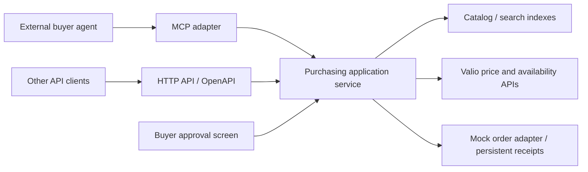

# Valio Aimo — implementation plan

Plan prepared on **14 November 2026 (Europe/Helsinki)**. This describes work to build, not implemented behavior. The official challenge and resource documentation were inspected; local catalog measurements and representative products were checked. Authenticated price/availability requests have not yet been tested.

## Problem and outcome

Build a **seller-side purchasing gateway** through which an external buyer agent can discover products, obtain prices and availability, prepare an exact order, and commit within its authority or obtain human approval. Demonstrate it with an existing MCP-capable agent client.

The [official challenge](https://hackjunction.app/participate/45/challenges/327) requires structured lookup, inquiry-to-order interaction at fixed prices, and permissions/human approval. Its judging weights are end-to-end demonstration **30%**, matching buyer needs **20%**, controls **20%**, exceptions **15%**, and openness/production path **15%**. Include shortage recovery even though exceptions also appear under optional features. MCP is our interface choice, not a sponsor requirement.

## Scope and architecture

| Priority | Deliverable | Observable outcome |
| --- | --- | --- |
| Core | Catalog discovery and offer preparation | A natural-language search leads to real IDs, supported requirements, valid quantities, and current price/availability checks. |
| Core | Enforced authority and human approval | Purchases within a mandate proceed; permitted commercial exceptions require an authenticated approver; unresolved facts block commitment. |
| Core | Persistent mock ordering | An authorized proposal produces a retrievable receipt; retries do not duplicate the order. |
| Demo priority | Shortage recovery and evidence history | A substitution is explained and authorized; changing approved terms prevents silent commitment. |

Use Python/FastAPI, SQLite, a local embedding matrix, and a small React interface; see [README](../README.md). Both protocol adapters call the same business logic. The external agent interprets the request and selects options; our service calculates and validates the proposed transaction.

Initial scope supports fixed-quantity purchases with sufficient evidence. Variable-weight or otherwise unresolved products remain searchable but cannot receive an executable proposal until their fulfillment and pricing conditions are established. Defer recipe generation, a custom buyer-agent application, payment integrations, marketplace features, and carbon scoring. Historical reliability can be displayed after the core flow works.

## Catalog normalization and discovery

Process the catalog offline; send only relevant candidates to the agent. Preserve raw records and create typed fields for identity, multilingual names, brand, claims, allergen relationships, ingredients, storage, sales/base units, packaging factors, ordering steps, deposits, and substitutions. Record the source of derived values and distinguish **known, derived, unknown, and conflicting** facts.

The inspected catalog has **17,546 products**, including **6,622** with different sales/base units, **632** explicitly marked variable weight, and **506** with deposits. **3,072** lack populated packaging measurements. Technical category and unit labels are incompletely documented; do not invent mappings.

| Actual example | Evidence | Required handling |
| --- | --- | --- |
| `464306`: Arki Eila lactose-free milk drink | Sales/base unit `ST`; base volume `1 L`; `KI` factor `20` | 1,000 L maps to 1,000 ST. A handling unit does not replace the declared sales unit. |
| `465039`: Eila lactose-free milk drink | Sales unit `KI`; base unit `ST`; factor `5`; structured base volume absent | Five ST per KI is explicit; the 1 L size comes from the name. Preserve that difference in evidence quality. |
| `460123`: Vitamin Well 12 × 500 ml | Sales unit `KI`; 12 BOT per KI; 12 deposit units per KI | Ten KI means 120 bottles and 120 deposit units, each requiring correct pricing. |
| `460675`: flank steak, approximately 2 kg | Sales unit `KG`; order step `10`; variable weight | The name does not define the order step. A 12 kg request rounds to 20 kg under the contract; overbuy and actual-weight settlement remain explicit. |
| `460035`: lettuce mix | Sales unit `KG`; order step `3`; no packaging measurements | A 4 kg request is not exactly orderable; propose 6 kg only under an applicable overbuy policy or approval. |

Validation must inspect dimensions: **6,373 of 8,970** populated `volume` objects use `GRM` or `KGM`. Product `468044` declares allergen code `AM` as both `CONTAINS` and `FREE_FROM`; such conflicts cannot pass a simple free-from filter. Seven referenced deposit-material IDs are absent from the catalog. Nutrition values must be interpreted with their recorded basis. The common `allowedLotSize=0.01` is synthetic source data, not evidence of real-world fractional-pack ordering; preserve it and make any additional packaging policy explicit.

Build keyword search for names, exact terms, IDs, and GTINs plus multilingual semantic retrieval for varied wording. Embed concise factual names/descriptions/attributes, apply supported structured filters, and combine candidate rankings with reciprocal rank fusion. Revalidate requirements after retrieval. A similarity score or substitution link does not establish suitability. No result or insufficient evidence must be a valid response.

Evaluate keyword-only, semantic-only, and hybrid retrieval on approximately 30 labeled Finnish/English requests, including synonyms, exact SKUs, dietary distinctions, irrelevant neighboring categories, and no-match cases. Compare relevance in the top results, constraint violations, and latency before choosing the embedding model and tuning retrieval.

## Proposed interfaces and offer calculation

Expose these operations through HTTP/OpenAPI and MCP; finalize their JSON Schemas with the application skeleton before splitting implementation work.

| Operation | Inputs / result |
| --- | --- |
| `search_products` | Free-text query, supported requirements, limit → concise candidates with actual IDs, units, evidence, and unresolved fields. |
| `get_product` | Product ID → detailed facts, packaging, and provenance. |
| `check_price_and_availability` | Shortlisted IDs and delivery date → timestamped dynamic evidence. Customer identity comes from the authenticated account. |
| `prepare_order` | Selected lines, requested amounts/units, requirements, delivery details → immutable proposal revision, calculations, and authorization decision. |
| `commit_order` | Proposal revision and idempotency key → revalidated acceptance, revised proposal, or a structured blocker. |
| `get_order` | Order ID → authorized access to status, receipt, and decision history. |

For example, our search schema can accept `{"query":"milk for hotel breakfast","requirements":{"lactose_free":true},"limit":10}`. The adapter maps this requirement to explicit catalog evidence. Unknown or ambiguous quantities such as “100 boxes” require a known buyer preference or clarification.

`prepare_order` calculates sales quantity, ordering-step rounding, excess/shortfall, product prices, tax, deposits, and applicable charges. Use decimal arithmetic. Retain net/gross totals and their currency; define mandate limits against a documented total basis. Do not substitute comparison prices for sales-unit prices or use gross packaging weight as food content. Missing prices/charges are unresolved, not zero. Never convert mass to volume without sufficient product-specific evidence.

Call the supplied `/api/price` and `/api/availability` only after narrowing the catalog. Their maximum is 1,000 product IDs per request, not a target batch size. Use bounded retries/backoff for reads, explicit error states, and caches keyed by customer/date/product with visible timestamps; cache freshness is not a reservation. Validate response IDs, units, dates, currency, nulls, and errors.

Stock is expressed in sales units. Check both sales-block flags, delivery date, order cutoff in Helsinki time, and required quantity. Terminal quantity `999999` means unknown; it must not become a claim of confirmed fulfillment. Use the price API's authoritative tax rate. Keep the upstream API key server-side.

## Authority, approval, and commitment

An authenticated buyer administrator establishes a server-side mandate: account and destinations, permitted constraints/substitutions, overbuy tolerance, spend limits, expiry, and authorized approvers. Agent credentials are scoped to that mandate; a caller-supplied customer field cannot grant another customer's access. A configurable €1,500 gross autonomous threshold is an illustrative demo policy, not a sponsor rule.

- **Ready to commit:** requirements satisfied and transaction within authority.
- **Approval required:** a permitted commercial exception needs human sign-off.
- **Needs resolution:** missing, conflicting, or unacceptable facts prevent commitment.

Use a separate authenticated approval endpoint and UI; never give the purchasing agent approver credentials. Approval binds to the exact proposal revision: buyer/account, destination, date, products, quantities, substitutions, currency, total, expiry, and policy version. A human may authorize additional spending or a preference exception; approval cannot establish unknown stock or resolve contradictory dietary evidence.

Immediately before commitment, refresh price/availability and recheck identity, mandate validity, requirements, and authorization. Changed approved terms create a new revision and authorization decision. Rejected/expired approvals cannot be used. Enforce one successful commitment per proposal and persistent idempotency; if aggregate budgets are enabled, reserve/check them atomically across concurrent purchases so splitting orders cannot bypass limits.

The inspected upstream contract has **no order or reservation endpoint**. Implement a mock order adapter with persistent acceptance/rejection and retrieval. Label receipts **“Accepted by demo order service.”** Revalidation does not reserve upstream stock; real acceptance requires integration with the actual ordering backend. Confirm the expected commitment representation with the sponsor while proceeding with the adapter.

Store an evidence history: requirement snapshot, source/catalog version, lookup timestamps, conversions, policy decisions, approval actor, and receipt. The record should explain actions from observable evidence without relying on a model's private reasoning. Restrict buyer/order visibility to authorized accounts.

## Demo and delivery sequence

Use an existing external MCP agent, a proposal/approval card, and a receipt with expandable evidence. Demonstrate:

1. **Autonomous purchase:** a fully supported request within mandate completes without intervention.
2. **Shortage recovery:** a labeled fixture makes only 600 L of `464306` available. The agent proposes another 400 L using listed UHT alternative `464398`; a buyer policy requires approval of this substitution.
3. **Changed conditions:** price or stock changes after approval; the old proposal cannot silently commit.
4. **Retry:** repeating commitment returns the original receipt without another order.

Use actual catalog records. Clearly distinguish live lookup mode, controlled failure fixtures, and mock order acceptance. If the network fails, demonstrate with labeled recorded/fixture responses; never present replayed data as a successful live integration.

| Build budget | Milestone |
| --- | --- |
| Hours 0–6 | Verify small authenticated API requests and deposit-price resolution; normalize representative products; establish conversion rules. |
| Hours 6–16 | Complete one purchase through the mock adapter, basic authorization, and persistent receipt. |
| Hours 16–26 | Add broader catalog ingestion, hybrid retrieval, and MCP integration. |
| Hours 26–36 | Complete human approval, shortage recovery, changed-condition handling, and duplicate protection. |
| Hours 36–48 | Evaluate retrieval, exercise failure cases, polish the UI, document assumptions, and rehearse. |

This is an effort budget, not a claim about time remaining. Confirm actual deadlines and reserve the submission buffer before scheduling team work.

Acceptance checks: correct units, steps, tax/deposits and totals; unresolved mandatory constraints cannot commit; cross-account access is denied; approvals cannot authorize changed baskets; expired/revoked authority is rejected; concurrent budget use is bounded; retries create no duplicates; the full demo produces a retrievable receipt and evidence history. No application tests or authenticated API calls have run at planning time.

## Coordination and open questions

Suggested four work areas are catalog/search, offer/API integration, authority/orders, and approval UI/demo. Assign named owners and coordinate shared schemas before parallel changes. Integration coordinator, demo owner, submission owner/backup, runtime versions, deployment target, feature-freeze time, and official submission requirements remain **TBD**.

Resolve with early integration checks and sponsor guidance:

- Is another order API available, or is the proposed mock commitment accepted?
- Can missing deposit-material IDs be priced, and what charges belong in the final total?
- How are variable weight, uncertain Terminal fulfillment, and final settlement represented?
- Are authoritative mappings or corrections available for ambiguous units, ordering steps, allergen codes, and conflicting attributes?
- What are the actual submission deadline, required links/artifacts, and presentation format?

## Sources and provenance

- [Official challenge and judging](https://hackjunction.app/participate/45/challenges/327)
- [Resource portal and supplied datasets](https://junction26.valioaimo.fi/)
- [API reference](https://junction26.valioaimo.fi/redoc) and [OpenAPI contract](https://junction26.valioaimo.fi/openapi.json)
- [Product schema](https://junction26.valioaimo.fi/files/008f9a50ba9a6538d2e5bdf29d592af8/valio_aimo_junction26_product_data_schema.json)
- Catalog measurements above came from the supplied `valio_aimo_junction26_product_data.json`, SHA-256 `50651aae31ca842112afdc16fcce92f9858d7f5d05e9928a3748aef16b22ea02`. Data is synthetic and restricted to this challenge. Raw datasets and credentials are not included in this plan.
- [Preparation and reuse log](pre-existing-work.md)
