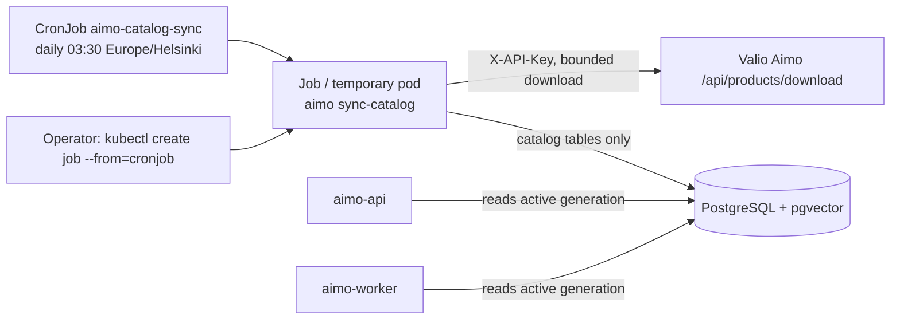

# Automatic product-catalog sync

Routine product-catalog ingestion runs as an independent Kubernetes Job, scheduled
by the CronJob `aimo-catalog-sync`. Each run starts a temporary pod from the
**worker image** with the command `aimo sync-catalog`, does its work and exits.
Ingestion never runs inside the frontend, API or worker processes, and there is no
permanent ingestion service, broker or agent.



## What one run does

1. **Takes the ingestion lock.** This is a PostgreSQL session advisory lock
   (`893019`) held on a dedicated autocommit connection, so no transaction stays open
   during the download or embedding. Scheduled runs, manual Jobs and `aimo ingest`
   all use the same lock. If another run holds it, this run reports
   `already-running` and exits 0 without changing anything.
2. **Downloads the snapshot** through the existing supplier path. Downloads use
   HTTPS only. The `X-API-Key` header goes only to the configured base URL and is
   never forwarded to a redirect. At most three redirects are followed, each must
   be HTTPS, and signed URLs are never logged. Each read has a 60-second timeout,
   and a single download has a 900-second deadline and a 256 MiB size limit. Up to
   three attempts are made, and only on timeouts, transport errors, 408/425/429 and
   5xx responses. The file is streamed into the pod's bounded `/tmp` volume and
   deleted when the run ends.
3. **Validates the snapshot against the approved pin.** The SHA-256 of the
   downloaded bytes must equal the approved `CATALOG_SHA256` built into the image,
   and the count must equal `CATALOG_PRODUCT_COUNT` (17,546). The downloaded bytes'
   own hash is never accepted as evidence of their correctness.
4. **Decides whether ingestion is necessary** (next section).
5. **Imports and activates when necessary.** This reuses the strict import path: it
   parses the JSON, rejects malformed, empty, duplicate-ID or schema-incompatible
   records, normalizes, embeds only missing texts (each batch committed to the
   cache independently), then publishes a complete generation and switches the
   active pointer in one short transaction.
6. **Prints one JSON line and exits**: 0 for `updated`, `unchanged` or
   `already-running`, and 1 for `failed`.

```json
{"event": "catalog_sync", "outcome": "unchanged", "source_hash": "5065…ea02", "generation": "…", "products": 17546, "new_embeddings": 0, "reused_embeddings": 0, "duration_seconds": 41.3}
{"event": "catalog_sync", "outcome": "updated", "reason": "import_profile_changed", "source_hash": "…", "generation": "…", "products": 17546, "withdrawn_products": 0, "new_embeddings": 0, "reused_embeddings": 17546, "model": "…", "import_profile": "catalog-import-v1:…", "duration_seconds": 95.0}
{"event": "catalog_sync", "outcome": "failed", "error_code": "SNAPSHOT_HASH_MISMATCH", "error": "Snapshot hash differs from the approved SHA-256; nothing was imported", "duration_seconds": 38.2}
```

Errors carry a stable `error_code` and a fixed message. The run never prints
exception text, URLs, credentials or snapshot contents. The codes are
`CREDENTIALS_MISSING`, `DOWNLOAD_FAILED`, `DOWNLOAD_REJECTED`, `DOWNLOAD_TOO_LARGE`,
`SNAPSHOT_HASH_MISMATCH`, `SNAPSHOT_COUNT_MISMATCH`, `SNAPSHOT_MALFORMED`,
`SNAPSHOT_EMPTY`, `SNAPSHOT_DUPLICATE_IDS`, `EMBEDDING_FAILED`, `EMBEDDING_INVALID`,
`PUBLISH_INCOMPLETE`, `LOCK_LOST`, `DATABASE_UNAVAILABLE`, `DATABASE_BUSY`,
`DATABASE_ERROR` and `INTERNAL_ERROR`.

## How unchanged snapshots are skipped

A run skips the import only when **all** of these hold for the active generation:

| Check | Rebuild `reason` when it fails |
| --- | --- |
| An active catalog exists | `no_active_catalog` |
| Its `source_hash` equals the downloaded, approved SHA-256 | `source_changed` |
| Its embedding model key and dimensions match the configured profile | `embedding_profile_changed` |
| Its `import_profile` matches this image's import profile | `import_profile_changed` |
| Its recorded and stored product counts both equal the approved count | `active_catalog_incomplete` |

A skipped run parses no JSON, computes no embeddings, inserts no products or
generation and leaves the active generation unchanged. Its cost is one download
and hash.

The import profile is `catalog-import-v<N>:<digest>`. The digest hashes the source
of `normalize`, `search_text`, `rich_search_text`, `document_text` and the unit
tables. Any change to normalization or search-document construction therefore
rebuilds the catalog instead of silently reusing it. Bump `IMPORT_PROFILE_VERSION`
in `src/aimo/ingest.py` when stored semantics change in a way those functions'
source does not show. A rebuild still reuses every cached embedding whose document
text is unchanged.

Migration `012_catalog_import_profile.sql` adds the column. Generations created
before it have no recorded profile, so **the first scheduled run after this change
rebuilds the catalog once**. All embeddings are reused when document text is
unchanged, and a new generation is published.

## Approved data only

Automatic ingestion is supported for the **approved static challenge dataset**,
pinned by SHA-256 and product count in the image. The CronJob never accepts a new,
previously unapproved supplier snapshot. A snapshot with a different hash fails
every run with `SNAPSHOT_HASH_MISMATCH`, and the previous catalog keeps serving.

To accept changed supplier data, an operator verifies it independently and then
either:

- runs the existing strict path with explicit values, for example
  `aimo ingest --file … --expected-sha256 … --expected-count …` (or `--stage`
  followed by `activate-catalog`), or
- updates `CATALOG_SHA256` and `CATALOG_PRODUCT_COUNT` through a reviewed PR and
  release.

The second option makes the new snapshot the approved pin for scheduled runs. An
automatic policy for accepting new supplier snapshots is a separate
source-validation decision and is not part of this feature.

## Failures, retries and recovery

- A failed run returns exit code 1. Kubernetes retries a failed pod at most twice
  (`backoffLimit: 2`), and the Job has a 3,600-second `activeDeadlineSeconds`.
- Until a later run succeeds, the previous active catalog keeps serving. Partially
  imported products are never visible because generation rows, product rows and the
  active pointer commit together.
- Embedding batches that completed before a failure stay cached, so the next run
  embeds only what is still missing.
- A run whose lock connection drops is fenced: publication checks that it still
  holds the lock and otherwise fails with `LOCK_LOST`, publishing nothing.
- Data errors (`SNAPSHOT_*`) are deterministic. Their retries fail the same way and
  the Job ends `Failed`, which is the signal to investigate. Nothing alerts
  automatically; check Job status.
- `CronJob.concurrencyPolicy: Forbid` stops overlapping scheduled Jobs. The
  database lock also covers manual Jobs and `aimo ingest`.

### Inspect and trigger

```sh
kubectl -n junction get cronjob aimo-catalog-sync
kubectl -n junction get jobs -l app=aimo-catalog-sync
kubectl -n junction logs job/JOB_NAME --tail=5     # last line is the JSON result
# Run now with the identical template (initial population or recovery):
kubectl -n junction create job "aimo-catalog-sync-manual-$(date +%s)" --from=cronjob/aimo-catalog-sync
kubectl -n junction wait --for=condition=complete --timeout=65m job/aimo-catalog-sync-manual-…
```

Manual Jobs are removed seven days after they finish. To pause scheduling, set
`catalog_sync.suspend = true` and apply the reviewed Terraform plan. A temporary
`kubectl patch cronjob aimo-catalog-sync -p '{"spec":{"suspend":true}}'` works too,
but Terraform will revert it.

Suspend the CronJob before an explicit `activate-catalog` rollback to a generation
built from a different snapshot or import profile. Otherwise the next run sees a
mismatch and rebuilds the current approved snapshot. Rolling back to a generation
with the same hash, profile and complete rows counts as unchanged and stays active.

## Serving while ingestion runs

Routine ingestion is designed to run unattended **while the apps keep serving**.
It never stops, scales down or restarts the API or worker.

Correctness is verified by tests against PostgreSQL in `tests/test_catalog_sync.py`:

- **Search consistency.** Search runs in one `REPEATABLE READ READ ONLY`
  transaction. The tests activate a new catalog and prune the old one *during* a
  search; the in-flight search still returns the old generation's products, and the
  next search sees the new generation.
- **Atomic activation.** The generation, its products and the active pointer commit
  in one transaction under the publisher lock (`893017`), which `activate-catalog`
  also uses.
- **Failed imports.** After download, embedding and validation failures, searches
  still work against the old catalog.
- **In-flight purchases.** A commit rebuilds its evidence from the active catalog
  inside its own checks. A proposal prepared before a sync that withdrew its product
  is revised and denied (`PRODUCT_DELETED`), not accepted. Historical proposal
  revisions and receipts are untouched, and pruning removes only product rows of
  older generations.

The earlier "imports with the apps stopped" rule was a **resource** limitation of
the single demo node, not a correctness limitation. Correctness is covered above.
Capacity is discussed next.

### Resources and capacity

The defaults are requests of 250m CPU, 768 MiB memory and 512 MiB ephemeral storage,
with limits of 1 CPU, 3 GiB memory and 1 GiB ephemeral storage. `/tmp` is an
`emptyDir` capped at 1 GiB. All of these can be changed through `catalog_sync`.

The figures below were measured on 2026-11-14 on a developer Mac (Apple silicon,
macOS `/usr/bin/time -l`) with the pinned E5 model. The input was a synthetic
17,546-record snapshot of 111 MB, larger than the real 84 MB file, read from a local
file, so download time is excluded. They are estimates, not cluster measurements.

| Run | Wall time | Peak RSS |
| --- | --- | --- |
| Unchanged snapshot (daily case) | 0.6 s | 130 MiB |
| Rebuild with every embedding cached (e.g. import-profile change) | 4.6 s | 757 MiB |
| Cold import: no catalog, 17,546 new embeddings, model loaded | 105 s | 1.79 GiB |

**Conclusion for the current single 2-vCPU/4-GB demo node:**

- Daily unchanged checks and cached rebuilds fit alongside serving.
- A **cold** full import (first population, or a new embedding model) peaks near
  1.8 GiB. That comes on top of the apps' 1,248 MiB of requests, which include the
  worker's own copy of the model, plus Traefik and system pods. Whether this fits
  in the node's allocatable memory **was not verified**. The pod requests only
  768 MiB, so it can be scheduled and then use burst memory. Under memory pressure
  it is the most likely pod to be evicted or OOM-killed. That failure is safe: the
  old catalog stays active and completed embedding batches are reused on the next
  run. It does not guarantee that the apps are unaffected.
- So run the **first population before setting `app_replicas = 1`**. That is the
  normal setup order, not a new stop requirement. For a later cold re-embed, either
  temporarily add node capacity, or have an operator deliberately schedule it in a
  maintenance window. The Job itself never stops serving apps.
- CPU time for the cold import was 86 CPU-seconds on the Mac. Expect several
  minutes at the 1-CPU limit on a shared cloud vCPU, well within the 3,600-second
  deadline.

## Permissions and secrets

The pod uses its own Secret, `aimo-catalog-sync`, containing only:

- `DATABASE_URL` for the dedicated **`aimo_catalog_sync`** role, which has catalog
  tables only;
- `VALIO_AIMO_API_KEY` for the supplier download;
- the embedding-profile keys shared with the API and worker (`EMBEDDING_*`,
  `SEARCH_*`), plus `SEARCH_API_KEY` only when hosted embeddings are configured.

It does not receive the browser session secret, the conversational `LLM_API_KEY`,
administrator or migration URLs, or seed credentials. It also gets no Kubernetes
API token. Terraform refuses to enable the CronJob without a separate catalog-sync
URL or with the runtime URL.

`aimo migrate --catalog-role ROLE` (or `CATALOG_SYNC_DATABASE_USER`) first revokes
everything from the role, then grants exactly:

| Table | Privileges |
| --- | --- |
| `catalog_generations` | SELECT, INSERT |
| `active_catalog` | SELECT, INSERT, UPDATE |
| `products` | SELECT, INSERT, DELETE (pruning old generations) |
| `embedding_cache` | SELECT, INSERT, UPDATE |

The role cannot read identities, sessions, policies, proposals, orders,
conversations or the migration ledger, and it cannot create objects. Release
migrations refresh these grants on every release when the `aimo-migration` Secret
names the role.

## One-time setup

Infrastructure creation, migrations, grants and secret provisioning remain
explicit operator steps. Once they are done and `catalog_sync.enabled = true` is
applied, Kubernetes runs the pod on schedule with no further action. Nothing in
this change was applied or deployed.

1. **Cloud role.** Apply the reviewed `infra/digitalocean` plan. It adds the
   `aimo_catalog_sync` database user and the `catalog_sync_database_url` and
   `catalog_sync_database_user` outputs. Other clouds expose the same two optional
   outputs.
2. **Private inputs.** New installations get them from `prepare-runtime.py`.
   Existing installations add these values to `runtime.auto.tfvars.json` using a
   secret editor, without printing them:
   `catalog_sync_database_url`, `migration_credentials.catalog_sync_database_user`,
   and `bootstrap_credentials.catalog_sync_database_user` while bootstrapping.
   `runtime_secrets.VALIO_AIMO_API_KEY` must be present.
3. **Grants.** Apply the Kubernetes plan so `aimo-migration` contains
   `CATALOG_SYNC_DATABASE_USER`, then let the next release migration Job, or the
   bootstrap Job for new installations, apply the catalog-only grants and
   migration 012.
4. **Enable.** Set `catalog_sync = { enabled = true }` (default schedule
   `30 3 * * *`, timezone `Europe/Helsinki`), then review and apply the plan.
   Releases keep the CronJob image on the deployed worker digest.
5. **First population.** Trigger the same Job template once, as shown in
   "Inspect and trigger", and wait for `outcome` to be `updated`. On a new
   installation, do this before setting `app_replicas = 1`. If skipped, the next
   scheduled run populates the catalog; until then readiness reports
   `INDEX_NOT_READY`.

Bootstrap no longer imports products. It migrates, seeds and grants. The catalog
always comes from this Job, so there is no separate manual import implementation.

## Why this is separate from price and availability

The product catalog is a large, static, finite snapshot. It is downloaded rarely,
validated against an approved hash, and indexed for search with embeddings. Price
and availability are live, per-customer and per-delivery-date, and the supplier
API is rate limited. The app queries them only for a narrowed shortlist at proposal
and commit time, and never polls them for the whole catalog. This Job does not
touch prices or stock, does not place orders, and does not ingest recipes.
