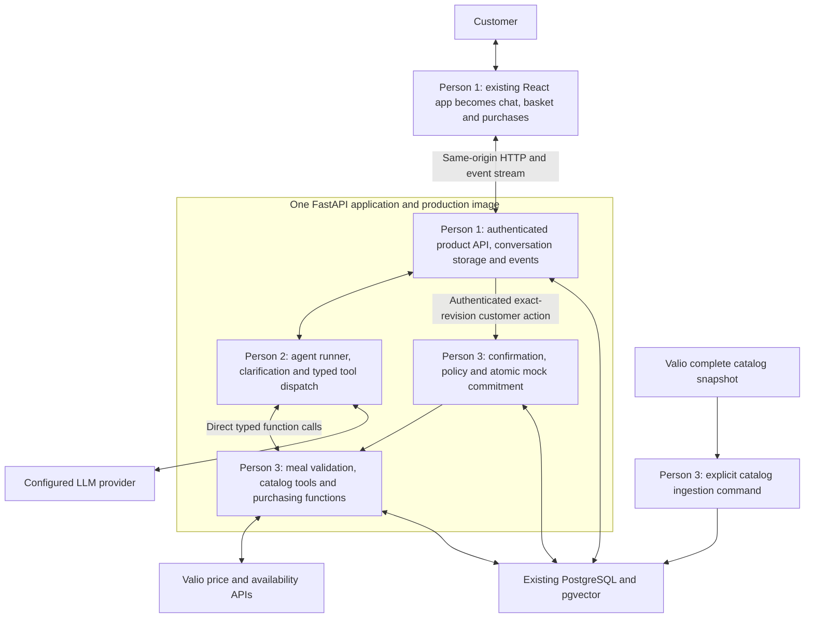
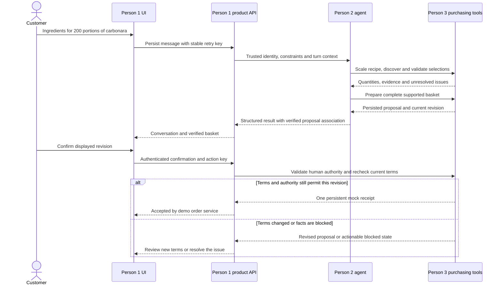

# Chat purchasing product and three person delivery plan

Date: 14 November 2026. Status: agreed product direction and implementation plan. Person numbers identify responsibilities; the team assigns names. This PR changes documentation only.

We deliver the customer-facing product: a chat interface, our own purchasing agent, and the tools that turn a meal request into a verified basket. The first complete scenario is **“I need ingredients for 200 portions of carbonara.”** The customer reviews the ingredients and exact purchase terms, confirms through an authenticated action, and receives an order result.

The agreed split is **person 1: frontend plus product APIs; person 2: agent; person 3: tools and purchasing backend**. These are ownership areas inside the existing application, not separate services.

This plan supersedes the external-agent-only product, exposed MCP/agent HTTP interfaces and standalone approval-homepage direction in [the gateway brief](brief.md). That brief remains the baseline for catalog evidence, quantity calculations, policy, concurrency and audit controls unless explicitly changed here. The separate [post-MVP draft](../Plan/post-mvp-plan.md) is reference material. Existing verification remains in [validation](validation.md); planned acceptance checks below are not claims of completed work.

## 1. Scope and current work

PR #4 merged into `develop` at `19bfda4`. Its reusable foundation includes React/TypeScript/Vite, FastAPI/Pydantic, PostgreSQL/pgvector, catalog ingestion and hybrid search, supplier price/availability lookups, exact pack arithmetic, four policy outcomes, versioned proposals, approval enforcement, idempotent mock orders and audit history.

The agent work in [PR #12](https://github.com/Junction-Best-Team/Main-Application/pull/12), frontend work in [PR #13](https://github.com/Junction-Best-Team/Main-Application/pull/13), and `codex/chat-purchasing-integration` branch were already in progress when this plan was written. Treat their contracts and implementations as integration candidates; inspect current heads rather than rebuilding them or assuming they are merged. The ownership below applies going forward, regardless of who first authored a file. Do not reset, overwrite or recreate another person's worktree.

| Keep and extend | Replace or retire at cutover |
| --- | --- |
| Existing frontend, login/session handling and purchase-detail components | `/` redirecting to a standalone approvals homepage; approvals-only navigation and branding |
| Purchasing `Service` functions and typed domain models | Exposed `/mcp` transport and `/api/agent/*` interface |
| Catalog, embeddings, hybrid search, supplier connectors and pack calculations | MCP-only dependencies, external bearer-client provisioning and obsolete demo clients, after their internal replacements work |
| Backend policy/approval checks, identities, historical revisions and receipts | Instructions suggesting an external agent is required or a chat message itself authorizes buying |
| One application image, PostgreSQL, explicit ingestion command and existing infrastructure | Duplicate UI projects, overlapping chat APIs or separate services introduced merely to divide work |

The milestone includes one supported recipe and a robust purchasing flow. It does not add unrestricted dietary verification, a recipe database project, continuous ingestion, multi-agent orchestration or new infrastructure services. Unsupported facts remain unresolved. Supplier order placement is still **mock acceptance**: actual checkout requires a real supplier order/acceptance contract, not a different label on the receipt.

## 2. Architecture and trust boundaries

The browser calls product APIs. Product APIs invoke the agent with server-derived context. The agent calls registered tools directly; it does not use MCP or loopback HTTP to reach our own backend. Tools validate their inputs and access the supplier/database. Supplier text and model output remain untrusted data.

Owning the agent does not grant it human authority. Only the authenticated customer action can confirm a purchase. The first product requires that action even when standing policy would otherwise allow an autonomous purchase. The model has no approval, confirmation, policy-editing or commit tool. The product API can complete a confirmed purchase through the purchasing service without asking the LLM to finish it.

## 3. Person 1 owns frontend and product APIs

**Deliverable:** a usable website and authenticated application interface that connect the customer to the agent and purchasing functions.

| Area | Responsibility |
| --- | --- |
| Frontend | Chat entry at `/`, addressable conversations, ingredient/recipe views, basket review, pending decisions and purchase history; responsive loading, empty, error and reconnect states |
| Authentication | Reuse browser sessions, login/logout, same-origin and CSRF protection; derive buyer identity from the session and resolve the internal agent through trusted provisioning |
| Product API | Conversation CRUD needed by the product, message submission, event streaming, purchase list/detail and confirmation/rejection routes; no duplication of purchasing rules inside route handlers |
| Conversation persistence | Store user messages, final assistant messages, turn status, meal-plan/proposal associations and retry keys; isolate buyers and serialize competing turns within one conversation |
| Agent execution | Invoke person 2's runner outside the event loop when it performs blocking work; apply configured time/concurrency limits and persist outcomes or recoverable failures |
| Confirmation UX | Render server-returned product/quantity/price evidence; send exact proposal ID, revision and stable action key to person 3's confirmation operation |
| Integration and runtime | Own shared API registration, generated browser contracts, application configuration, packaging and coordinated deployment-template edits |

Likely files: `frontend/`, `src/aimo/api.py`, conversation routes/storage in new focused modules, `src/aimo/chat_schemas.py`, browser session integration and conversation migrations. Use existing modules in the active integration branch when suitable; names here are ownership guidance, not a requirement to rewrite them.

Person 1 owns the public chat/event contract and publishes example responses early. They are the integration coordinator and maintain the list of dependent PRs and migration ordering. They do not own LLM reasoning, semantic ranking, recipe arithmetic or policy decisions.

**Completion checks:** a customer can sign in, create/resume a conversation, clarify a meal request, review a real proposal, confirm/reject, and retrieve the result after refresh. Existing purchase history and historical links remain accessible. Duplicate clicks, a changed proposal, a failed turn and an interrupted event stream each have a clear recoverable state. Build the production frontend and run the relevant browser/API tests.

## 4. Person 2 owns the agent

**Deliverable:** an internal conversational agent that turns customer intent into typed tool calls and a useful explanation, while keeping decisions and facts within the backend contracts.

| Area | Responsibility |
| --- | --- |
| Provider | One configurable LLM integration, provider authentication, bounded timeout/retry handling and understandable configuration failures |
| Conversation | Understand meal/portion requests, ask for material missing information and use already supplied constraints without repeatedly asking |
| Recipe proposal | Propose an explicit recipe basis, quantities, assumptions and supported dietary requirements; mark estimates for customer review |
| Tool orchestration | Register only approved typed tools, invoke person 3's functions directly and map successful results into structured agent output |
| Product selection | Inspect real candidate IDs/evidence; request alternatives for shortages and preserve every required ingredient or explicitly report the missing portion |
| Progress and recovery | Emit agreed progress events, return the final `AgentTurn`, preserve verified proposals after later provider failures and recover from bounded tool errors |
| Testing | Deterministic fake-provider tests plus a bounded real-provider smoke test when configured; report those separately |

Likely files: `src/aimo/agent.py`, focused provider/agent helpers, prompt/tool registry and agent tests. PR #12 already contains a runner and direct tool adapter; integrate that work rather than introducing another orchestration framework.

The initial seam is `run_turn(identity, messages, service) -> AgentTurn`. Extend it jointly with person 1 for trusted turn IDs, constraints and progress callbacks where needed. Person 1 supplies identity and persistence context; person 3 supplies the typed purchasing service. The provider never receives session cookies, database credentials or authorization secrets in conversation content.

The agent cannot invent product IDs, prices, stock, conversion factors or dietary evidence. It cannot choose a buyer identity, loosen hard customer constraints, grant product scope or manufacture approval. No commit tool is registered. A user typing “approved” is handled as conversation; the authenticated confirmation control completes authorization.

**Completion checks:** the agent handles the carbonara request, clarification, a recipe proposal, complete ingredient matching, verified basket preparation, shortages and unresolved evidence. Test malformed tool arguments, identity injection, provider failure, loop limits and stable preparation retries. Read persisted order status on later turns; do not repeat purchasing side effects to reconstruct conversation history.

## 5. Person 3 owns tools and purchasing backend

**Deliverable:** typed application functions that produce trustworthy meal quantities, candidate products, commercial proposals and authorized purchase results.

| Area | Responsibility |
| --- | --- |
| Supplier integration | Existing catalog download, price/availability clients, response validation, rate-limit-aware retries and clear live/fixture modes |
| Discovery | Ingestion, normalization, embeddings, keyword/semantic retrieval and supported structured filters; return IDs and evidence, not suitability guarantees based on similarity |
| Meal arithmetic | Validate recipe units and serving basis; scale quantities deterministically; match each ingredient to explicit product selections and preserve the ingredient-to-SKU explanation |
| Basket calculation | Combine duplicate SKUs, convert supported units into pack quantities, expose excess/shortfall and retain exact rational arithmetic plus decimal money |
| Domain policy | Spending, destinations, supported dietary evidence, substitutions, product scope, current authority and the four existing policy outcomes |
| Confirmation and ordering | Domain operation binding a human decision to the exact buyer/proposal/revision/terms, revalidation, revision changes, atomic idempotent commitment and audit/receipt retrieval |
| Internal identities | Safe provisioning for server-owned agents and removal of obsolete external bearer credentials without breaking historical references |
| Tool contracts | Canonical input/output models and examples for person 2; maintain `Service` as the reusable application boundary |

Likely files: `src/aimo/service.py`, `catalog.py`, `search.py`, `ingest.py`, `upstream.py`, `purchases.py`, `approval_policy.py`, `approval_workflow.py`, domain schemas, meal helpers, seed/provisioning changes and domain migrations. Own deletion of `mcp_adapter.py` and MCP-only clients; person 1 owns removing their application mount and browser-facing dependencies.

Person 3 supplies functions; they do not build another HTTP server because this workstream is called “tools API.” Person 1 exposes only the authenticated product routes that the browser needs.

**Completion checks:** a complete supported meal plan maps to evidence-backed product/pack quantities and a purchase proposal. Exercise unknown count-to-weight conversion, missing ingredients, unsupported dietary requests, withdrawn products, conflicting facts, shortage, substitutions, strict budgets and changed authority. Preserve concurrent preparation/commit protection, confirmation expiry, one order per proposal and historical receipts.

## 6. Shared contracts and file ownership

Freeze a minimal compatible contract before broad UI/agent work. Use the existing Pydantic models and in-progress `chat_schemas.py` definitions as the starting point. They already define `Ingredient`, `MealPlan`, `AgentTurn` and conversation/message shapes; the required recipe basis, versioning and recovery semantics below may need explicit additions. An agreed field change must update producer, consumers, examples and tests together.

| Contract | Canonical owner | Required meaning |
| --- | --- | --- |
| Conversation and message | Person 1 | Scoped ID, persisted messages, actor role, timestamps, turn/request ID, status, linked meal plan and purchase revisions; pagination and recoverable failures |
| Chat event | Person 1, consumed/emitted with person 2 | Conversation and turn association, event ID/cursor, event type and typed payload. Begin with authoritative `conversation` updates plus progress/error/completion. Text deltas can improve presentation; the persisted final response remains authoritative. |
| Recipe and meal plan | Person 3 defines domain semantics; person 1 maintains shared API serialization | Plan ID/revision, recipe basis/base servings, requested portions, ingredient IDs/amounts/units, requested constraints, assumptions and selection mapping. Distinguish base quantities from already-scaled quantities to prevent double scaling. |
| Agent runner/result | Person 2 | Trusted identity/turn context and persisted input messages in; text, validated meal-plan/proposal associations and events out. Reference only IDs obtained from successful scoped tools. |
| Tool request/response | Person 3 | Typed fields, evidence/units, actionable failures and current domain outcomes; person 2 registers these shapes, not separately invented schemas. |
| Proposal and receipt | Person 3 | Reuse proposal ID/revision/fingerprint, current and committed revisions, totals, policy outcome, expiry and mock receipt contracts. |
| Customer action | Person 1 owns HTTP; person 3 owns authorization semantics | Exact proposal/revision and stable idempotency key from the UI; human identity from the server session. Return a stored receipt, revised terms needing a new action, or a clear blocked state. |

Keep one canonical definition per concept. Person 1 is the sole editor for shared chat schema/route registration until any domain models are moved to a person-3-owned module. Person 3 owns purchasing schemas. Person 1 owns `config.py`, Docker/runtime wiring and dependency/lockfile integration, accepting focused requirements from the other two. Both persistence owners reserve unique migration filenames with person 1 before committing. No workstream applies migrations to another person's database.

Proposed browser surface, aligned with the current frontend work:

| Route | Purpose |
| --- | --- |
| `/`, `/conversations/{id}` | Product entry and resumable conversation |
| `/purchases`, `/purchases/{id}` | Pending/history list and exact purchase details |
| Existing `/login` and `/api/login`, `/api/session`, `/api/logout` | Browser authentication |
| `POST /api/conversations`, `GET /api/conversations`, `GET /api/conversations/{id}` | Create, list and retrieve buyer-scoped conversations |
| `POST /api/conversations/{id}/messages` | Persist an idempotent turn request, return the current conversation/turn state, invoke the runner within the agreed execution budget |
| `GET /api/conversations/{id}/events` | Authenticated event stream; reconnect/read authoritative state without resubmitting a purchase |
| `GET /api/purchases`, `GET /api/purchases/{id}` | Buyer-scoped purchase list and detail |
| `POST /api/purchases/{id}/confirm` | Authenticated exact-revision confirmation and domain-controlled commitment |
| Existing decision route or agreed purchase rejection route | Persist rejection; reuse existing semantics rather than creating conflicting decision states |

Set exact status codes and event/retry semantics in shared examples at the contract checkpoint. Do not silently rename routes already consumed by the active frontend branch. Regenerate OpenAPI/TypeScript contracts from Python; retire removed operations from the published schema.

## 7. Meal quantities and purchasing authorization

“200 portions” is a recipe requirement, not a supplier order unit. Person 2 proposes a recipe with a stated basis; person 3 scales that basis and translates quantities using catalog evidence. Keep the required ingredient amount separate from pack-rounded purchased amount. Counted eggs cannot become kilograms from an invented average; unresolved conversion needs an explicit correction or a supported product/recipe basis.

Every required ingredient must be matched or visibly unresolved. An agent may not prepare a partial basket and call it a complete meal. Aggregate duplicate product selections without losing their contributing ingredient quantities. Customer constraints have explicit provenance: user request, reviewed plan or stated assumption. Unconfirmed model assumptions cannot loosen a hard budget or required dietary constraint.

The existing `approved_product_ids` list is standing authority, initially configured for the milk demo. For the meal milestone, outside-scope choices continue to require a permitted substitution exception, or remain denied if policy forbids them. A customer-confirmed recipe does not rewrite that list. If a wider standing scope is needed, person 3 provides privileged versioned provisioning; the model never grants it. A per-meal authorization records exact selected terms and expires with that proposal. Missing trusted scope still fails closed.

Keep policy outcome and customer confirmation state separate. `ready_to_commit` can mean that policy allows purchase while the product still awaits the customer's confirmation. `denied` and `needs_resolution` never become executable through a generic confirm button. Confirmation covers price, quantities, destination, delivery date, substitutions and the exact revision; it does not authorize unknown facts or a later revision.

Person 3 checks current customer/agent authority under the existing lock protocol. Customer confirmation and any required exception approval must be recorded against the same exact terms; never attach an old approval to a new revision. Re-fetch supplier evidence outside long database transactions, then atomically validate state and create the mock order. A saved successful retry returns its receipt before new supplier/provider work. Provider failure after confirmation must not prevent reading or completing an already authorized backend action.

## 8. Persistence, execution and recovery

Use the existing PostgreSQL database. Person 1 adds conversation/message/turn persistence and associations; person 3 owns durable meal/selection evidence and any confirmation records required beyond existing approvals. Link by IDs and revisions rather than copying authoritative totals into chat text. Preserve existing buyers, identities, policies, approvals, orders and audit history through additive migrations.

Create a durable turn record before invoking the provider. One active turn per conversation avoids conflicting state; concurrent submissions receive an explicit busy/conflict response or a persisted retry result. Use a database-backed claim/version or bounded lease if runs can cross replicas. An event-stream reconnect reads progress/current state and does not start another agent turn. A process restart exposes an interrupted turn as recoverable; do not promise a worker continues after process death. Reuse recorded tool results and stable preparation keys on a deliberate retry.

No network/provider call or human wait holds a database transaction or lock open. Synchronous supplier/database work runs off the ASGI event loop. Keep completed user-visible replies and purchase associations durable before reporting completion. Stream persisted conversation changes and bounded progress; do not make a token log or event-sourcing platform a dependency for the first purchase.

## 9. Cleanup and compatibility ownership

Person 1 coordinates deletion after replacement behavior is integrated. These removals are intentional for this product; there is no requirement to maintain an external-agent integration surface.

| Change | Owner | Completion condition |
| --- | --- | --- |
| Change root entry, navigation, login return paths and purchase history | Person 1 | Chat/purchases work on direct navigation, refresh and sign-in |
| Retire standalone approvals homepage | Person 1 | Pending decisions are discoverable in the new product; old approval links resolve to the correct authenticated historical review |
| Remove `/mcp` mount, transport auth and lifecycle | Person 1 | Internal agent is integrated; retain database pool shutdown, health endpoints and API error behavior |
| Delete MCP adapter, dependency and MCP-only clients | Person 3, coordinated with person 1 for lockfile | No runtime imports or active demos depend on MCP; direct-tool coverage replaces transport-only tests |
| Remove `/api/agent/*` routes | Person 1, person 3 validates replacement | Product APIs and direct service calls cover the complete workflow; removed routes return 404/410, never frontend HTML |
| Retire external bearer provisioning | Person 3 | Internal agent context is provisioned and scope-checked; update seed/CLI, fixtures, bootstrap credentials and runtime-generation scripts without deleting historical actor IDs |
| Update schemas, examples and demo scripts | Contract owner; person 1 integrates | Generated clients match the new API; current docs describe the owned-agent product |

Keep authenticated approval/decision functions or routes that still serve the new product or historical links. Removing a screen is not a reason to delete policy enforcement. Do not remove OpenAPI or the browser HTTP API simply because MCP is gone. Preserve business regression coverage; replace obsolete transport tests rather than lowering the quality bar by deleting failing cases.

## 10. Infrastructure and deployment work

**Person 1 owns runtime integration**, person 2 supplies LLM/provider requirements, and person 3 supplies database/bootstrap/ingestion requirements. There is no fourth infrastructure workstream.

Keep one application Deployment/image and existing PostgreSQL/pgvector. The current image already builds the React assets and serves them from FastAPI; current ingress routes `/` to that application. Chat does not by itself require another service, port, database or cluster. F-INFRA-002 in [findings](findings.md) records an existing cloud foundation; do not provision another one or assume the application rollout has been verified.

- Wire the selected provider's server configuration through existing runtime inputs. In-progress agent work uses `LLM_API_KEY`, `LLM_BASE_URL`, `LLM_MODEL`, `LLM_TIMEOUT_SECONDS` and `LLM_MAX_TOOL_ROUNDS`; finalize these once, alongside the overall turn budget/concurrency limit. Keep credentials in deployment secrets, never browser bundles or logs.
- Keep conversational LLM settings independent of the pinned local embedding model and catalog generation. An external LLM does not require replacing the embedding cache or removing offline embedding startup.
- Verify event streaming through the configured Traefik/ingress path. Change buffering, timeouts or heartbeat behavior only as needed; verify reconnect and shutdown behavior. Do not add sticky sessions when persisted state and ordinary readback suffice.
- Preserve trusted proxy addressing, TLS/secure cookies, CSRF, read-only containers and healthy liveness during slow provider calls. Readiness must not perform a paid LLM generation; report missing required configuration clearly.
- Check DB pool/concurrency budgets and actual application memory/latency before changing replica/resource settings. Scale-out claims require measured validation.
- Update `infra/` Terraform/runtime helpers and `deploy/` examples consistently. Add migrations and grant the runtime database role access to new tables/sequences through explicit setup. Retire external-agent bootstrap variables only after provisioning is replaced.
- Preserve the existing main-release workflow. This plan/implementation work does not itself authorize Terraform apply, release promotion, deployment activation or new paid resources.

## 11. Delivery sequence and integration checkpoints

Each person works in a separate worktree and branch from current `origin/develop`, reuses relevant in-progress work and opens PRs into `develop`. Person 1 tracks dependencies and shared-file ownership; do not cherry-pick or overwrite another workstream without checking what is already integrated.

| Phase | Person 1 frontend plus API | Person 2 agent | Person 3 tools | Exit condition |
| --- | --- | --- | --- | --- |
| 0. Contract checkpoint | Publish routes, conversation/events, example payloads and shared-file ownership | Agree runner, progress callback and provider configuration | Publish meal/tool schemas and confirmation semantics | All three can consume the same examples; assign unique migration numbers and list required contract additions |
| 1. Parallel foundations | Build UI against a fixture runner and implement authenticated persistence/routes | Build runner against typed fake tools/provider | Build deterministic meal helpers and direct-service tests | Independently demonstrable pieces; no production fixture fallback |
| 2. First vertical flow | Connect real runner and purchase/confirmation routes | Complete one supported carbonara plan and product selection | Prepare and commit through actual domain functions | One persisted end-to-end mock purchase through the UI; real provider/supplier checks reported separately |
| 3. Exceptions and cutover | Refresh/history/old links, errors, confirmation races; remove retired public routes | Missing data, shortage and provider/tool recovery | Scope, arithmetic, repricing, revocation, retries and migration checks | New product preserves controls; MCP/external bearer interface retired without lost history |
| 4. Delivery verification | Browser/image/contract checks and final integration PR | Agent regression and configured provider smoke | Domain regression, catalog and upstream checks | Latest CI green, evidence recorded, deployment prerequisites explicit |

Merge shared contracts and independently useful modules first. Keep the partially integrated product unreleased until phase 2 works. Review the final combined branch, not just three isolated passing suites. Refresh examples and acceptance evidence when contracts change. PR descriptions must state dependencies, migrations, removals and verified versus mocked behavior.

## 12. Acceptance matrix

| Scenario | Primary owner | Required result |
| --- | --- | --- |
| Customer requests 200 carbonara portions | All three, person 1 coordinates | Explicit recipe basis and constraints, complete ingredient plan, real product IDs and an exact reviewable basket |
| Ingredient quantity needs a conversion or packs | Person 3 | Evidence-backed conversion and exact rounding; show excess or resolve missing evidence |
| Required ingredient unavailable | Persons 2 and 3 | Explain shortage, propose validated alternatives and obtain required consent; no silent partial meal |
| Customer types “approved” | Persons 1 and 2 | No order; direct customer to the authenticated confirmation action |
| Policy permits autonomous purchase | Persons 1 and 3 | Chat product still waits for the customer's exact-revision confirmation |
| Forbidden choice, unsupported requirement or unknown fact | Person 3 | Denied or needs_resolution as appropriate; confirmation cannot repair it |
| Prices, authority or scope change | Persons 1 and 3 | Old terms/approval do not commit; actionable revision or blocked state |
| Duplicate message, prepare or confirmation | All three | Stable retry behavior and at most one order; no duplicate conversation work from stream reconnect |
| Different customer or revoked identity | Persons 1 and 3 | No cross-account reads, tool actions or confirmation |
| Provider unavailable after preparing a basket | Persons 1 and 2 | Preserve the verified proposal; show recoverable failure and allow backend review/confirmation |
| Restart, refresh or two browser tabs | Person 1 with person 3 | Persisted state, safe recovery and consistent revision/decision semantics |
| Removed interfaces and old links | Persons 1 and 3 | MCP/external-agent routes unavailable; useful history accessible without misleading accepted terms |
| Deployment artifact | Person 1 | Built UI and APIs in one image, streaming/configuration checked, no browser credentials; no unapproved deployment |

Use focused unit, PostgreSQL/concurrency, API, browser and fake-provider tests. Retain purchasing regressions from PR #4 even when their entry points change. Record actual provider/supplier modes; do not relabel fixture results as live. Update [validation](validation.md) and [provenance](pre-existing-work.md) with implementation evidence when it exists. This documentation PR does not run or claim the new product flow.

## 13. Decisions still needed during implementation

These do not block parallel foundation work: assign the three people by name; select the configured LLM model/provider and credentials; agree the first recipe basis and portion assumptions; verify which catalog products support every ingredient and which privileged demo scope is intended. Person 1 records these at the contract/vertical-flow checkpoints. A real supplier checkout contract remains a separate requirement before presenting the product as real order placement.
