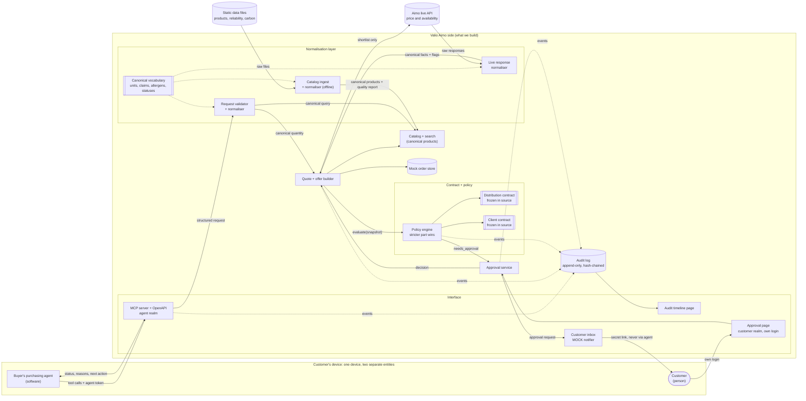
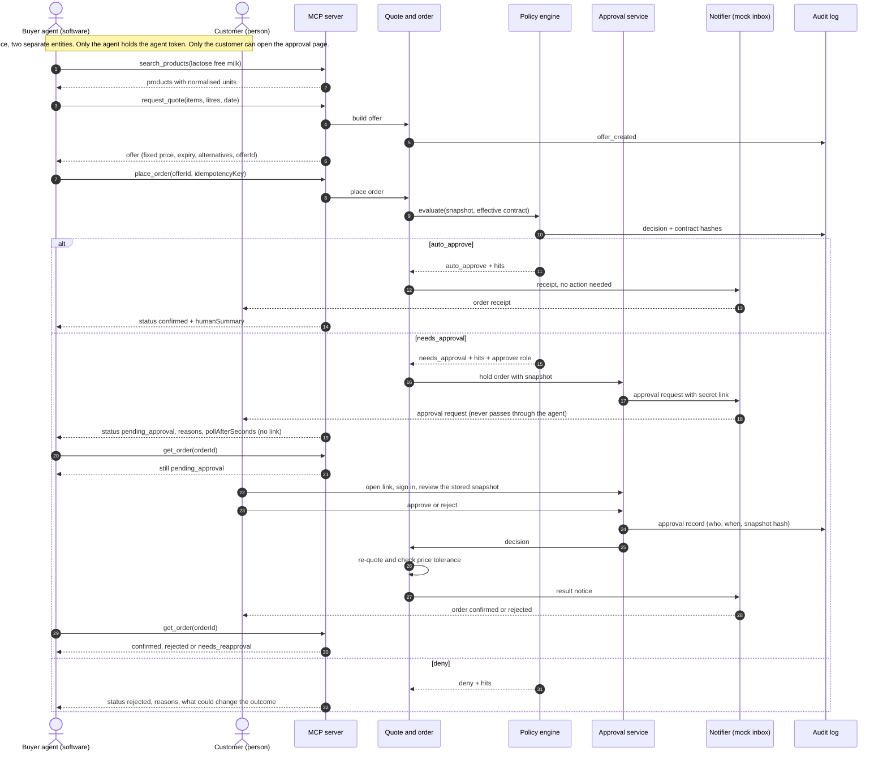
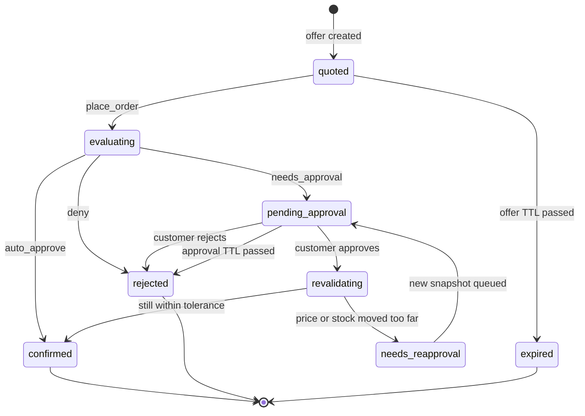
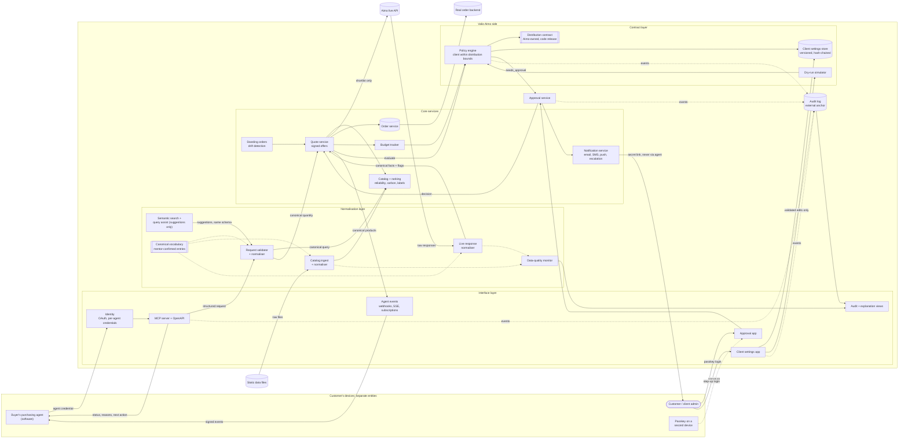
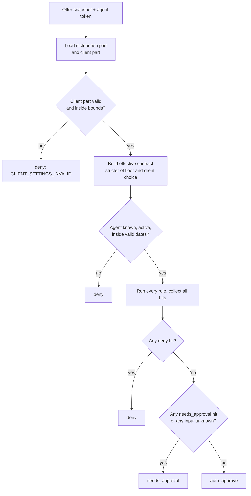

# Type1 architecture (DRAFT v2)

Status: draft for discussion, updated 2026-11-14. Nothing here is agreed or implemented. It refines `docs/architecture.md` (the four tracks and C1 to C5) and does not replace it until the team adopts it. Numbers marked `PLACEHOLDER` are for the team to decide. Orders, contracts, approvals, notifications and audit are **mocks** (the Aimo API has no order endpoint).

Owner decisions behind this draft (quoted in `docs/findings.md`): D-003 (contract fixed in code), D-004 (two-part contract, client-editable in the full product), D-005 (MVP and full design as two parts; customer and agent are separate entities on one device).

## 1. The idea

An external purchasing agent talks to Aimo only through an **MCP server** (the same operations also in an OpenAPI spec). What the agent may do alone is defined by a **two-part contract**: a **distribution part** owned by Aimo and a **client part** owned by the customer. In the MVP both parts are constants in source code that nothing can change at runtime. In the full product the customer can edit chosen fields of the client part through a settings screen, but never beyond bounds that the distribution part sets.

When an order needs a human, Aimo asks the **customer** (a person) through a channel that does not pass through the agent. The agent gets a structured status back and waits.

We build in two layers so we do not over-commit: **Part A, the MVP** is what we must show to pass the challenge. **Part B, the full product** is what would make it good. The MVP is built on the same seams, so each Part B item replaces a small piece instead of forcing a redesign (section 5).

## 2. Entities: one device, two entities

The customer and their agent may run on the same laptop or phone. They are still two entities with different powers, and Aimo treats them that way.

| Entity | Holds | May do | May never do |
| --- | --- | --- | --- |
| Buyer agent (software) | Agent token | Search, quote, place an order, poll its status, read the contract | Approve an order, read an approval link, change the contract |
| Customer (person; in the full product also "client admin") | Login on Aimo's approval app (full: passkey) | Approve or reject held orders; full product: edit allowed client settings | Edit the distribution part |
| Aimo team | Source code | Change the distribution part by a code release | Edit a client's settings (full product) |

Rules that keep the two entities apart:
- The approval request goes from Aimo to the customer through the notifier, never in the agent's response. The agent's output contains no approval link or token.
- The approval app accepts only a customer login. An agent token is rejected there.
- The approval page is rendered from Aimo's stored snapshot, not from text supplied by the agent. Free text from the agent is shown only as "agent's note (unverified)".
- Limit to state honestly: if the agent can also drive the customer's browser, read their email or use their logged-in session, one device collapses the separation. MVP mitigation: a separate Aimo login that the agent does not have. Full-product mitigation: passkey with user presence, approval from a second device, and a pause button for the agent.

## 3. Part A: MVP

Target: pass the challenge core and score on the five criteria (E2E demo 30, user need 20, controls 20, exceptions 15, openness 15) with the smallest build.

### 3.1 MVP requirements

| ID | Requirement | Judged on |
| --- | --- | --- |
| M-01 | **Agent interface:** MCP server with `search_products`, `get_product`, `list_substitutes`, `get_contract`, `request_quote`, `place_order`, `get_order`, plus the same operations in one OpenAPI file. Agent-token auth (mock: API key from env). | E2E, openness |
| M-02 | **Catalog:** in-memory index; search by text plus filters (dietary claims such as lactose-free, allergens, category); product detail with a normalised unit (litres per sales unit as resolved, warning or unknown; F-DATA-009). | need, E2E |
| M-03 | **Quote:** live price and availability on a shortlist only, with a cache. Handles Stock vs Terminal, `salesBlock`, `closingTime`, `availableDate`. | E2E, exceptions |
| M-04 | **Offer:** ID, fixed price, quantity in sales units, delivery date, expiry, snapshot hash. An order is accepted only against a valid offer. | E2E |
| M-05 | **Exceptions:** partial availability, earliest date, and substitute candidates (the supplied pairs re-checked for allergens, claims and unit) returned as alternative offers. | exceptions |
| M-06 | **Mock order store:** `place_order` with an idempotency key, `get_order`, the states in 3.4. | E2E |
| M-07 | **Two-part contract** (section 6), both parts frozen in source, validated at startup, combined into an effective contract, hashes recorded. | controls, openness |
| M-08 | **Policy engine:** `auto_approve`, `needs_approval`, `deny`; records every rule hit; unknown input fails closed. | controls |
| M-09 | **Approval service:** hold, approve or reject, bound to the snapshot hash, with a time limit; re-quote when approved. | controls, E2E |
| M-10 | **Customer notification:** a `Notifier` interface. MVP implementation: a mock "customer inbox" page, clearly labelled mock. Approval page behind its own login (seeded user). | controls |
| M-11 | **Agent output:** one response envelope (section 8) with status, reasons, next action, poll interval and a human-readable summary. The agent polls `get_order`. | need, E2E |
| M-12 | **Audit:** append-only, hash-chained log of every step; a readable timeline page. | controls |
| M-13 | **Demo:** a reference client script (not a real buyer agent) with three runs: within limits and confirmed; above limit, approved by the customer; one exception (partial availability or substitute). | E2E, exceptions |
| M-14 | **Docs:** mock labelling, assumptions, the contract spec, and the production path. | openness |
| M-15 | **Normalisation layer** (3.5): a canonical vocabulary, a catalog ingest, a live-response normaliser and an agent-request validator. Every derived value carries status, basis and evidence. A set of golden tests covers the known problem products and a quality report prints counts of resolved, warning and unknown. | need, exceptions, controls |

### 3.2 MVP architecture



### 3.3 MVP order flow, with output to the agent and the request to the customer



### 3.4 Order states



### 3.5 Normalisation layer: canonical vocabulary and normalisers

**Do we need a translator? Yes, a small deterministic one.** The raw data and the live API give untranslated unit codes, placeholder amounts and inconsistent volumes (F-DATA-009, F-API-005, F-OPEN-001). If those reach the agent or the policy engine, the system can quietly order 20,000 L of soy sauce instead of 20 L. So everything that crosses a boundary is translated once, in one place, into a shared vocabulary, and anything it cannot translate is marked unknown and sent to a human.

**Two parts**
1. **Canonical vocabulary** (the protocol): one versioned file, proposed as `contracts/canonical.v1`. It holds the closed lists everybody uses: units and dimensions (`L`, `kg`, `piece`, `sales_unit`), dietary claims, allergens, `availabilityBasis`, `resolutionStatus` (`resolved`, `warning`, `unknown`), and the policy reason codes. The agent only ever sees these terms, never raw codes such as `KI` or `KRS`.
2. **Three normalisers** (the ingestors) that translate into it:

| Normaliser | Direction | Owner | Runs |
| --- | --- | --- | --- |
| Catalog ingest | static product files to canonical products, plus a quality report | Track 1 | build or startup (offline) |
| Live response normaliser | raw price and availability to canonical offer facts and flags | Track 2 | on every quote |
| Request validator | the agent's request to a canonical query and quantity | Track 4 at the MCP edge, using Track 1's synonym tables and Track 2's conversion | on every call |

**Design rules**
- **Deterministic, no LLM in the critical path.** The buyer's agent is already a language model: it fills a strict schema and Aimo validates it. Free text is accepted only as search terms. This keeps results repeatable and auditable and keeps supplier text out of any decision.
- **Never guess.** If a value cannot be resolved it is `unknown`; a doubtful one is `warning`. Both become rule hits (for example `QUANTITY_UNIT_UNRESOLVED`) and the order goes to the customer.
- **Provenance on every derived value**, copied into the offer snapshot and the audit log so the approver can see why 1,000 L became a number of cases:

```json
"litresPerSalesUnit": {
  "value": 10,
  "status": "resolved",
  "basis": "name_token x sales_unit_size",
  "evidence": { "nameToken": "1 l", "salesUnit": "KI", "sizeInBaseUnits": 10 },
  "crossCheck": { "priceOverComparisonPrice": 10.02, "ok": true }
}
```

- **Supplier free text** (marketing and preparation texts) is labelled `untrusted_text` and is never treated as an instruction.
- **Structured errors for bad requests**, so a good agent can self-correct, for example `{ "error": "AMBIGUOUS_DIMENSION", "detail": "This product has both a volume and a weight; set quantity.unit to L or kg." }`.

**What the agent sends (illustrative)**

```json
{
  "lines": [{
    "search": "lactose free milk",
    "filters": { "dietary": ["lactose_free"], "excludeAllergens": [] },
    "quantity": { "amount": 1000, "unit": "L" }
  }],
  "deliveryDate": "2026-11-16"
}
```

**Translation rules, taken from the findings**

| Problem | Evidence | Rule | Where |
| --- | --- | --- | --- |
| Unit codes are untranslated and not uniform | F-DATA-009 row 1 | Our own code-to-meaning table, each entry marked verified or unverified; raw codes are never exposed alone | Ingest |
| Litres or kg per sales unit | F-DATA-005, F-DATA-009 rows 2, 6 to 10; F-API-003 | Use a structured volume only if its unit is `LTR`, `MLT` or `CLT` and it agrees with the name; else single name token times sales-unit size; else `unknown`. Never use the multiplier in the name. | Ingest |
| Cross-check of that derivation | F-API-003 | At quote time compare catalog price divided by comparison price with the derived litres; disagreement becomes `warning` | Response normaliser |
| Structured volume with the wrong scale | F-DATA-009 row 8 (21 of 919 disagree) | Disagreement or an implausible value is `unknown` | Ingest |
| Volume and weight both present | F-DATA-009 row 11 | Dimension comes from the request; if both exist and the request does not say, return `AMBIGUOUS_DIMENSION` | Request validator |
| Lot size 0.01 on discrete units | F-DATA-010, F-OPEN-001 | Whole sales units for discrete units, the stated lot size for `KG` goods | Ingest, request validator |
| Variable-weight goods | F-DATA-009 row 5 | Quote in kg with a stated tolerance; unknown stays unknown | Ingest |
| Dietary claims and allergens | F-DATA-002, F-DATA-003 | Map to the vocabulary; a missing allergen entry is "unknown", never "free from"; allergen codes are decoded and marked unverified before they are shown | Ingest |
| Temperature classes | F-DATA-011 | Label 7 frozen and 8 ambient; the rest "chilled" | Ingest |
| Placeholder and sentinel amounts | F-API-005, F-API-010 | `availabilityBasis`: `stock_tracked`, `stock_untracked` (9,999,999,999), `terminal_unknown` (999999), `unavailable` (empty schedule) | Response normaliser |
| Cut-off and delivery date | F-API-004, F-API-008, F-OPEN-001 | Flag `cutoff_passed` against the clock and `late_delivery` when `availableDate` is after the requested date; both go to the customer | Response normaliser |
| Price validity and agreement price | F-API-009 | Offer expiry is the earlier of our window and `validTo`; show `agreementPrice` as a label; `error` means unknown product | Response normaliser |
| Sales unit differs between file and availability | F-API-010 | Read the unit from the schedule line; if it differs from the file, flag it and convert through `units[]` | Response normaliser |
| Loose requests from the agent | agent input | Strict schema, a synonym table ("litres", "l", "liter" become `L`), dates in ISO format, structured errors | Request validator |

**Golden tests (MVP).** A short list of known problem products with the expected outcome: `464119` (case of 10, 10 L), `462626` (volume only from the name), `463203` (multipack `100x2 cl`), a 20 L soy sauce stored as 20,000 L (must be `unknown` or `warning`), `HP Sauce 4,6kg/4L` (dimension), and an item with no allergen entry (must not be "free from"). The ingest prints a quality report with counts of `resolved`, `warning` and `unknown` per derived field.

**MVP vs full.** MVP: the vocabulary file, the three normalisers with deterministic rules, provenance, golden tests, the quality report. Full: semantic and multilingual search, optional query assist that only produces suggestions checked by the same schema, a data-quality monitor, and dictionary entries confirmed by mentors (F-OPEN-001 lists what is still a best guess).

### 3.6 Left out of the MVP on purpose

Settings screen, real email/SMS/push, passkeys, OAuth, webhooks, multiple agents, spend-per-week limits, semantic search and query assist, ranking by reliability or carbon, signed offers, standing orders. Each has a seam in section 5 so none of them needs a redesign.

## 4. Part B: full product

Target: a product a real wholesaler could pilot. Nothing here is promised for the hackathon.

### 4.1 Full-product requirements

| ID | Requirement | Replaces or extends |
| --- | --- | --- |
| F-01 | **Client settings app:** the customer's admin edits only the fields listed as client-editable in the distribution contract. Tightening applies at once. Loosening waits for a cooling-off period and needs step-up login. Versioned history, diff view, every change audited. | M-07 client part becomes a store |
| F-02 | **Dry-run:** "what would this order do under these settings", before saving a change. | M-08 reused with a simulated snapshot |
| F-03 | **Real notification channels:** email, SMS, push; reminders, escalation to a backup approver, quiet hours, approve from a second device. | M-10 notifier |
| F-04 | **Passkey-signed approvals** (WebAuthn) and an out-of-band flow in the style of OpenID CIBA. | M-09 signer |
| F-05 | **Agent identity:** OAuth client credentials per agent, scopes, rotation, revocation, and a customer-side "pause this agent" switch. | M-01 auth |
| F-06 | **Agent events:** signed webhooks and MCP subscriptions or SSE instead of polling. | M-11 delivery |
| F-07 | **Several agents and approvers per client;** cumulative spend limits per period with a budget tracker. | M-07, M-08 |
| F-08 | **Ranking and comparison:** delivery reliability, carbon (labelled as group average), certificates; substitute ranking; recipe-aware substitution. | M-02, M-05 |
| F-09 | **Signed offers** (JWS) with origin metadata so an agent can verify Aimo's claims; verifiable credentials as an option. | M-04 snapshot hash |
| F-10 | **Standing orders and drift detection** (portion or cost drift flagged for the customer). | new module |
| F-11 | **Audit:** external anchoring of the chain head, export, plain-language explanations, per-client views. | M-12 |
| F-12 | **Delegable substitution classes:** a distribution release can mark certain substitutions (same category, no new allergen, not dearer) as optionally auto-approvable, which a client may switch on. | M-07 rules |
| F-13 | **Real order backend and payments** (an order endpoint on the real system, x402-style payments). | M-06 adapter |
| F-14 | **Semantic and multilingual search** (Finnish, Swedish, English) and optional query assist that only suggests, validated by the same request schema. | M-02, M-15 request validator |
| F-15 | **Data-quality monitor:** keeps cross-checking derived values against live responses (for example price divided by comparison price) and reports drift; dictionary updates confirmed by mentors. | M-15 |

### 4.2 Full-product architecture



## 5. Seams: how the MVP grows into the full product

Rule: the evaluation code, the output shapes and the audit events stay the same. Only the thing behind each interface changes.

| Seam (interface) | MVP behind it | Full product behind it |
| --- | --- | --- |
| `ContractSource` | Two frozen constants | Distribution constant + versioned client settings store |
| `ContractValidator` | Runs at startup | Same code runs on every settings save |
| `Notifier` | Mock customer inbox | Email, SMS, push, escalation |
| `ApprovalSigner` | Server-side HMAC (mock) | WebAuthn passkey |
| `AgentAuth` | Static API key per agent | OAuth client credentials |
| `AgentEvents` | Agent polls `get_order` | Webhooks, SSE, subscriptions |
| `OfferIntegrity` | Snapshot hash | Signed offer |
| `AuditSink` | JSONL file, hash chain | Same plus external anchor |
| `Rule` list | Functions in one list | Same list, new rules added by release |
| `Ranker` | Price and delivery date | Reliability, carbon, labels, substitution ranking |
| `QueryInterpreter` | Strict request schema + synonym table | Semantic search and query assist (suggestions only) |
| `Vocabulary` | One versioned file | Same file, extended by release, updates confirmed by mentors |
| `OrderBackend` | Mock store | Adapter to a real order system |

## 6. The contract: distribution part and client part

### 6.1 Layering rules

- **Distribution part (Aimo):** lives in source, changes only by a code release, carries its own version and hash. It defines (1) fixed values nobody can change, (2) rule floors, the least strict effect a rule may have, and (3) the **client-editable surface**: the list of fields a client may set, each with a type, bounds, a default and how loosening is handled.
- **Client part (customer):** a settings document for one client. It may contain only fields listed as client-editable, and every value must be inside its bounds. A document that breaks this is rejected on save (full product) or fails startup (MVP). It is never silently clamped.
- **Effective contract:** fixed values, plus client values, plus rule effects where `effect = stricter of (distribution floor, client choice)`. The policy engine only reads the effective contract. A client can make Aimo stricter for them, never looser than the floor.
- **Hashes:** every decision and audit event carries `distributionHash`, `clientHash` and `effectiveHash`.
- **Who may change what:**

| Part | MVP | Full product |
| --- | --- | --- |
| Distribution | Code change and redeploy | Code change and release (unchanged) |
| Client | Code change and redeploy (it is a constant) | The client's admin through the settings app, only the listed fields, in human realm with step-up login |
| Either, by the agent | Never | Never |
| Client, by Aimo staff | Code change | Never (read-only; an Aimo kill switch can deny all orders for a client) |

- **Loosening vs tightening (full product):** a change that lets the agent do more alone (higher limit, new category, lower severity) is "loosening" and waits for the cooling-off period (`PLACEHOLDER` 24 hours) with step-up login. A tightening change applies immediately. The approver contact address is treated as sensitive: changing it needs step-up and a notice to the old address.

### 6.2 Distribution contract, first draft

```json
{
  "contract": "aimo.distribution-contract",
  "version": "1.0.0",

  "fixed": {
    "offerTtlMinutes": 15,
    "maxRepriceTolerancePct": 5,
    "snapshotHash": "sha256",
    "failClosedOnUnknown": true,
    "agentMayChangeContract": false,
    "approvalChannel": "outside_agent_realm",
    "auditRequired": true,
    "auditHashChain": true
  },

  "ruleFloors": {
    "PROFILE_UNKNOWN":            "deny",
    "CONTRACT_EXPIRED":           "deny",
    "CLIENT_SETTINGS_INVALID":    "deny",
    "OFFER_EXPIRED":              "deny",
    "SNAPSHOT_MISMATCH":          "deny",
    "CUTOFF_PASSED":              "needs_approval",
    "LATE_DELIVERY":              "needs_approval",
    "ALLERGEN_CONFLICT":          "deny",
    "DIETARY_CLAIM_LOST":         "deny",
    "CATEGORY_NOT_ALLOWED":       "deny",
    "QUANTITY_ABOVE_LIMIT":       "deny",
    "ORDER_TOTAL_ABOVE_HARD_LIMIT": "deny",
    "ORDER_TOTAL_ABOVE_AUTO_LIMIT": "needs_approval",
    "SUBSTITUTION_PRESENT":       "needs_approval",
    "PARTIAL_AVAILABILITY":       "needs_approval",
    "TERMINAL_STOCK_UNKNOWN":     "needs_approval",
    "QUANTITY_UNIT_UNRESOLVED":   "needs_approval",
    "PRICE_ABOVE_REFERENCE":      "needs_approval"
  },

  "clientEditable": {
    "limits.autoApproveMaxOrderTotalEur": { "type": "number", "min": 0, "max": 2000,  "default": 500,   "loosenWhen": "increased" },
    "limits.denyAboveOrderTotalEur":      { "type": "number", "min": 0, "max": 50000, "default": 20000, "loosenWhen": "increased" },
    "limits.maxQuantityPerLine":          { "type": "number", "min": 1, "max": 5000,  "default": 2000,  "loosenWhen": "increased" },
    "limits.maxLinesPerOrder":            { "type": "integer", "min": 1, "max": 50,   "default": 20,    "loosenWhen": "increased" },
    "limits.maxDeliveryHorizonDays":      { "type": "integer", "min": 1, "max": 14,   "default": 7,     "loosenWhen": "increased" },
    "scope.allowedCategories":            { "type": "set", "subsetOf": "sellableCategories", "default": [], "loosenWhen": "item_added" },
    "price.needsApprovalIfAboveLastPurchasePct": { "type": "number", "min": 0, "max": 50, "default": 10, "loosenWhen": "increased" },
    "price.repriceTolerancePct":          { "type": "number", "min": 0, "max": 5,    "default": 3,     "loosenWhen": "increased" },
    "approval.approverRole":              { "type": "enum", "values": ["purchasing_manager", "kitchen_manager", "owner"], "default": "purchasing_manager", "loosenWhen": "never" },
    "approval.approvalTtlHours":          { "type": "integer", "min": 1, "max": 72, "default": 24, "loosenWhen": "never" },
    "approval.contacts":                  { "type": "contactList", "sensitive": true, "loosenWhen": "always" },
    "ruleEffects.<ruleCode>":             { "type": "enum", "values": ["auto_approve", "needs_approval", "deny"], "min": "ruleFloors[<ruleCode>]", "loosenWhen": "less_strict" },
    "agents.<agentId>.status":            { "type": "enum", "values": ["active", "paused"], "default": "active", "loosenWhen": "to_active" }
  },

  "lists": {
    "sellableCategories": "from the catalog (349 codes in the challenge data)"
  }
}
```

Notes:
- `ruleFloors` are minimums. `SUBSTITUTION_PRESENT` has the floor `needs_approval`, so by default no client can allow automatic substitutions. F-12 would add finer rules by release (for example `SUBSTITUTION_SAME_CATEGORY_NO_NEW_ALLERGEN` with floor `auto_approve`), and clients could then opt in.
- Limits are compared against the total including VAT and deposits (`PLACEHOLDER`, confirm with the live price response).
- `ALLERGEN_CONFLICT` means a substituted or chosen product adds an allergen or removes a dietary claim the request required. Its floor is `deny` and cannot be lowered.
- Which fields exist is itself part of the contract. Adding a field to `clientEditable` is a code release.

### 6.3 Client contract, first draft (example for the demo customer)

```json
{
  "contract": "aimo.client-settings",
  "schema": "aimo.distribution-contract@1.0.0",
  "version": 1,
  "clientId": "buyer:demo-hotelchain",

  "agents": {
    "agent:demo-hotelchain": {
      "status": "active",
      "validFrom": "2026-11-13",
      "validTo": "2026-11-16"
    }
  },

  "settings": {
    "limits": {
      "autoApproveMaxOrderTotalEur": 500,
      "denyAboveOrderTotalEur": 20000,
      "maxQuantityPerLine": 2000,
      "maxLinesPerOrder": 20,
      "maxDeliveryHorizonDays": 7
    },
    "scope": { "allowedCategories": ["10400"] },
    "price": {
      "needsApprovalIfAboveLastPurchasePct": 10,
      "repriceTolerancePct": 3
    },
    "approval": {
      "approverRole": "purchasing_manager",
      "approvalTtlHours": 24,
      "contacts": [
        { "approverId": "approver:demo-manager", "role": "purchasing_manager", "channel": "customer_inbox" }
      ]
    },
    "ruleEffects": {
      "SUBSTITUTION_PRESENT": "needs_approval",
      "PARTIAL_AVAILABILITY": "needs_approval",
      "TERMINAL_STOCK_UNKNOWN": "needs_approval"
    }
  }
}
```

What this means for the demo: a 1,000 litre order that totals more than 500 EUR is held for the customer; a small reorder inside the limits is confirmed on its own; a product outside category `10400` is denied. All numbers are `PLACEHOLDER`.

### 6.4 Evaluation



MVP loading: constants are checked at startup. A test fails the build if either part changes without a version bump (compared with a committed hash), so any change is visible in review.

## 7. Decision output (what `evaluate` returns)

One object per order attempt. The same object is stored in the audit log, shown to the customer, and summarised for the agent.

```json
{
  "decision": "needs_approval",
  "distributionHash": "sha256:...",
  "clientHash": "sha256:...",
  "effectiveHash": "sha256:...",
  "clientId": "buyer:demo-hotelchain",
  "agentId": "agent:demo-hotelchain",
  "snapshotHash": "sha256:...",
  "evaluatedAt": "2026-11-14T10:15:00+02:00",
  "approverRole": "purchasing_manager",
  "hits": [
    {
      "code": "ORDER_TOTAL_ABOVE_AUTO_LIMIT",
      "effect": "needs_approval",
      "source": "client",
      "message": "Order total 1,480.00 EUR is above the 500.00 EUR limit for autonomous orders.",
      "limit": 500,
      "actual": 1480
    }
  ]
}
```

| Field | Meaning |
| --- | --- |
| `decision` | `auto_approve`, `needs_approval` or `deny`. The strictest hit wins. |
| `hits[]` | Every rule that fired. `code` is stable, `message` is for people, `limit` and `actual` show the numbers, `source` says whether the distribution or the client part set the effect. |
| `approverRole` | Only for `needs_approval`. |
| three hashes | Prove which rules were in force. |
| `snapshotHash` | Hash of the exact offer. An approval is bound to it. |

Reason codes are the keys of `ruleFloors` in 6.2.

## 8. Output to the agent, and the request to the customer

### 8.1 What the agent gets back (one envelope for every outcome)

```json
{
  "status": "pending_approval",
  "orderId": "ord_8fk2",
  "offerId": "off_31ab",
  "decision": "needs_approval",
  "reasons": [
    { "code": "ORDER_TOTAL_ABOVE_AUTO_LIMIT", "message": "Order total 1,480.00 EUR is above the 500.00 EUR limit for autonomous orders." }
  ],
  "nextAction": { "type": "wait", "tool": "get_order", "pollAfterSeconds": 30, "approvalExpiresAt": "2026-11-15T10:15:00+02:00" },
  "customerNotice": { "sent": true, "channel": "customer_inbox", "note": "Approval requested from the buyer's purchasing manager. The agent cannot approve." },
  "humanSummary": "Order held for approval: 1,000 L lactose-free milk, 1,480.00 EUR incl. VAT, delivery 2026-11-16. It exceeds the autonomous limit of 500.00 EUR."
}
```

| Status | `nextAction` | The agent can tell its user |
| --- | --- | --- |
| `confirmed` | `none` | `humanSummary` with order number, total, delivery date |
| `pending_approval` | `wait`, poll `get_order` | `humanSummary` plus that a person at the customer must approve |
| `needs_reapproval` | `wait` | price or stock changed since approval; a new request was sent |
| `rejected` | `change_request` or `none` | reasons, and what could change the outcome (smaller quantity, different date, allowed product) |
| `expired` | `request_quote` | the offer ran out; ask for a new quote |

The envelope never contains an approval link, token or the approver's contact details. `humanSummary` is for the agent to relay and is not authority for anything.

### 8.2 What the customer is asked

Sent by the `Notifier` to a contact in the client part. It contains: the agent's name and the time; the order as stored (lines, quantities in sales units and in litres or kg, unit prices, total incl. VAT, delivery date); substitutions and exceptions highlighted; the reasons in plain language; the deadline; and Approve and Reject buttons behind a login. It does not contain the agent's free text except as "agent's note (unverified)".

After the decision the customer gets a result notice. After an `auto_approve` the customer gets a receipt with no action needed. All of this is also in the audit timeline.

## 9. Impact on the existing contracts (proposed, not yet filed)

| Contract | Change |
| --- | --- |
| New C0 | `contracts/canonical.v1`: the vocabulary, the canonical product and the canonical offer fact, each derived value with `status`, `basis`, `evidence`. Track 1 proposes it, all tracks consume it. |
| C2 | `placeOrder(offerId, idempotencyKey)`; no `mandateId`. Response is the envelope in 8.1. `get_order` returns the same envelope. |
| C3 | `evaluate(agentId, offerSnapshot)` returns the object in section 7. Owns the two contract parts, the validator and the effective-contract builder. |
| C4 | `decide(snapshotHash, approve or reject, approverId)`; bound to the snapshot hash; customer realm only. |
| C5 | Events carry the three contract hashes and `snapshotHash` where relevant, plus `prevHash` for the chain. |
| New C6 | `Notifier.send(recipient, kind, payload)` where `kind` is `approval_request`, `receipt` or `result`. Track 3 defines the payload, Track 4 builds the mock inbox. |
| New C7 (full product) | Settings API for the client-editable surface. Not needed for the MVP. |
| Public spec | Add `get_contract` (read-only; returns the effective contract for the calling agent). No operation mutates a contract. |

If the team adopts this, open entries in `docs/issues.md` for each change.

## 10. Open questions for the team

1. Stack and language (decides the contract file format and MCP SDK).
2. The real numbers: limits, offer TTL, price tolerance, approval TTL, cooling-off period.
3. Is substitution always a human decision in the MVP (the draft says yes), or do we want one automatic class for the exception demo?
4. Partial availability: always a human, or accept a partial order automatically above a share?
5. Mock notifier: a web inbox page only, or also a real email to a team address for the demo?
6. Does the demo show the customer realm on a second screen, to make "two entities" visible?
7. Weekly spend limits: stretch (F-07) or MVP?
8. Who is the integration coordinator for the contract files (Track 3 owns the content, Track 4 the public spec)?
9. Who owns `contracts/canonical.v1` (proposed: Track 1), and how do other tracks request a vocabulary change (an entry in `docs/issues.md`)?
10. Which golden-test products do we agree on, and which unit-dictionary entries must a mentor or the webshop confirm before the demo?
11. `CUTOFF_PASSED` is `needs_approval` in the draft (F-OPEN-001) rather than `deny`, because all Terminal products already show a passed cut-off (F-API-008). Do we agree, or do we want `deny` once a mentor confirms the meaning of `closingTime`?
