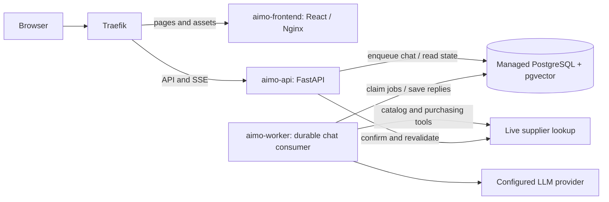

# Separate frontend, API and worker

The frontend, API and durable worker run independently against the same database.
Purchasing rules and authenticated exact-revision confirmation apply across them.



Each app has an independent image, Deployment, pod, Service, health probes and
resource budget. They share source modules and the existing database; they do
not share a container or process. The frontend has no application Secrets. The
API has database/session/supplier credentials and the Google key for short-lived
voice tokens, without ML dependencies. The worker has database/provider/supplier
credentials but no session signing key.
The worker's Service exposes health checks internally only; it has no public ingress.

## Durable execution

The authenticated message endpoint saves a `queued` turn and user message in one
transaction, then returns the conversation immediately with `busy=true`.
The worker claims one turn at a time with `FOR UPDATE SKIP LOCKED`, resolves the
recorded active customer and the privileged internal-agent mapping, and runs the
existing bounded agent/tool loop. SSE delivers persisted replies and proposals.

Jobs survive API/worker restarts. A 420-second lease allows a killed worker's job
to be reclaimed. A unique attempt fences stale replies; preparation keeps its
existing stable per-turn idempotency key. After three interrupted claims, or a
provider/application error, the UI offers an explicit retry of the same message.
A customer retry resets the attempt budget without duplicating the user message.
Different messages cannot overtake an unfinished turn. Logout does not cancel an
already authorized request; deactivating the requesting identity prevents a
queued request from executing. The worker never receives browser session cookies.

One worker processes one conversation turn at a time. Additional worker pods can
claim different conversations, but total connection pools and model memory must
fit capacity. PostgreSQL is the queue; no Redis/broker is required. This does not
add separate search, policy or approval microservices, nor real supplier orders.

## Build and run

```sh
docker build --target frontend -t aimo:frontend .
docker build --target api -t aimo:api .
docker build --target worker -t aimo:worker .
```

For local development, configure `.env`, migrate/seed/import explicitly, then
`docker compose --profile app up --build`. Open `http://localhost:8000`.
The local frontend proxies API/SSE to the API container. In Kubernetes, Traefik
routes `/api`, `/health`, `/docs`, `/openapi.json` and `/mcp` directly to the API;
other app paths go to the frontend. Keep `/clusterview` on its existing separate
ingress. For hot reload run `aimo serve`, `aimo worker`, and Vite in separate
terminals with `PUBLIC_BASE_URL=http://localhost:5173`.

## Schema and releases

Run migrations and grants before changing application images, using the
[release migration procedure](release-migrations.md). Keep the existing managed
database, catalog and purchasing history; `seed` only inserts missing demo rows.
Migration 004 introduced durable queue state. Historical interrupted turns without
an authenticated submitter became retryable failures; the migration never guesses
an identity. Do not rename or remove applied migrations.

Releases build all three targets and roll out immutable digests after migrations.
If any app rollout fails, the release restores every changed image. Database schema
and provider configuration are not rolled back with images; preserve compatibility
and restore configuration separately where needed. Never restore an old database
snapshot over new purchasing records. See [deployment](../deploy/README.md) and
[infrastructure](../infra/README.md) for current setup and release operations.
