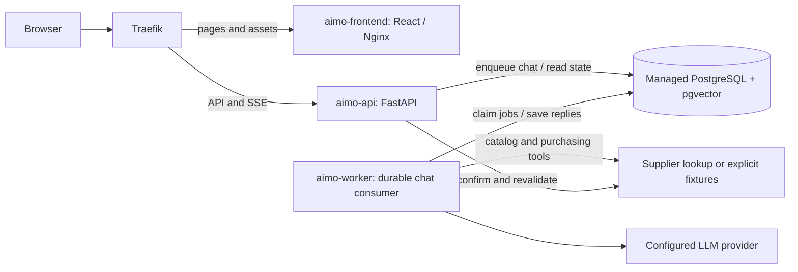

# Separate frontend, API and worker

The owner's 2026-11-14 request replaces the earlier single-container deployment
choice. Purchasing rules, authenticated exact-revision confirmation, persisted
history and mock-order labels remain unchanged.



Each app has an independent image, Deployment, pod, Service, health probes and
resource budget. They share source modules and the existing database; they do
not share a container or process. The frontend has no application Secrets. The
API has database/session/supplier credentials but no LLM key or ML dependencies.
The worker has database/provider/supplier credentials but no session signing key.
The worker's Service exposes health checks internally only; it has no public ingress.

## Durable execution

The authenticated message endpoint saves a `queued` turn and user message in one
transaction, then returns the conversation immediately with `busy=true`.
The worker claims one turn at a time with `FOR UPDATE SKIP LOCKED`, resolves the
recorded active customer and the privileged internal-agent mapping, and runs the
existing bounded agent/tool loop. SSE delivers persisted replies and proposals.

Jobs survive API/worker restarts. A 240-second lease allows a killed worker's job
to be reclaimed. A unique attempt fences stale replies; preparation keeps its
existing stable per-turn idempotency key. After three interrupted claims, or a
provider/application error, the UI offers an explicit retry of the same message.
A customer retry resets the attempt budget without duplicating the user message.
Different messages cannot overtake an unfinished turn. Logout does not cancel an
already authorized request; deactivating the requesting identity prevents a
queued request from executing. The worker never receives browser session cookies.

One worker processes one conversation turn at a time. Additional worker pods can
claim different conversations, but total connection pools and model memory must
fit capacity. PostgreSQL is the queue; no Redis/broker is required. This does not
add separate search, policy or approval microservices, nor real supplier orders.

## Build and run

```sh
docker build --target frontend -t aimo:frontend .
docker build --target api -t aimo:api .
docker build --target worker -t aimo:worker .
```

For local development, configure `.env`, migrate/seed/import explicitly, then
`docker compose --profile app up --build`. Open `http://localhost:8000`.
The local frontend proxies API/SSE to the API container. In Kubernetes, Traefik
routes `/api`, `/health`, `/docs`, `/openapi.json` and `/mcp` directly to the API;
other app paths go to the frontend. Keep `/clusterview` on its existing separate
ingress. For hot reload run `aimo serve`, `aimo worker`, and Vite in separate
terminals with `PUBLIC_BASE_URL=http://localhost:5173`.

## One-time cutover from the monolith

Use the existing private Terraform state and inputs; do not create another cloud
stack, database, ingress load balancer or catalog. Preserve a private state backup
and the prior image/configuration for rollback.

1. Publish the three images and record immutable digests. Add `worker_image` and
   `frontend_image` to private Kubernetes inputs; `image` now identifies the API.
2. Stop the old `aimo` Deployment and wait for in-flight requests to finish before
   schema setup. Run `aimo migrate` with the setup database role using the worker
   image. Migration 004 adds queue state, submitter and attempt count. It retains
   all messages, policies, proposals, receipts and confirmations. Historical
   interrupted turns become retryable failures because their authenticated
   submitter was not recorded; the migration never guesses an identity.
3. Preserve the existing runtime-role grants. This migration only adds columns
   and an index to a table already covered by table-level runtime grants. Do not
   re-seed, re-import the catalog or run the full bootstrap job for this cutover.
4. Plan the updated portable Terraform stack against its existing state, with
   `app_replicas=1`, three image digests and existing private configuration. Expect
   replacement of `aimo` with `aimo-api`, creation of frontend/worker resources,
   a worker Secret, and changed ingress routes. Review and apply that plan. This
   is a maintenance-window cutover on the single-node demo cluster, not a
   zero-downtime migration. Moved blocks preserve ownership of the old Terraform
   addresses. The cloud/database stack is unchanged.
5. Verify all three Deployments are ready; sign in through HTTPS; submit chat;
   confirm its queued message returns promptly and its worker-generated reply
   appears through SSE. Check historical purchases and exact-revision confirmation.
   ClusterView should show three app workloads.

If cutover fails, stop the new worker/API, restore the previous application image,
ingress routes and Terraform configuration/state ownership through a reviewed
reverse plan. Keep migration 004 in place. Before running the old synchronous
API, change any remaining `queued`/`running` turns to `failed` in a setup-role
transaction while all consumers are stopped, so the old API can retry them.
Never restore an old database snapshot over new purchasing records.

Subsequent main releases build all three targets. The release job validates that
all three deployments are enabled, updates worker/API/frontend by digest, and
restores every changed component if any rollout fails. Migrations remain explicit
operator steps before a schema-changing release. Do not activate a new main
pipeline against the old deployment before the initial cutover.
