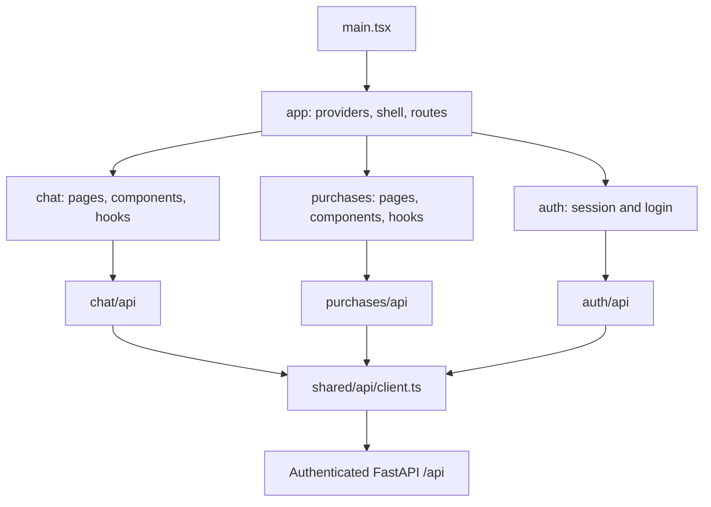

# Frontend architecture

## Runtime and build

`index.html` loads `src/main.tsx`, which mounts `app/App.tsx` in StrictMode and
loads `styles/theme.css`. `AuthProvider` restores the buyer session before the
app renders its shell and routes. React Router handles navigation. FastAPI
serves `dist/` from the existing single production image. No Node server runs
in production; Vite is a development/build tool.

Each feature's API module uses generated schema types. The chat API additionally
opens native EventSource connections; the chat hook owns their lifetime.
Shared modules do not import features or application composition. Features may
use a specific module from another feature when the dependency is explicit:
chat currently uses purchases' status derivation for its basket badges.

## Responsibilities

| Location                 | Owns                                                             | Does not own                         |
| ------------------------ | ---------------------------------------------------------------- | ------------------------------------ |
| `app/`                   | Providers, route table, shell                                    | Endpoint details, purchase decisions |
| `features/*/pages/`      | Route params and screen composition                              | Raw fetch calls                      |
| `features/*/components/` | Typed props, rendering and callbacks                             | Server state orchestration           |
| `features/*/hooks/`      | Loading/error states, actions, effects and recovery              | HTTP transport implementation        |
| `features/*/api/`        | Endpoint paths, typed request/response payloads and CSRF headers | React state and rendering            |
| `features/*/model/`      | Pure domain derivation                                           | Network effects                      |
| `shared/api/`            | Cookie-aware transport, generated schema, aliases                | Feature workflow decisions           |
| `shared/components/`     | Reused UI such as badges/errors                                  | Feature-specific controllers         |
| `styles/`                | Tokens, cascade order, legacy screen rules                       | Data or authorization                |

Keep local UI state local. Session state uses React context; server snapshots
and async actions remain in feature hooks. No global store or query library is
introduced for this refactor. Backend state remains authoritative.

## Route map

| URL                              | Component                                    | Authentication                                       |
| -------------------------------- | -------------------------------------------- | ---------------------------------------------------- |
| `/login`                         | `auth/pages/LoginPage`                       | Public; signed-in buyers return to their destination |
| `/`                              | `chat/pages/ChatPage`                        | Required                                             |
| `/conversations/:conversationId` | `chat/pages/ChatPage`                        | Required                                             |
| `/purchases`                     | `purchases/pages/PurchasesPage`              | Required                                             |
| `/purchases/:proposalId`         | `purchases/pages/PurchaseDetailPage`         | Required                                             |
| `/approvals/:approvalId`         | Same detail page, historical approval lookup | Required                                             |
| `/approvals`                     | Redirect to `/purchases`                     | Destination requires sign-in                         |
| Other paths                      | Not-found view                               | Public                                               |

`RequireAuth` preserves the requested path through login. The route table is in
`app/AppRoutes.tsx`. New Home/Request routes are future visual work; they are
not silently introduced by moving files.

## Important flows

### Session

`AuthProvider` calls `getSession()` on mount. A 401 represents signed out;
other bootstrap failures display an error. Login saves the returned session.
Logout uses its CSRF token and clears the session after success. Feature hooks
clear authentication on a 401; the route guard then sends the buyer to login.

### Conversation

`useChat(conversationId)` loads the sidebar and active snapshot. It retains
pagination, visible-tab refresh, SSE events, expiry and reconnect messaging.
Changing routes or unmounting closes the active event stream. Persisted backend
snapshots drive updates; the browser does not invent assistant results.

A stable creation key protects conversation creation. Pending message text/key
are stored in buyer/conversation-scoped session storage before sending. Retries
reuse that key, and server `retry_message` data can restore unfinished requests
on another browser. Active-route refs prevent old successful responses from
replacing the currently selected conversation.

### Purchase review

`usePurchases()` owns list pagination and visible-tab refresh.
`usePurchaseDetail()` loads either a current proposal or the exact historical
approval. `PurchaseSheet` renders evidence and quantities;
`PurchaseDecisionPanel` renders checks, closed states, receipts and explicit
confirm/reject callbacks.

`confirmPurchase()` sends the exact proposal/revision and the existing
buyer-specific stable retry key with CSRF. The hook reloads server state after
confirmation. Revised terms display a notice and require another explicit
click. Text messages never authorize purchases. UI eligibility is advisory;
the backend enforces current identity, policy, revision and idempotency.
Accepted orders remain labelled as mock, without supplier checkout/reservation.

## Styling and generated code

Global CSS enters through `main.tsx` only. `styles/theme.css` declares cascade
order, imports Tailwind theme/utilities and imports `legacy.css` in the
components layer. Utilities therefore override old selectors without escalating
specificity. Preflight stays disabled during migration. Remove obsolete legacy
rules as each screen adopts the design references.

Python models → `scripts/export_schema.py` → `frontend/openapi.json` →
`npm run types` → `shared/api/schema.ts`. Never edit generated schema output.
Readable aliases live in `shared/api/types.ts`; endpoint wrappers belong to the
feature API modules. No provider or supplier credentials belong in this app.
